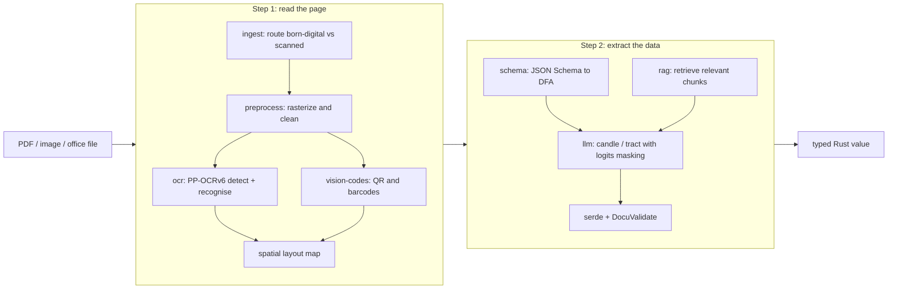

# docula

Sovereign, pure-Rust (zero-FFI) document intelligence: turn PDFs, scans, photos and office files into strongly typed, validated Rust structs.

You describe the data you want as a Rust type (`#[derive(JsonSchema, Deserialize)]`). `docula` reads the document, reconstructs its layout, and has a local LLM fill in only what that schema allows. Nothing links against `tesseract`, `poppler`, `opencv`, `zbar` or `mupdf`, so it builds wherever Rust builds.

Version 0.1.0, pre-release. The pipeline, schema DFA, validation, routing, rasterization and domain schemas are real; the OCR and LLM inference stages are still scaffolds (see [Implemented vs planned](#implemented-vs-planned)). See [DEV_STATUS.md](DEV_STATUS.md) and [CHANGELOG.md](CHANGELOG.md) for exactly what is and is not implemented.

## How it works



1. **Read.** Route and rasterize the document, run neural OCR and optical-code detection, and build a spatial layout map. Compliance tags (`@censor`, `@ignore`, `@non-storing`) are applied here.
2. **Extract.** Compile your type's JSON Schema into a DFA, mask the LLM's logits so it can only emit valid JSON for that schema, deserialize with Serde, then check business rules with `DocuValidate` (for example, line items must sum to the invoice total).

The full design is in [docs/00_MASTER_SPECIFICATION.md](docs/00_MASTER_SPECIFICATION.md).

## Crates

| Crate | Layer | Responsibility |
|---|---|---|
| [`docula`](.) | Facade | Re-exports every crate below and provides `DoculaPipeline` / `DoculaPipelineBuilder` |
| [`docula-core`](crates/docula-core/README.md) | Kernel | Normalized geometry, `DocumentSource`, `DoculaConfig` (TOML + env layering), `NonStored<T>`, `ImageCrop` |
| [`docula-ingest`](crates/docula-ingest/README.md) | Step 1 | PDF object-tree inspection, font `ToUnicode` checks, born-digital vs scanned routing |
| [`docula-preprocess`](crates/docula-preprocess/README.md) | Step 1 | `tiny-skia` PDF rasterization, office-suite rasterization, deskew/binarize filters, stitching |
| [`docula-composer`](crates/docula-composer/README.md) | Step 1 | Multi-shot document reconstruction and single-shot multi-document segmentation |
| [`docula-ocr`](crates/docula-ocr/README.md) | Step 1 | `OcrEngine` trait, DBNet-style detection and CRNN-style recognition (heuristic today), language assets, reading-order clustering |
| [`docula-vision-codes`](crates/docula-vision-codes/README.md) | Step 1 | QR / 1D barcode detection (`rxing`) and SEPA, Swiss QR and CFDI payload parsing |
| [`docula-compliance`](crates/docula-compliance/README.md) | Cross-cutting | Action tags, spatial pixel blackout, deterministic PII sanitization |
| [`docula-schema`](crates/docula-schema/README.md) | Step 2 | JSON Schema to DFA compiler, logits masking, the `DocuValidate` trait |
| [`docula-llm`](crates/docula-llm/README.md) | Step 2 | `LlmBackend` trait with `CandleBackend`, `TractBackend` (scaffolds) and `MockLlmBackend` |
| [`docula-rag`](crates/docula-rag/README.md) | Step 2 | Table-aware chunking, hybrid BM25 + dense retrieval, `EmbedagGraphRetriever` |
| [`docula-exemplar`](crates/docula-exemplar/README.md) | Step 2 | Few-shot exemplar pool and layout-fingerprint retrieval |
| [`docula-hitl`](crates/docula-hitl/README.md) | Feedback | Human-in-the-loop triage, correction triads, promotion policies, lineage tracking |
| [`docula-domains`](crates/docula-domains/README.md) | Verticals | Invoice, receipt, bank statement and bill-of-lading schemas, validation rules and `docula_*!` macros |
| [`docula-cli`](crates/docula-cli/README.md) | Binary | `docula extract`, `inspect` and `codes` commands |

## Quick start

```toml
[dependencies]
docula = { git = "https://github.com/yasuomaidana/docula" }
schemars = "1.0"
serde = { version = "1.0", features = ["derive"] }
tokio = { version = "1.43", features = ["rt-multi-thread", "macros"] }
```

```rust,ignore
use docula::schema::{DocuValidate, ValidationError};
use docula::{DoculaPipeline, DocumentSource};
use schemars::JsonSchema;
use serde::{Deserialize, Serialize};

#[derive(Debug, Serialize, Deserialize, JsonSchema)]
struct Receipt {
    merchant: String,
    total: f64,
}

impl DocuValidate for Receipt {
    fn validate_integrity(&self) -> Result<(), Vec<ValidationError>> {
        if self.total < 0.0 {
            return Err(vec![ValidationError::new("total", "Total cannot be negative")]);
        }
        Ok(())
    }
}

#[tokio::main]
async fn main() -> Result<(), Box<dyn std::error::Error>> {
    // Inference is still scaffolded: `with_llm_backend(..)` takes any `LlmBackend`;
    // tests use `MockLlmBackend` with a canned JSON response.
    let pipeline = DoculaPipeline::builder().build();
    let source = DocumentSource::from_image_path("receipt.png");

    let result = pipeline.process::<Receipt>(&source).await?;
    println!("{:?} (confidence {:.2})", result.data, result.confidence);
    Ok(())
}
```

Tests swap in `docula::llm::MockLlmBackend::with_canned_response(json)` so the pipeline runs without model files; see [`tests/ergonomic_pipeline_tests.rs`](tests/ergonomic_pipeline_tests.rs).

### Command line

```bash
cargo run -p docula-cli -- extract --input invoice.pdf --dpi 150
cargo run -p docula-cli -- inspect --input invoice.pdf   # born-digital or scanned?
cargo run -p docula-cli -- codes   --input invoice.png   # QR codes and barcodes
```

### Ready-made domains

`docula-domains` ships `InvoiceData`, `ReceiptData`, `BankStatementData` and `BillOfLadingData` with arithmetic validation, plus macros (`docula_invoice!`, `docula_receipt!`, `docula_bank_statement!`, `docula_bill_of_lading!`) to extend them with your own fields. Worked examples are in [docs/08_INVOICE_AND_GENERIC_SCHEMA_EXAMPLE.md](docs/08_INVOICE_AND_GENERIC_SCHEMA_EXAMPLE.md) and [docs/23_LINE_ITEM_SCHEMAS_AND_EXTRACT_ONLY_PROFILE.md](docs/23_LINE_ITEM_SCHEMAS_AND_EXTRACT_ONLY_PROFILE.md).

## Configuration

Every setting has an in-memory default. Override them with a TOML file, a string, or environment variables; unknown keys are rejected so typos fail fast. Start from the commented template [`Docula.toml`](Docula.toml) and load it with `DoculaConfig::from_file`. Details: [docs/15_CONSUMER_CONFIGURATION_AND_TOML.md](docs/15_CONSUMER_CONFIGURATION_AND_TOML.md).

## Implemented vs planned

| Capability | Status | Notes |
|---|---|---|
| Core geometry, config loader, `NonStored<T>` | **Implemented** | `docula-core` |
| PDF routing, `tiny-skia` rasterization, filters, stitching | **Implemented** | Pure Rust; acceleration optional via `oxipix` |
| Office suite ingestion (`.xlsx`, `.csv`, `.docx`, `.pptx`, `.odt`, `.ods`, `.odp`, `.rtf`, `.txt`) | **Implemented** | [docs/19](docs/19_OFIMATIC_OFFICE_SUITE_INGESTION.md) |
| OCR detection, recognition and language assets | **Partial** | Detection is heuristic (Otsu + connected components) and recognition uses pre-registered text; neural PP-OCRv6 is specified in [docs/05](docs/05_OCR_AND_SPATIAL_EXTRACTION.md) and [docs/16](docs/16_MULTI_LINGUAL_OCR_AND_ASSET_MANAGEMENT.md) |
| Optical codes (QR, 1D, SEPA, Swiss QR, CFDI) | **Implemented** | `rxing` |
| Schema DFA, logits masking, `DocuValidate` | **Implemented** | `docula-schema` |
| LLM backends | **Scaffolded** | `CandleBackend` and `TractBackend` validate the schema DFA but return canned output or `{}`; real inference is DOC-1201 in [docs/22](docs/22_FINANCE_DOCUMENT_EXTRACTION_AND_REAL_INFERENCE.md). `oxillama`, `oxibonsai` removed |
| Hybrid RAG and knowledge graph | **Implemented** | `embedag_rag::VerifiedRagEngine` replaces the removed `oxirag` |
| Few-shot exemplars, HITL, lineage | **Implemented** | `docula-exemplar`, `docula-hitl` |
| Domain verticals (invoice, receipt, bank, logistics) | **Implemented** | `docula-domains` |
| Multi-shot reconstruction, multi-document segmentation | **Implemented** | `docula-composer` |
| Sovereign pixmap (zero `image` crate) | **Superseded** | Real `image` + `rxing` are used; see [docs/21](docs/21_SOVEREIGN_PIXMAP_AND_ACCELERATOR_EXTIRPATION.md) |
| Measured coverage floor in CI | **In progress** | DOCULA-45; 77% line coverage today |
| Whole-repo clone and `rstest` gate cleanup | **Planned** | Pre-existing debt, tracked separately |

The `oxirag`, `oxillama` and `oxibonsai` dependencies were removed after their 2026-11 relicense to BUSL-1.1 (DOCULA-46); see the [CHANGELOG](CHANGELOG.md).

## Documentation

Start with the [Master Architecture Specification](docs/00_MASTER_SPECIFICATION.md), then follow your interest.

**Design and planning**
- [01. Development Plan & Engineering Roadmap](docs/01_DEVELOPMENT_PLAN.md)
- [02. Design Patterns & Architecture Blueprint](docs/02_DESIGN_PATTERNS_AND_ARCHITECTURE.md)
- [09. Benchmark & Crate Comparison](docs/09_BENCHMARK_AND_COMPARISON.md)

**Step 1: reading the page**
- [03. Ingestion & Intelligent Routing](docs/03_INGESTION_AND_ROUTING.md)
- [04. Rasterization & Preprocessing](docs/04_RASTERIZATION_AND_PREPROCESSING.md)
- [05. OCR & Spatial Extraction](docs/05_OCR_AND_SPATIAL_EXTRACTION.md)
- [10. Image Stitching & Overlap Deduplication](docs/10_IMAGE_STITCHING_AND_DEDUPLICATION.md)
- [16. Multi-Lingual OCR & Language Asset Management](docs/16_MULTI_LINGUAL_OCR_AND_ASSET_MANAGEMENT.md)
- [17. Pure-Rust Optical Code Extraction](docs/17_OPTICAL_CODE_EXTRACTION.md)
- [18. Document Screenshots & Region Cropping](docs/18_DOCUMENT_SCREENSHOTS_AND_REGION_CROPPING.md)
- [19. Ofimatic & Office Suite Ingestion](docs/19_OFIMATIC_OFFICE_SUITE_INGESTION.md)
- [21. Sovereign Pixmap & Accelerator Extirpation](docs/21_SOVEREIGN_PIXMAP_AND_ACCELERATOR_EXTIRPATION.md)

**Step 2: structured extraction**
- [06. LLM & Local/Embedded Backends](docs/06_LLM_AND_LOCAL_EMBEDDED_BACKENDS.md)
- [07. Structured Extraction & Constrained Decoding](docs/07_STRUCTURED_EXTRACTION_AND_CONSTRAINED_DECODING.md)
- [08. End-to-End Invoice & Generic Schema Examples](docs/08_INVOICE_AND_GENERIC_SCHEMA_EXAMPLE.md)
- [11. RAG & Large Document Retrieval](docs/11_RAG_AND_LARGE_DOCUMENT_RETRIEVAL.md)
- [12. Few-Shot & Exemplar Management](docs/12_FEW_SHOT_AND_EXEMPLAR_MANAGEMENT.md)
- [20. Pipeline Ergonomics & Document Identifier Inference](docs/20_ERGONOMIC_EXTRACTION_AND_ID_INFERENCE.md)
- [22. Finance Document Extraction & Real Inference](docs/22_FINANCE_DOCUMENT_EXTRACTION_AND_REAL_INFERENCE.md)
- [23. Line-Item Schemas & Extract-Only Profile](docs/23_LINE_ITEM_SCHEMAS_AND_EXTRACT_ONLY_PROFILE.md)

**Operations**
- [13. Human-in-the-Loop & Active Learning](docs/13_HUMAN_IN_THE_LOOP_AND_ACTIVE_LEARNING.md)
- [14. Edge Compliance & Non-Storing Directives](docs/14_COMPLIANCE_AND_NON_STORING.md)
- [15. Consumer Configuration & TOML Strategy](docs/15_CONSUMER_CONFIGURATION_AND_TOML.md)

**Related:** the [`oxipix` assessment and roadmap](docs/oxipix/00_TECHNICAL_ASSESSMENT.md), [AGENTS.md](AGENTS.md) for contributor agents, and [DEV_STATUS.md](DEV_STATUS.md) for milestone status.

## Build and verify

```bash
cargo build --workspace
cargo fmt --all --check
cargo clippy --workspace --all-targets -- -D warnings
cargo test --workspace
```

CI (`.github/workflows/ci.yml`) runs formatting, clippy, complexity metrics, the 500-line and zero-duplication hygiene gate, a security audit with no ignored advisories, and the full test suite on Linux, macOS and Windows (stable and beta). The `quality gates` workflow (`.github/workflows/quality.yml`) runs `loom-gate` against the limits in [`.github/dendrite/directives.toml`](.github/dendrite/directives.toml): line count, clones, complexity, structure, `rstest` usage and coverage.

## License

Licensed under either of [Apache License, Version 2.0](LICENSE-APACHE) or [MIT license](LICENSE-MIT) at your option.
