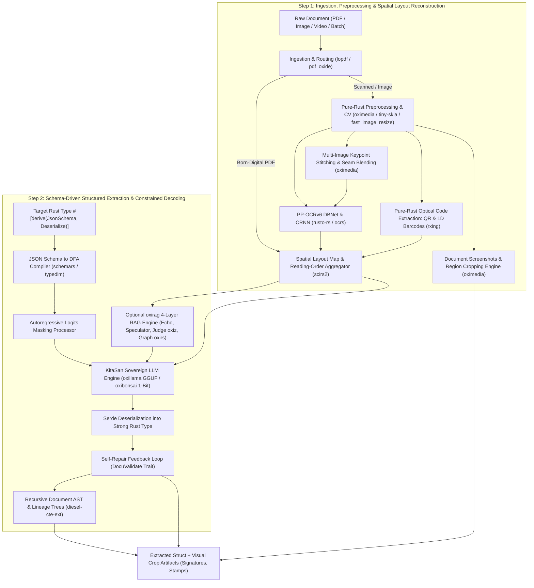

# Master Technical Specification: `docula`

## 1. Executive Summary & Core Philosophy

`docula` is an industrial-grade, sovereign, pure-Rust multi-modal document intelligence engine. It transforms heterogeneous raw documents (scanned bills, born-digital PDFs, camera photos of multi-page invoices, utility statements) into strongly typed, validated domain models (such as `InvoiceData`) with **zero foreign C/C++ dynamic linkage (Zero-FFI)**, fail0 + Clippy0 rigor, and local-first execution.

`docula` is built upon the **KitaSan (COOLJAPAN) sovereign open-source stack**—the premier zero-FFI pure-Rust ecosystem engineered by Tetsuya Kitahata (founder of the Apache Newsletter and pioneer of open-source software)—alongside **`diesel-cte-ext`** for recursive common table expressions.

### Fundamental System Architecture: The Two-Step Paradigm

Rather than forcing an end-to-end deep learning or multi-modal Vision-Language Model (VLM) to perform OCR, spatial reasoning, tabular layout understanding, and structured extraction simultaneously—which suffers from high latency, massive hallucination rates, and extreme compute overhead—`docula` enforces a **strict, decoupled two-step architecture**:



1. **Step 1: Deterministic Spatial Reconstruction & Visual Extraction**
   - Ingests raw multi-modal inputs without external C/C++ libraries.
   - Deconstructs born-digital PDFs or rasterizes scanned documents via pure-Rust engines (`pdf_oxide`, `tiny-skia`).
   - Normalizes images using **`oximedia`** (pure-Rust OpenCV and FFmpeg alternative): Hough deskewing, Otsu/Bradley-Roth adaptive binarization, morphological filtering, and SIMD resizing.
   - Multi-photo camera captures are seamlessly stitched using `oximedia` pure-Rust FAST/ORB keypoints and RANSAC homography.
   - Detects and recognizes text tokens across 50+ languages using PP-OCRv6 neural architectures (`rusto-rs`).
   - Slices full-page screenshots and spatial region-of-interest (ROI) image crops (`ImageCrop` for signatures, seals, logos, stamps) via `oximedia`.
   - Scans 1D and 2D optical barcodes/QR codes (`rxing`).
   - Clusters reading order into a unified 2D-aligned `SpatialLayoutMap` using `scirs2` spatial statistics.

2. **Step 2: Schema-Driven Structured Extraction**
   - Ingests the spatial layout representation and the user-specified Rust struct.
   - For complex, multi-page document bundles (10–100+ pages), activates **`oxirag`**—a 4-layer pure-Rust RAG engine featuring prefix caching (Echo), speculative retrieval (Speculator), formal SMT-based fact verification with **`oxiz`** (Judge), and knowledge graph traversal with **`oxirs`** (GraphRAG).
   - Ingests entities into a Document Knowledge Graph (DocKG) via **`oxirs`** (RDF/SPARQL 1.2 semantic web platform).
   - Manages hierarchical document structures, reading order trees, and active learning audit DAGs through recursive Common Table Expressions powered by **`diesel-cte-ext`**.
   - Dynamically compiles a strict JSON schema via `schemars`.
   - Runs local sovereign LLM inference with grammar-based constrained decoding (DFA logits masking) powered by:
     - **`oxillama`**: Pure-Rust sovereign alternative to `llama.cpp` for multi-format quantized GGUF models (Q4_0, Q4_K, Q5_K, Q8_0).
     - **`oxibonsai`**: Pure-Rust sub-2-bit (1-bit `Q1_0_g128` and ternary `TQ2_0_g128`) inference engine for ultra-low memory (<2 GB RAM) edge deployment.
   - Deserializes into the user's Rust type via `serde`.
   - Executes validation and optional self-repair loops for domain constraints.

---

## 2. The KitaSan (COOLJAPAN) Open Source Stack & Diesel CTE Foundation

`docula` standardizes on the open-source software stack from the COOLJAPAN organization ([github.com/cool-japan](https://github.com/cool-japan/cool-japan)) and `diesel-cte-ext` ([github.com/leynos/diesel-cte-ext](https://github.com/leynos/diesel-cte-ext)):

| Component / Crate | Upstream Repository | Architectural Role in `docula` | Zero-FFI Guarantee |
|:---|:---|:---|:---|
| **`oximedia`** | [`cool-japan/oximedia`](https://github.com/cool-japan/oximedia) | Pure-Rust OpenCV and FFmpeg replacement (108 crates). Powers image preprocessing, deskewing, adaptive binarization, camera calibration, visual stitching, and sub-image region cropping. | 100% Pure Rust (`fail0 + Clippy0`) |
| **`oxillama`** | [`cool-japan/oxillama`](https://github.com/cool-japan/oxillama) | Pure-Rust LLM inference engine—the sovereign alternative to `llama.cpp`. GGUF loader (`oxillama-gguf`), multi-format quantization (`oxillama-quant`), runtime (`oxillama-runtime`), and OpenAI-compatible server. | 100% Pure Rust (`fail0 + Clippy0`) |
| **`oxibonsai`** | [`cool-japan/oxibonsai`](https://github.com/cool-japan/oxibonsai) | Pure-Rust 1-bit (`Q1_0_g128`) and ternary (`TQ2_0_g128`) sub-2-bit inference engine. Enables 8B parameter LLM inference on edge devices in <2 GB RAM with zero external C/C++ runtimes. | 100% Pure Rust (`fail0 + Clippy0`) |
| **`oxirag`** | [`cool-japan/oxirag`](https://github.com/cool-japan/oxirag) | 4-layer RAG engine: Layer 1 (Echo prefix caching), Layer 2 (Speculator draft retrieval), Layer 3 (Judge SMT verification via `oxiz`), and Layer 4 (Graph GraphRAG via `oxirs`). | 100% Pure Rust (`fail0 + Clippy0`) |
| **`oxirs`** | [`cool-japan/oxirs`](https://github.com/cool-japan/oxirs) | Rust-native Semantic Web and Knowledge Graph platform (Apache Jena replacement). Provides RDF triples/quads, SPARQL 1.2, GraphQL, and Document Knowledge Graphs (DocKGs). | 100% Pure Rust (`fail0 + Clippy0`) |
| **`scirs2`** | [`cool-japan/scirs`](https://github.com/cool-japan/scirs) | Pure-Rust NumPy/SciPy replacement. Provides matrix algebra, spatial clustering, and geometry routines for spatial reading order resolution. | 100% Pure Rust (`fail0 + Clippy0`) |
| **`oxiz`** | [`cool-japan/oxiz`](https://github.com/cool-japan/oxiz) | Pure-Rust SMT solver (Z3 replacement). Embedded in `oxirag` Layer 3 (Judge) to formally verify numerical equations and financial constraints. | 100% Pure Rust (`fail0 + Clippy0`) |
| **`oxixml`** | [`cool-japan/oxixml`](https://github.com/cool-japan/oxixml) | Pure-Rust XML / XSD / Schematron / JSON-LD / SVG library for validating structured e-invoicing standards (Factur-X, ZUGFeRD, UBL 2.1). | 100% Pure Rust (`fail0 + Clippy0`) |
| **`diesel-cte-ext`** | [`leynos/diesel-cte-ext`](https://github.com/leynos/diesel-cte-ext) | Recursive Common Table Expressions (CTEs) for Diesel (`RecursiveCTEExt`, `RecursiveParts`, `with_recursive`). Drives hierarchical document ASTs and HITL correction lineage DAGs. | 100% Pure Rust (`PostgreSQL`, `SQLite`, `diesel_async`) |

---

## 3. Specification Index

The technical specification is organized into the following single-responsibility documents:

| Document | Focus & Component | Primary Crates & Technologies |
|:---|:---|:---|
| **[01. Development Plan & Roadmap](file:///Users/yasuomaidana/RustRoverProjects/docula/docs/01_DEVELOPMENT_PLAN.md)** | Phased monorepo roadmap, single-responsibility tickets, acceptance criteria & test scenarios | Engineering execution roadmap |
| **[02. Design Patterns & Architecture](file:///Users/yasuomaidana/RustRoverProjects/docula/docs/02_DESIGN_PATTERNS_AND_ARCHITECTURE.md)** | Rust design patterns evaluation, crate topology, consumer integration & justification | docula monorepo design, KitaSan stack, diesel-cte-ext |
| **[03. Ingestion and Intelligent Routing](file:///Users/yasuomaidana/RustRoverProjects/docula/docs/03_INGESTION_AND_ROUTING.md)** | PDF parsing, text-vs-image routing, multi-file and multi-page batch handling | pdf_oxide, lopdf, image, rayon |
| **[04. Rasterization and Preprocessing](file:///Users/yasuomaidana/RustRoverProjects/docula/docs/04_RASTERIZATION_AND_PREPROCESSING.md)** | Pure-Rust PDF rendering (tiny-skia), image normalization, deskew, binarization, SIMD resizing | oximedia, pdf_oxide, fast_image_resize, tiny-skia |
| **[05. OCR and Spatial Text Extraction](file:///Users/yasuomaidana/RustRoverProjects/docula/docs/05_OCR_AND_SPATIAL_EXTRACTION.md)** | Multi-lingual text detection (DBNet) & recognition (CRNN), 50 languages, spatial mapping | rusto-rs (PP-OCRv6), ocrs, scirs2, rayon |
| **[06. LLM and Local/Embedded Backends](file:///Users/yasuomaidana/RustRoverProjects/docula/docs/06_LLM_AND_LOCAL_EMBEDDED_BACKENDS.md)** | Modular LLM backend design, Cargo feature flags, local-first inference (oxillama GGUF / oxibonsai 1-bit) | oxillama, oxibonsai, scirs2, candle, tract, rig-core |
| **[07. Structured Extraction and Constrained Decoding](file:///Users/yasuomaidana/RustRoverProjects/docula/docs/07_STRUCTURED_EXTRACTION_AND_CONSTRAINED_DECODING.md)** | Compile-time schema extraction, logits processors, DFA token masking, self-repair loops | schemars, typedlm, serde, serde_json |
| **[08. End-to-End Invoice Example](file:///Users/yasuomaidana/RustRoverProjects/docula/docs/08_INVOICE_AND_GENERIC_SCHEMA_EXAMPLE.md)** | Complete Rust code walkthrough using InvoiceData, custom schemas, and multi-image processing | End-to-end integration and API consumption |
| **[09. Benchmark & Crate Comparison](file:///Users/yasuomaidana/RustRoverProjects/docula/docs/09_BENCHMARK_AND_COMPARISON.md)** | Deep-dive crate review, zero-FFI audit, latency profiles, and comparison vs. Python/C++ stacks | oximedia, oxillama, oxibonsai, oxirag, oxirs, diesel-cte-ext |
| **[10. Image Stitching & Overlap Deduplication](file:///Users/yasuomaidana/RustRoverProjects/docula/docs/10_IMAGE_STITCHING_AND_DEDUPLICATION.md)** | Pure-Rust visual keypoint stitching (FAST/RANSAC) and fuzzy spatial text overlap reconciliation | oximedia, imageproc, strsim, rayon |
| **[11. RAG & Large Document Retrieval](file:///Users/yasuomaidana/RustRoverProjects/docula/docs/11_RAG_AND_LARGE_DOCUMENT_RETRIEVAL.md)** | 4-layer RAG (Echo, Speculator, SMT Judge, GraphRAG) and Document Knowledge Graphs | oxirag, oxirs, oxiz, candle-core, hnsw_rs |
| **[12. Few-Shot & Exemplar Management](file:///Users/yasuomaidana/RustRoverProjects/docula/docs/12_FEW_SHOT_AND_EXEMPLAR_MANAGEMENT.md)** | Dual-stage exemplar retrieval, recursive template lineage trees via diesel-cte-ext | docula-exemplar, diesel-cte-ext, oxirs, hnsw_rs |
| **[13. Human-in-the-Loop & Active Learning](file:///Users/yasuomaidana/RustRoverProjects/docula/docs/13_HUMAN_IN_THE_LOOP_AND_ACTIVE_LEARNING.md)** | Triage gates, immutable correction triad capture, recursive version DAGs via diesel-cte-ext | docula-hitl, diesel-cte-ext, testcontainers |
| **[14. Edge Compliance & Non-Storing Directives](file:///Users/yasuomaidana/RustRoverProjects/docula/docs/14_COMPLIANCE_AND_NON_STORING.md)** | Struct-level doc annotations (/// @censor, @ignore, @non-storing), PII regex redaction, NonStored smart pointer | docula-compliance, zeroize, regex |
| **[15. Consumer Configuration & TOML Strategy](file:///Users/yasuomaidana/RustRoverProjects/docula/docs/15_CONSUMER_CONFIGURATION_AND_TOML.md)** | In-memory safe defaults, DoculaConfig builder, custom TOML paths, embedded app configuration | docula-core, toml, serde |
| **[16. Multi-Lingual OCR & Language Asset Management](file:///Users/yasuomaidana/RustRoverProjects/docula/docs/16_MULTI_LINGUAL_OCR_AND_ASSET_MANAGEMENT.md)** | 50+ script handling, ocr-latin vs ocr-multilingual feature gating, mmap2 zero-copy memory mapping | docula-ocr, rusto-rs, ocrs, memmap2 |
| **[17. Pure-Rust Optical Code Extraction](file:///Users/yasuomaidana/RustRoverProjects/docula/docs/17_OPTICAL_CODE_EXTRACTION.md)** | Zero-FFI QR & 1D barcode detection (rxing), financial QR standards (EPC, Swiss QR), /// @decode directive | docula-vision-codes, rxing, image |
| **[18. Document Screenshots & Region Cropping](file:///Users/yasuomaidana/RustRoverProjects/docula/docs/18_DOCUMENT_SCREENSHOTS_AND_REGION_CROPPING.md)** | Full-page raster captures, BoundingBox ROI cropping (ImageCrop), sub-image slicing with oximedia | docula-preprocess, oximedia, tiny-skia |

---

## 4. Cargo Feature Matrix

The crate architecture is fully configurable via Cargo feature flags. Sovereign local-only backends from the KitaSan stack are enabled by default, ensuring privacy, zero network latency, and air-gapped execution.

```toml
[features]
default = ["local-embedded", "ocr-multilingual"]

# KitaSan Sovereign LLM Engines
local-embedded   = ["dep:oxibonsai", "dep:scirs2"]    # Pure-Rust sub-2-bit / 1-bit inference
local-gguf       = ["dep:oxillama"]                   # Pure-Rust general GGUF inference (llama.cpp alternative)
local-candle     = ["dep:candle-core", "dep:candle-transformers"] # Hugging Face pure-Rust fallback
local-onnx       = ["dep:tract-core", "dep:tract-onnx"] # Pure-Rust ONNX execution

# Computer Vision & Preprocessing
cv-oximedia      = ["dep:oximedia"]                   # Pure-Rust OpenCV/FFmpeg vision filters & stitching

# Optional Advanced Vision (Milestone 7)
vision-codes     = ["dep:docula-vision-codes"]        # Pure-Rust QR and 1D barcode scanning (rxing)
vision-crops     = ["dep:oximedia", "image/png"]      # Full-page screenshots & sub-image ROI cropping

# Optional Retrieval, Knowledge Graphs & Active Learning
rag              = ["dep:docula-rag", "dep:oxirag", "dep:oxirs"] # 4-layer RAG & Document Knowledge Graph
exemplars        = ["dep:docula-exemplar", "dep:diesel-cte-ext"] # Few-shot exemplar retrieval & template DAGs
hitl             = ["dep:docula-hitl", "dep:diesel-cte-ext"]     # Active learning triage & recursive lineage trees

# Cloud & Gateway Fallbacks (Optional)
remote-openai    = ["rig-core/openai"]
remote-ollama    = ["rig-core/ollama"]

# OCR Engines
ocr-multilingual = ["rusto-rs"]                       # PP-OCRv6 50-language engine
ocr-latin-fast   = ["ocrs"]                           # Pure-Rust Latin OCR via RTen
```

---

## 5. Architectural Guarantees

1. **Pure Rust Sovereignty (Zero-FFI):** No C/C++ compilation steps, no `libtesseract`, `libleptonica`, `libpoppler`, `libzbar`, `opencv`, or `llama.cpp` dynamic linking. Built on the KitaSan pure-Rust ecosystem (`fail0 + Clippy0` enforced).
2. **Memory Safety & Parallelism:** Concurrency via `rayon` and `tokio`, avoiding unsafe foreign pointer manipulations.
3. **Deterministic Type Safety & Compliance:** Output is mathematically guaranteed to deserialize into the target Rust structure with deterministic PII sanitization.
4. **Visual & Region Extraction Fidelity:** Native zero-copy sub-image views and full-page raster snapshots via `oximedia` with strict compliance precedence over censored pixels.
5. **Recursive Relational Integrity:** Hierarchical document ASTs and active learning correction lineage graphs are queried deterministically using recursive Common Table Expressions via `diesel-cte-ext`.
6. **Mandatory Containerized Persistence Verification:** All persistent storage layers (cold archives, databases, vector indices, external storage engines) are verified with real throwaway containers using [Testcontainers for Rust](https://rust.testcontainers.org). Mocking persistence in integration tests without real containerized verification is strictly prohibited.

---

## 6. Testing & Quality Verification Stack

Docula enforces deterministic testing standards across all architectural components:
- **Unit & Property Testing**: Pure-Rust unit tests and proptest invariants in `#[cfg(test)]`.
- **Formatting & Static Analysis**: Zero Clippy warnings (`-D warnings`) and standard formatting (`cargo fmt --check`).
- **Complexity Guardrails**: Cyclomatic complexity $\le 15$ and cognitive complexity $\le 20$ via `rust-code-analysis-cli`.
- **Persistent Layer Testing Mandate ([Testcontainers](https://rust.testcontainers.org))**: All persistence layers, storage engines, database adapters, and cold archival tiers (e.g. `docula-hitl` correction repositories, vector persistence) **MUST** use [Testcontainers for Rust](https://rust.testcontainers.org) (`testcontainers`) for integration testing. Real container lifecycle management guarantees isolation, eliminates mock drift, and is strictly validated in CI.
