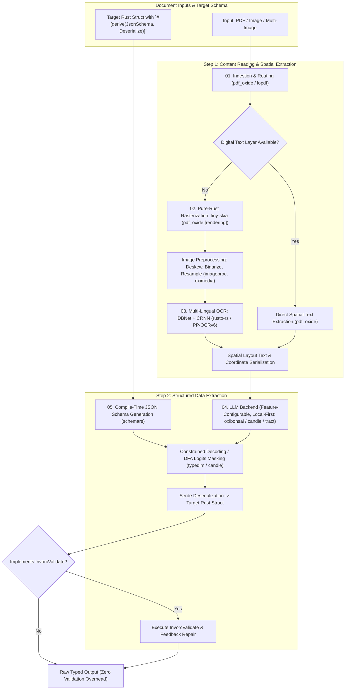

# Master Specification: Sovereign Rust Document Intelligence Engine (`invorc`)

## 1. Executive Summary

`invorc` is a sovereign, pure-Rust document intelligence engine designed to extract typed, structured data from heterogeneous documents—such as invoices, receipts, and bank statements—supplied as single PDFs, multi-page PDFs, individual images, or sets of images.

The architecture is founded on zero-FFI, pure-Rust principles, eliminating external C/C++ dependencies (like Tesseract, Poppler, OpenCV, PyTorch, or llama.cpp) and heavy runtime microservice overhead.



---

## 2. Core Operational Paradigm: The Two-Step Pipeline

The engine operates on a clean two-step paradigm:

1. **Step 1: Content Reading and Spatial Layout Extraction**
   - Ingests single/multi-page PDFs or image arrays.
   - Evaluates whether pages are born-digital text or scanned rasters.
   - Rasterizes non-text PDF pages into memory buffers without C++ bindings.
   - Preprocesses images (Hough-transform deskewing, binarization, SIMD scaling).
   - Runs neural multi-lingual OCR (covering 50+ languages simultaneously).
   - Generates a spatial, layout-preserving representation of the text.

2. **Step 2: Schema-Driven Structured Extraction**
   - Ingests the spatial layout representation and the user-specified Rust struct.
   - Dynamically compiles a strict JSON schema via `schemars`.
   - Runs local/embedded LLM inference with grammar-based constrained decoding (DFA logits masking) to guarantee valid JSON formatting matching the struct.
   - Deserializes into the user's Rust type via `serde`.
   - Executes validation and optional self-repair loops for domain constraints.

---

## 3. Specification Index

The technical specification is organized into the following modular documents:

| Document                                                                                                                                                                | Focus & Component                                                                                | Primary Crates & Technologies                                           |
|:------------------------------------------------------------------------------------------------------------------------------------------------------------------------|:-------------------------------------------------------------------------------------------------|:------------------------------------------------------------------------|
| **[01. Ingestion and Intelligent Routing](file:///Users/yasuomaidana/RustRoverProjects/invorc/docs/01_INGESTION_AND_ROUTING.md)**                                       | PDF parsing, text-vs-image routing, multi-file and multi-page batch handling                     | `pdf_oxide`, `lopdf`, `image`, `rayon`                                  |
| **[02. Rasterization and Preprocessing](file:///Users/yasuomaidana/RustRoverProjects/invorc/docs/02_RASTERIZATION_AND_PREPROCESSING.md)**                               | Pure-Rust PDF rendering (tiny-skia), image normalization, deskew, binarization, SIMD resizing    | `pdf_oxide` (`rendering`), `imageproc`, `oximedia`, `fast_image_resize` |
| **[03. OCR and Spatial Text Extraction](file:///Users/yasuomaidana/RustRoverProjects/invorc/docs/03_OCR_AND_SPATIAL_EXTRACTION.md)**                                    | Multi-lingual text detection (DBNet) & recognition (CRNN), 50 languages, spatial mapping         | `rusto-rs` (PP-OCRv6), `ocrs`, `rayon`                                  |
| **[04. LLM and Local/Embedded Backends](file:///Users/yasuomaidana/RustRoverProjects/invorc/docs/04_LLM_AND_LOCAL_EMBEDDED_BACKENDS.md)**                               | Modular LLM backend design, Cargo feature flags, local-first inference (1-bit / Candle / ONNX)   | `oxibonsai`, `candle`, `tract`, `mistral.rs`, `rig-core`                |
| **[05. Structured Extraction and Constrained Decoding](file:///Users/yasuomaidana/RustRoverProjects/invorc/docs/05_STRUCTURED_EXTRACTION_AND_CONSTRAINED_DECODING.md)** | Compile-time schema extraction, logits processors, DFA token masking, self-repair loops          | `schemars`, `typedlm`, `serde`, `serde_json`                            |
| **[06. End-to-End Invoice Example](file:///Users/yasuomaidana/RustRoverProjects/invorc/docs/06_INVOICE_AND_GENERIC_SCHEMA_EXAMPLE.md)**                                 | Complete Rust code walkthrough using `InvoiceData`, custom schemas, and multi-image processing   | End-to-end integration and API consumption                              |
| **[07. Development Plan & Roadmap](file:///Users/yasuomaidana/RustRoverProjects/invorc/docs/07_DEVELOPMENT_PLAN.md)**                                                   | Phased monorepo roadmap, milestones, feature deliverables, and unit/integration/fuzz test suites | Engineering execution roadmap                                           |
| **[08. Benchmark & Crate Comparison](file:///Users/yasuomaidana/RustRoverProjects/invorc/docs/08_BENCHMARK_AND_COMPARISON.md)**                                         | Deep-dive crate review, zero-FFI audit, latency profiles, and comparison vs. Python/C++ stacks   | Performance & competitive analysis                                      |
| **[09. Image Stitching & Overlap Deduplication](file:///Users/yasuomaidana/RustRoverProjects/invorc/docs/09_IMAGE_STITCHING_AND_DEDUPLICATION.md)**                     | Dual-layer visual keypoint stitching (FAST/RANSAC) and fuzzy spatial text overlap reconciliation | `imageproc`, `oximedia`, `strsim`, `rayon`                              |
| **[10. RAG & Large Document Retrieval](file:///Users/yasuomaidana/RustRoverProjects/invorc/docs/10_RAG_AND_LARGE_DOCUMENT_RETRIEVAL.md)**                               | Optional in-memory layout-aware vector retrieval for massive (10–100+ page) document bundles       | `candle-core`, `hnsw_rs`, `tantivy`, `strsim`                           |

---

## 4. Cargo Feature Matrix

The crate architecture is fully configurable via Cargo feature flags. Embedded and local-only backends are enabled by default, ensuring privacy, zero network latency, and air-gapped execution.

```toml
[features]
default = ["local-embedded", "ocr-multilingual"]

# Core Execution Engines
local-embedded   = ["oxibonsai", "candle-core"] # Pure-Rust local inference
local-onnx       = ["tract-core", "tract-onnx"] # Pure-Rust ONNX execution
local-vlm        = ["candle-transformers"]      # Vision-Language Models (Qwen2.5-VL / Florence-2)

# Optional Retrieval-Augmented Generation for Massive Packets
rag              = ["dep:invorc-rag"]

# Cloud & Gateway Fallbacks (Optional)
remote-openai    = ["rig-core/openai"]
remote-ollama    = ["rig-core/ollama"]

# OCR Engines
ocr-multilingual = ["rusto-rs"]                 # PP-OCRv6 50-language engine
ocr-latin-fast   = ["ocrs"]                     # Pure-Rust Latin OCR via RTen
```

---

## 5. Architectural Guarantees

1. **Pure Rust Sovereignty (Zero-FFI):** No C/C++ compilation steps, no `libtesseract`, `libleptonica`, `libpoppler`, or `libvips` dynamic linking.
2. **Memory Safety & Parallelism:** Concurrency via `rayon` and `tokio`, avoiding unsafe foreign pointer manipulations.
3. **Deterministic Type Safety:** Output is mathematically guaranteed to deserialize into the target Rust structure.
