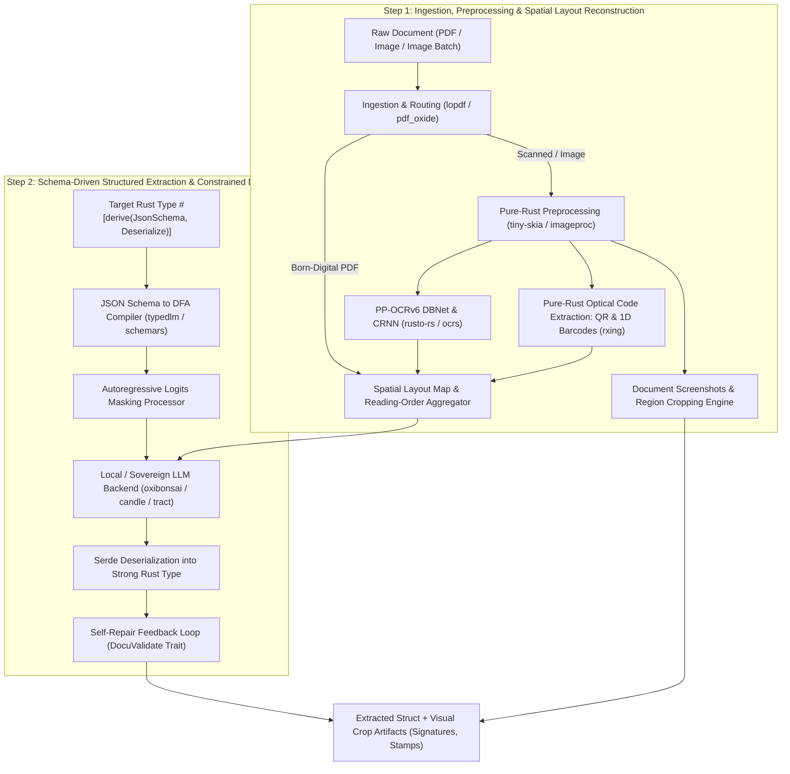

# Master Technical Specification: `docula`

## 1. Executive Summary & Core Philosophy

`docula` is an industrial-grade, sovereign, pure-Rust multi-modal document intelligence engine. It transforms heterogeneous raw documents (scanned bills, born-digital PDFs, camera photos of multi-page invoices, utility statements) into strongly typed, validated domain models (such as `InvoiceData`) with **zero foreign C/C++ dynamic linkage (Zero-FFI)** and local-first execution.

### Fundamental System Architecture: The Two-Step Paradigm

Rather than forcing an end-to-end deep learning or multi-modal Vision-Language Model (VLM) to perform OCR, spatial reasoning, tabular layout understanding, and structured extraction simultaneously—which suffers from high latency, massive hallucination rates, and extreme compute overhead—`docula` enforces a **strict, decoupled two-step architecture**:



1. **Step 1: Deterministic Spatial Reconstruction & Visual Extraction**
   - Ingests raw multi-modal inputs without external C/C++ libraries.
   - Deconstructs born-digital PDFs or rasterizes scanned documents via pure-Rust engines (`pdf_oxide`, `tiny-skia`).
   - Normalizes images (deskewing, adaptive binarization, SIMD resizing).
   - Detects and recognizes text tokens across 50+ languages using PP-OCRv6 neural architectures (`rusto-rs`).
   - Slices full-page screenshots and spatial region-of-interest (ROI) image crops (`ImageCrop` for signatures, seals, logos, stamps).
   - Scans 1D and 2D optical barcodes/QR codes (`rxing`).
   - Synthesizes all recognized tokens, visual crops, and bounding boxes into a unified 2D-aligned `SpatialLayoutMap`.

2. **Step 2: Schema-Driven Structured Extraction**
   - Ingests the spatial layout representation and the user-specified Rust struct.
   - Dynamically compiles a strict JSON schema via `schemars`.
   - Runs local/embedded LLM inference with grammar-based constrained decoding (DFA logits masking) to guarantee valid JSON formatting matching the struct.
   - Deserializes into the user's Rust type via `serde`.
   - Executes validation and optional self-repair loops for domain constraints.

---

## 3. Specification Index

The technical specification is organized into the following single-responsibility documents:

| Document | Focus & Component | Primary Crates & Technologies |
|:---|:---|:---|
| **[01. Development Plan & Roadmap](file:///Users/yasuomaidana/RustRoverProjects/docula/docs/01_DEVELOPMENT_PLAN.md)** | Phased monorepo roadmap, single-responsibility tickets, acceptance criteria & test scenarios | Engineering execution roadmap |
| **[02. Design Patterns & Architecture](file:///Users/yasuomaidana/RustRoverProjects/docula/docs/02_DESIGN_PATTERNS_AND_ARCHITECTURE.md)** | Rust design patterns evaluation, crate topology, consumer integration & justification | docula monorepo design |
| **[03. Ingestion and Intelligent Routing](file:///Users/yasuomaidana/RustRoverProjects/docula/docs/03_INGESTION_AND_ROUTING.md)** | PDF parsing, text-vs-image routing, multi-file and multi-page batch handling | pdf_oxide, lopdf, image, rayon |
| **[04. Rasterization and Preprocessing](file:///Users/yasuomaidana/RustRoverProjects/docula/docs/04_RASTERIZATION_AND_PREPROCESSING.md)** | Pure-Rust PDF rendering (tiny-skia), image normalization, deskew, binarization, SIMD resizing | pdf_oxide, imageproc, oximedia, fast_image_resize |
| **[05. OCR and Spatial Text Extraction](file:///Users/yasuomaidana/RustRoverProjects/docula/docs/05_OCR_AND_SPATIAL_EXTRACTION.md)** | Multi-lingual text detection (DBNet) & recognition (CRNN), 50 languages, spatial mapping | rusto-rs (PP-OCRv6), ocrs, rayon |
| **[06. LLM and Local/Embedded Backends](file:///Users/yasuomaidana/RustRoverProjects/docula/docs/06_LLM_AND_LOCAL_EMBEDDED_BACKENDS.md)** | Modular LLM backend design, Cargo feature flags, local-first inference (1-bit / Candle / ONNX) | oxibonsai, candle, tract, mistral.rs, rig-core |
| **[07. Structured Extraction and Constrained Decoding](file:///Users/yasuomaidana/RustRoverProjects/docula/docs/07_STRUCTURED_EXTRACTION_AND_CONSTRAINED_DECODING.md)** | Compile-time schema extraction, logits processors, DFA token masking, self-repair loops | schemars, typedlm, serde, serde_json |
| **[08. End-to-End Invoice Example](file:///Users/yasuomaidana/RustRoverProjects/docula/docs/08_INVOICE_AND_GENERIC_SCHEMA_EXAMPLE.md)** | Complete Rust code walkthrough using InvoiceData, custom schemas, and multi-image processing | End-to-end integration and API consumption |
| **[09. Benchmark & Crate Comparison](file:///Users/yasuomaidana/RustRoverProjects/docula/docs/09_BENCHMARK_AND_COMPARISON.md)** | Deep-dive crate review, zero-FFI audit, latency profiles, and comparison vs. Python/C++ stacks | Performance & competitive analysis |
| **[10. Image Stitching & Overlap Deduplication](file:///Users/yasuomaidana/RustRoverProjects/docula/docs/10_IMAGE_STITCHING_AND_DEDUPLICATION.md)** | Dual-layer visual keypoint stitching (FAST/RANSAC) and fuzzy spatial text overlap reconciliation | imageproc, oximedia, strsim, rayon |
| **[11. RAG & Large Document Retrieval](file:///Users/yasuomaidana/RustRoverProjects/docula/docs/11_RAG_AND_LARGE_DOCUMENT_RETRIEVAL.md)** | Optional in-memory layout-aware vector retrieval for massive (10–100+ page) document bundles | candle-core, hnsw_rs, tantivy, strsim |
| **[12. Few-Shot & Exemplar Management](file:///Users/yasuomaidana/RustRoverProjects/docula/docs/12_FEW_SHOT_AND_EXEMPLAR_MANAGEMENT.md)** | Dual-stage exemplar retrieval (fast layout fingerprint + HNSW fallback) and dynamic prompt injection | docula-exemplar, hnsw_rs, strsim, serde_json |
| **[13. Human-in-the-Loop & Active Learning](file:///Users/yasuomaidana/RustRoverProjects/docula/docs/13_HUMAN_IN_THE_LOOP_AND_ACTIVE_LEARNING.md)** | Triage gates, immutable correction triad capture, two-tier storage (/data/corrections/ vs /data/examples/) | docula-hitl, uuid, chrono, sha2 |
| **[14. Edge Compliance & Non-Storing Directives](file:///Users/yasuomaidana/RustRoverProjects/docula/docs/14_COMPLIANCE_AND_NON_STORING.md)** | Struct-level doc annotations (/// @censor, @ignore, @non-storing), PII regex redaction, zero-storage NonStored smart pointer | image, schemars, regex, zeroize |
| **[15. Consumer Configuration & TOML Strategy](file:///Users/yasuomaidana/RustRoverProjects/docula/docs/15_CONSUMER_CONFIGURATION_AND_TOML.md)** | In-memory safe defaults, DoculaConfig builder, custom TOML paths, embedded app configuration | docula-core, toml, serde |
| **[16. Multi-Lingual OCR & Language Asset Management](file:///Users/yasuomaidana/RustRoverProjects/docula/docs/16_MULTI_LINGUAL_OCR_AND_ASSET_MANAGEMENT.md)** | 50+ script handling, ocr-latin vs ocr-multilingual feature gating, mmap2 zero-copy memory mapping | docula-ocr, rusto-rs, ocrs, memmap2 |
| **[17. Pure-Rust Optical Code Extraction](file:///Users/yasuomaidana/RustRoverProjects/docula/docs/17_OPTICAL_CODE_EXTRACTION.md)** | Zero-FFI QR & 1D barcode detection (rxing), financial QR standards (EPC, Swiss QR), /// @decode directive | docula-vision-codes, rxing, image |
| **[18. Document Screenshots & Region Cropping](file:///Users/yasuomaidana/RustRoverProjects/docula/docs/18_DOCUMENT_SCREENSHOTS_AND_REGION_CROPPING.md)** | Full-page raster captures, BoundingBox ROI cropping (ImageCrop), sub-image slicing, /// @crop directive | docula-core, docula-preprocess, image, base64 |

---

## 4. Cargo Feature Matrix

The crate architecture is fully configurable via Cargo feature flags. Embedded and local-only backends are enabled by default, ensuring privacy, zero network latency, and air-gapped execution.

```toml
[features]
default = ["local-embedded", "ocr-multilingual"]

# Core Execution Engines
local-embedded   = ["oxibonsai", "candle-core"] # Pure-Rust local inference
local-onnx       = ["tract-core", "tract-onnx"] # Pure-Rust ONNX execution
local-vlm        = ["candle-transformers"]      # Vision-Language Models (Qwen2.5-VL / Florence-2)

# Optional Advanced Vision (Milestone 7)
vision-codes     = ["dep:docula-vision-codes"]  # Pure-Rust QR and 1D barcode scanning (rxing)
vision-crops     = ["image/png", "image/jpeg"]  # Full-page screenshots & sub-image ROI cropping

# Optional Retrieval & Active Learning
rag              = ["dep:docula-rag"]
exemplars        = ["dep:docula-exemplar"]      # Dual-stage few-shot exemplar injection
hitl             = ["dep:docula-hitl"]          # Active learning triage & correction triads

# Cloud & Gateway Fallbacks (Optional)
remote-openai    = ["rig-core/openai"]
remote-ollama    = ["rig-core/ollama"]

# OCR Engines
ocr-multilingual = ["rusto-rs"]                 # PP-OCRv6 50-language engine
ocr-latin-fast   = ["ocrs"]                     # Pure-Rust Latin OCR via RTen
```

---

## 5. Architectural Guarantees

1. **Pure Rust Sovereignty (Zero-FFI):** No C/C++ compilation steps, no `libtesseract`, `libleptonica`, `libpoppler`, `libzbar`, or `libvips` dynamic linking.
2. **Memory Safety & Parallelism:** Concurrency via `rayon` and `tokio`, avoiding unsafe foreign pointer manipulations.
3. **Deterministic Type Safety & Compliance:** Output is mathematically guaranteed to deserialize into the target Rust structure with deterministic PII sanitization.
4. **Visual & Region Extraction Fidelity:** Native zero-copy sub-image views and full-page raster snapshots with strict compliance precedence over censored pixels.
