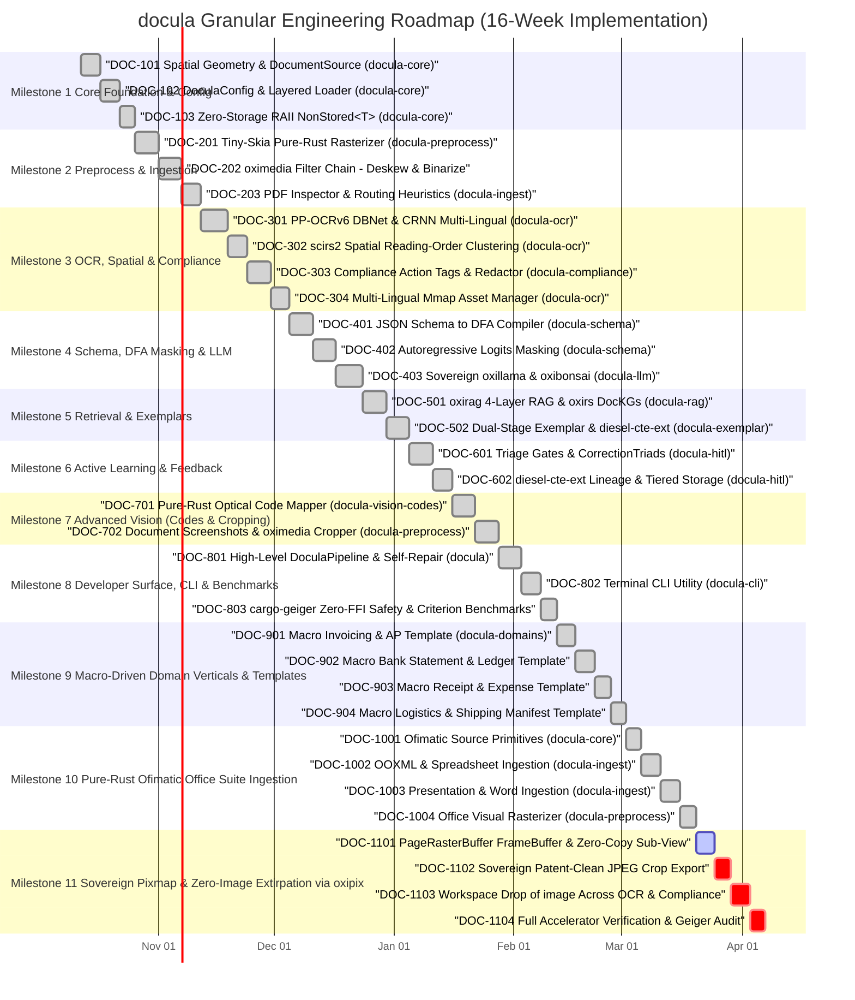

# Development Plan & Engineering Roadmap: `docula`

## 1. Executive Roadmap & Workspace Blueprint

This document specifies the end-to-end development roadmap for `docula`. The implementation is organized into an **11-Milestone phased execution model** across a 14-crate Cargo Monorepo Workspace, standardizing on the **KitaSan (COOLJAPAN) open-source stack** (`oximedia`, `oxillama`, `oxibonsai`, `oxirag`, `oxirs`, `scirs2`, `oxiz`) and **`diesel-cte-ext`**.

Optical Code Detection (QR / 1D Barcodes) and Visual Region Cropping (Document Screenshots / ROI Crops) are scheduled for **Milestone 7 (Advanced Vision)** as the latest functional capabilities. However, all foundational abstractions (`BoundingBox` pixel projection, `ImageCrop` value objects, `RegionCropper` trait, and schema reflection tags) are engineered **from Day 0 in Milestone 1 and Milestone 2** to guarantee zero breaking changes or hard refactoring when Milestone 7 lands.



---

## 2. Monorepo Structure & Package Manifests

```text
docula/
├── Cargo.toml                  # Workspace Manifest
├── Cargo.lock
├── README.md
├── Docula.toml                 # Default consumer configuration template
├── docs/                       # Comprehensive Architecture & Specification Suite
│   ├── 00_MASTER_SPECIFICATION.md
│   ├── 01_DEVELOPMENT_PLAN.md
│   ├── 02_DESIGN_PATTERNS_AND_ARCHITECTURE.md
│   ├── 03_INGESTION_AND_ROUTING.md
│   ├── 04_RASTERIZATION_AND_PREPROCESSING.md
│   ├── 05_OCR_AND_SPATIAL_EXTRACTION.md
│   ├── 06_LLM_AND_LOCAL_EMBEDDED_BACKENDS.md
│   ├── 07_STRUCTURED_EXTRACTION_AND_CONSTRAINED_DECODING.md
│   ├── 08_INVOICE_AND_GENERIC_SCHEMA_EXAMPLE.md
│   ├── 09_BENCHMARK_AND_COMPARISON.md
│   ├── 10_IMAGE_STITCHING_AND_DEDUPLICATION.md
│   ├── 11_RAG_AND_LARGE_DOCUMENT_RETRIEVAL.md
│   ├── 12_FEW_SHOT_AND_EXEMPLAR_MANAGEMENT.md
│   ├── 13_HUMAN_IN_THE_LOOP_AND_ACTIVE_LEARNING.md
│   ├── 14_COMPLIANCE_AND_NON_STORING.md
│   ├── 15_CONSUMER_CONFIGURATION_AND_TOML.md
│   ├── 16_MULTI_LINGUAL_OCR_AND_ASSET_MANAGEMENT.md
│   ├── 17_OPTICAL_CODE_EXTRACTION.md
│   ├── 18_DOCUMENT_SCREENSHOTS_AND_REGION_CROPPING.md
│   ├── 19_OFIMATIC_OFFICE_SUITE_INGESTION.md
│   ├── 20_ERGONOMIC_EXTRACTION_AND_ID_INFERENCE.md
│   ├── 21_SOVEREIGN_PIXMAP_AND_ACCELERATOR_EXTIRPATION.md
│   └── oxipix/                  # Sovereign Standalone Crate Specification Suite
│       ├── 00_TECHNICAL_ASSESSMENT.md
│       ├── 01_ARCHITECTURE_AND_DESIGN_PATTERNS.md
│       ├── 02_CODEC_AND_ACCELERATOR_ENGINE.md
│       ├── 03_ROADMAP_AND_MILESTONES.md
│       └── 04_BENCHMARKS_AND_TESTING_SUITE.md
├── data/
│   ├── corrections/            # Tier 1: Cold Storage (Append-only immutable JSONL & DB)
│   └── examples/               # Tier 2: Curated Few-Shot Pool
├── crates/
│   ├── docula-core/            # Core primitives, BoundingBox, ImageCrop, NonStored<T>, DoculaConfig
│   ├── docula-preprocess/      # oximedia CV, tiny-skia rendering, Hough deskew, binarization, stitching, region crops
│   ├── docula-vision-codes/    # Pure-Rust rxing 1D & QR barcode detector (Milestone 7)
│   ├── docula-schema/          # schemars JSON Schema reflection, typedlm DFA masking
│   ├── docula-ingest/          # lopdf hierarchy inspection, routing heuristics
│   ├── docula-ocr/             # PP-OCRv6 DBNet detection, CRNN 50-language recognition, scirs2 clustering
│   ├── docula-compliance/      # Spatial blackout, PII sanitization, action directives
│   ├── docula-llm/             # KitaSan sovereign LLMs (oxillama GGUF, oxibonsai 1-bit), candle, tract
│   ├── docula-rag/             # oxirag 4-layer engine (Echo, Speculator, Judge oxiz, Graph oxirs)
│   ├── docula-exemplar/        # Dual-stage retrieval, diesel-cte-ext template inheritance, few-shot builder
│   ├── docula-hitl/            # Active learning flywheel, triage gates, diesel-cte-ext correction DAGs
│   ├── docula/                 # High-level developer facade offering typed API
│   ├── docula-cli/             # Sovereign command-line tool
│   └── docula-domains/         # Standard domain vertical schemas, DocuValidate rules & optical code adapters
└── tests/
    ├── fixtures/               # Test PDFs, bills, receipts, QR invoices
    └── integration_tests/      # End-to-end integration and fuzz suites
```

---

## 3. Detailed Milestone & Single-Responsibility Ticket Breakdown

### Milestone 1: Core Foundation & Consumer Configuration (`docula-core`)

#### Ticket DOC-101: Spatial Coordinate Primitives & Universal Input Abstraction (Day 0 Vision Ready)
* **Reference Spec:** [`00_MASTER_SPECIFICATION.md`](file:///Users/yasuomaidana/RustRoverProjects/docula/docs/00_MASTER_SPECIFICATION.md), [`18_DOCUMENT_SCREENSHOTS_AND_REGION_CROPPING.md`](file:///Users/yasuomaidana/RustRoverProjects/docula/docs/18_DOCUMENT_SCREENSHOTS_AND_REGION_CROPPING.md)
* **Single Responsibility:** Provide foundational geometric and input abstractions, with normalized coordinates and `ImageCrop` structures built in from Day 0.
* **Design Pattern:** **Value Object Pattern** & **Strategy Pattern**.
* **Acceptance Criteria:**
  1. `Point` and `BoundingBox` enforce normalized coordinate range $[0.0, 1.0]$.
  2. `BoundingBox` provides `.to_pixel_rect(w, h)` with safe boundary clamping.
  3. `ImageCrop` value object and `RegionCropper` trait are declared in `docula-core`.
  4. `DocumentSource` supports memory buffers, file paths, and multi-page byte slices.
* **Test Scenarios:**
  * `test_bounding_box_normalization`: Coordinates clamped to $[0.0, 1.0]$.
  * `test_bounding_box_to_pixel_rect`: Normalized coords map accurately to integer pixels without overflow.
  * `test_document_source_from_bytes`: Memory slice initializes valid document source.

#### Ticket DOC-102: Consumer-Driven `DoculaConfig` & Layered Loader
* **Reference Spec:** [`15_CONSUMER_CONFIGURATION_AND_TOML.md`](file:///Users/yasuomaidana/RustRoverProjects/docula/docs/15_CONSUMER_CONFIGURATION_AND_TOML.md)
* **Single Responsibility:** Implement consumer-friendly configuration handling without static file assumptions.
* **Design Pattern:** **Builder Pattern** & **Hierarchical Fallback Pattern**.
* **Acceptance Criteria:**
  1. `DoculaConfig::default()` operates 100% in-memory with zero disk reads.
  2. `DoculaConfigBuilder` permits fluent programmatic configuration.
  3. Supports overrides from arbitrary file path, TOML string, or environment variables.
* **Test Scenarios:**
  * `test_default_config_in_memory`: Default config constructs without disk access.
  * `test_builder_overrides`: Custom DPI and triage thresholds take precedence.

#### Ticket DOC-103: Zero-Storage RAII Smart Pointer `NonStored<T>`
* **Reference Spec:** [`14_COMPLIANCE_AND_NON_STORING.md`](file:///Users/yasuomaidana/RustRoverProjects/docula/docs/14_COMPLIANCE_AND_NON_STORING.md)
* **Single Responsibility:** Provide an in-memory wrapper for sensitive fields that zeroes memory on drop and skips serialization.
* **Design Pattern:** **RAII Pattern** & **Smart Pointer Wrapper**.
* **Acceptance Criteria:**
  1. Implements `Deref` and `DerefMut` for in-memory arithmetic.
  2. Implements `ZeroizeOnDrop` to scrub heap memory on exit.
  3. `serde::Serialize` implementation skips serialization or outputs redacted placeholder.
* **Test Scenarios:**
  * `test_non_stored_memory_zeroing`: Memory buffer cleared when dropped.
  * `test_non_stored_serialization_skip`: Serialized struct omits wrapped field.

---

### Milestone 2: Preprocessing & Ingestion (`docula-preprocess`, `docula-ingest`)

#### Ticket DOC-201: Pure-Rust PDF Rasterization Bridge & Page Pixmap Buffer
* **Reference Spec:** [`04_RASTERIZATION_AND_PREPROCESSING.md`](file:///Users/yasuomaidana/RustRoverProjects/docula/docs/04_RASTERIZATION_AND_PREPROCESSING.md)
* **Single Responsibility:** Render PDF pages into memory-backed RGBA pixmaps using `pdf_oxide` (`tiny-skia` renderer) with zero-copy sub-image view capability.
* **Design Pattern:** **Strategy Pattern** (concrete rasterization strategy).
* **Acceptance Criteria:**
  1. Renders single and multi-page PDFs to memory buffers at configurable DPI (150/300 DPI).
  2. Zero linkage against Poppler, MuPDF, or external C dynamic libraries.
  3. Returns `PageRasterBuffer` ready for OCR and downstream ROI cropping.
* **Test Scenarios:**
  * `test_render_single_page_pdf`: Render 1-page sample at 300 DPI; assert resulting dimensions match expected pixels.
  * `test_render_invalid_pdf_bytes`: Pass random bytes; assert graceful error return.

#### Ticket DOC-202: Image Filter Chain powered by `oximedia` (Deskew, Binarize, SIMD Resize)
* **Reference Spec:** [`04_RASTERIZATION_AND_PREPROCESSING.md`](file:///Users/yasuomaidana/RustRoverProjects/docula/docs/04_RASTERIZATION_AND_PREPROCESSING.md), [`10_IMAGE_STITCHING_AND_DEDUPLICATION.md`](file:///Users/yasuomaidana/RustRoverProjects/docula/docs/10_IMAGE_STITCHING_AND_DEDUPLICATION.md)
* **Single Responsibility:** Implement modular image filter passes using **`oximedia`** (KitaSan OpenCV/FFmpeg pure-Rust replacement) and `fast_image_resize`.
* **Design Pattern:** **Chain of Responsibility Pattern**.
* **Acceptance Criteria:**
  1. `HoughDeskewFilter` using `oximedia` detects angles between $-45^\circ$ and $+45^\circ$ and rotates within $\pm 0.5^\circ$ accuracy.
  2. `AdaptiveBinarizeFilter` via `oximedia` removes shadows and normalizes uneven lighting with local Otsu/Bradley-Roth algorithms.
  3. `SimdResizeFilter` rescales images using AVX2/NEON intrinsics without memory leaks.
  4. Multi-image visual stitching executes pure-Rust FAST/ORB keypoint matching and RANSAC homography via `oximedia`.
* **Test Scenarios:**
  * `test_deskew_rotated_image`: Pass image rotated by $15^\circ$; assert detected angle is $15^\circ \pm 0.5^\circ$.
  * `test_simd_resize_aspect_ratio`: Scale $1920\times 1080$ to width 960; verify height is 540.
  * `test_oximedia_adaptive_binarize`: Verify high-contrast binary output on shadow-degraded receipt.

#### Ticket DOC-203: PDF Object Tree Inspector & Routing Classifier (`docula-ingest`)
* **Reference Spec:** [`03_INGESTION_AND_ROUTING.md`](file:///Users/yasuomaidana/RustRoverProjects/docula/docs/03_INGESTION_AND_ROUTING.md)
* **Single Responsibility:** Inspect PDF object trees with `lopdf` to classify pages as born-digital or rasterized.
* **Design Pattern:** **Routing Heuristic / Decision Strategy Pattern**.
* **Acceptance Criteria:**
  1. Inspects `/Font` and `/Contents` streams.
  2. Pages with vector text streams are routed to `PageRoute::BornDigital`.
  3. Pages containing only image objects or empty text streams are routed to `PageRoute::NeedsOcr`.
* **Test Scenarios:**
  * `test_classify_born_digital_pdf`: Born-digital PDF routed to digital extraction.
  * `test_classify_scanned_pdf`: Scanned image PDF routed to rasterizer.

---

### Milestone 3: Multi-Lingual OCR, Reading-Order Clustering & Compliance (`docula-ocr`, `docula-compliance`)

#### Ticket DOC-301: PP-OCRv6 Neural Text Detection & Recognition (`docula-ocr`)
* **Reference Spec:** [`05_OCR_AND_SPATIAL_EXTRACTION.md`](file:///Users/yasuomaidana/RustRoverProjects/docula/docs/05_OCR_AND_SPATIAL_EXTRACTION.md)
* **Single Responsibility:** Execute DBNet text detection and CRNN character recognition across 50 languages using `rusto-rs` and `rayon`.
* **Design Pattern:** **Strategy Pattern** (concrete `OcrEngine` implementation).
* **Acceptance Criteria:**
  1. DBNet detects text bounding polygons and returns unclipped bounding boxes.
  2. CRNN recognizes characters across English, Spanish, Japanese, Chinese, Arabic.
  3. Rayon parallelizes OCR inference across batches of bounding boxes.
* **Test Scenarios:**
  * `test_ocr_latin_text`: Recognize standard English invoice snippet with CER $< 1.5\%$.
  * `test_ocr_cjk_text`: Recognize Chinese/Japanese receipt sample.

#### Ticket DOC-302: Spatial Reading-Order Clustering via `scirs2`
* **Reference Spec:** [`05_OCR_AND_SPATIAL_EXTRACTION.md`](file:///Users/yasuomaidana/RustRoverProjects/docula/docs/05_OCR_AND_SPATIAL_EXTRACTION.md)
* **Single Responsibility:** Group raw detected text spans into lines, cluster into columns using `scirs2` spatial statistics, and generate layout-preserving text.
* **Design Pattern:** **Composite Pattern** (Spans $\to$ Lines $\to$ Blocks $\to$ `SpatialLayoutMap`).
* **Acceptance Criteria:**
  1. Horizontal text clustering groups spans within character-spacing tolerance into lines.
  2. Preserves tabular columns by snapping bounding boxes to vertical alignment boundaries using `scirs2` spatial algorithms.
  3. Output serialization formats spatial layout cleanly for LLM comprehension.
* **Test Scenarios:**
  * `test_table_reading_order`: Verify table with 3 columns is serialized row-by-row rather than column-stacked.
  * `test_multiline_invoice_header`: Verify invoice header lines are properly ordered from top to bottom.

#### Ticket DOC-303: Compliance Action Tag Processor & Pixel Blackout (`docula-compliance`)
* **Reference Spec:** [`14_COMPLIANCE_AND_NON_STORING.md`](file:///Users/yasuomaidana/RustRoverProjects/docula/docs/14_COMPLIANCE_AND_NON_STORING.md)
* **Single Responsibility:** Execute schema directives (`@censor`, `@ignore`, `@non-storing`) and sanitize PII before storage.
* **Design Pattern:** **Command / Action Strategy Pattern**.
* **Acceptance Criteria:**
  1. `@censor`: Overwrites pixels in bounding box with pure black (`[0, 0, 0, 255]`) and purges text spans from layout map.
  2. Deterministic regex masks IBANs, Credit Cards, and SSNs.
  3. Precedence invariant: censored regions are redacted before any visual crops or screenshots are exported.
* **Test Scenarios:**
  * `test_blackout_boundary_pixels`: Assert pixel values inside bbox are `[0, 0, 0, 255]` and pixels outside remain untouched.
  * `test_purge_text_span_overlap`: Assert spans falling inside censored bbox are removed from layout.

#### Ticket DOC-304: Multi-Lingual Mmap Asset Manager & Feature Gating (`docula-ocr`)
* **Reference Spec:** [`16_MULTI_LINGUAL_OCR_AND_ASSET_MANAGEMENT.md`](file:///Users/yasuomaidana/RustRoverProjects/docula/docs/16_MULTI_LINGUAL_OCR_AND_ASSET_MANAGEMENT.md)
* **Single Responsibility:** Manage OCR weights and dictionaries via zero-copy memory mapping (`memmap2`) and feature gating (`ocr-latin` vs `ocr-multilingual`).
* **Design Pattern:** **Flyweight / Memory-Mapped Asset Manager Pattern**.
* **Acceptance Criteria:**
  1. Compiling with default `ocr-latin` excludes heavy multi-lingual dictionaries.
  2. Compiling with `ocr-multilingual` enables 50-language dictionary with lazy memory mapping.
  3. Process RSS remains below 150 MB during idle state.
* **Test Scenarios:**
  * `test_mmap_lazy_init`: Memory is mapped only when first recognition query executes.
  * `test_custom_model_dir_override`: Load weights from custom path provided in `DoculaConfig`.

---

### Milestone 4: Schema Reflection, DFA Logits Masking & Sovereign LLMs (`docula-schema`, `docula-llm`)

#### Ticket DOC-401: Dynamic JSON Schema to DFA State Machine Compiler (`docula-schema`)
* **Reference Spec:** [`07_STRUCTURED_EXTRACTION_AND_CONSTRAINED_DECODING.md`](file:///Users/yasuomaidana/RustRoverProjects/docula/docs/07_STRUCTURED_EXTRACTION_AND_CONSTRAINED_DECODING.md)
* **Single Responsibility:** Compile `schemars` JSON Schema AST into a Deterministic Finite Automaton (DFA) state machine.
* **Design Pattern:** **Visitor Pattern** (traversing schema AST) & **State Machine Pattern** (DFA tracking).
* **Acceptance Criteria:**
  1. Recursively compiles objects, arrays, strings, numbers, booleans, and enums into DFA transitions.
  2. Day 0 directive registry recognizes `/// @crop`, `/// @screenshot`, `/// @decode`, `/// @censor`, `/// @ignore`.
* **Test Scenarios:**
  * `test_dfa_nested_object_compilation`: Compile struct with nested fields; verify initial state permits `{`.
  * `test_dfa_invalid_transition`: Attempt to advance with an invalid token; assert transition failure.

#### Ticket DOC-402: Token Logits Masking Processor (`docula-schema`)
* **Reference Spec:** [`07_STRUCTURED_EXTRACTION_AND_CONSTRAINED_DECODING.md`](file:///Users/yasuomaidana/RustRoverProjects/docula/docs/07_STRUCTURED_EXTRACTION_AND_CONSTRAINED_DECODING.md)
* **Single Responsibility:** Intercept autoregressive LLM token logits and set invalid out-of-grammar token logits to $-\infty$.
* **Design Pattern:** **Decorator / Interceptor Pattern**.
* **Acceptance Criteria:**
  1. Invalid tokens according to DFA state receive $-\infty$ (`f32::NEG_INFINITY`).
  2. Valid tokens retain their raw logit scores.
* **Test Scenarios:**
  * `test_masking_disallows_illegal_tokens`: Tokens not in the grammar bitset are masked to $-\infty$.
  * `test_complete_token_sequence_yields_valid_json`: Generate simulated token stream; assert `serde_json::from_str` succeeds.

#### Ticket DOC-403: KitaSan Sovereign LLM Backend Trait and Dispatcher (`docula-llm`)
* **Reference Spec:** [`06_LLM_AND_LOCAL_EMBEDDED_BACKENDS.md`](file:///Users/yasuomaidana/RustRoverProjects/docula/docs/06_LLM_AND_LOCAL_EMBEDDED_BACKENDS.md)
* **Single Responsibility:** Define `LlmBackend` trait and provide pure-Rust implementations: **`oxillama`** (general GGUF quantized models) and **`oxibonsai`** (1-bit and ternary sub-2-bit edge models), alongside `candle` and `tract`.
* **Design Pattern:** **Strategy Pattern**.
* **Acceptance Criteria:**
  1. Feature flags `local-gguf` (`oxillama`), `local-embedded` (`oxibonsai`), `local-candle`, `local-onnx` compile cleanly.
  2. Air-gapped execution with zero network socket allocation in local modes.
  3. Logits interceptors bind natively into `oxillama-runtime` and `oxibonsai` token generation loops.
* **Test Scenarios:**
  * `test_mock_llm_backend`: Test prompt completion using deterministic mock backend.
  * `test_oxillama_logits_interceptor`: Verify logits processor is invoked on every generated token in `oxillama`.
  * `test_oxibonsai_sub2bit_inference`: Verify sub-2-bit model initialization and constrained generation.

---

### Milestone 5: Retrieval, Knowledge Graphs & Exemplars (`docula-rag`, `docula-exemplar`)

#### Ticket DOC-501: `oxirag` 4-Layer RAG Engine & `oxirs` Document Knowledge Graphs (`docula-rag`)
* **Reference Spec:** [`11_RAG_AND_LARGE_DOCUMENT_RETRIEVAL.md`](file:///Users/yasuomaidana/RustRoverProjects/docula/docs/11_RAG_AND_LARGE_DOCUMENT_RETRIEVAL.md)
* **Single Responsibility:** Implement 4-layer RAG architecture (**`oxirag`**) for 10–100+ page documents: Layer 1 (Echo prefix caching), Layer 2 (Speculator draft retrieval), Layer 3 (Judge SMT formal verification via **`oxiz`**), and Layer 4 (Graph GraphRAG via **`oxirs`**).
* **Design Pattern:** **Multi-Tiered Verification & Graph Pattern**.
* **Acceptance Criteria:**
  1. Preserves table cells without splitting table rows across arbitrary token boundaries.
  2. `oxirag` prefix caching bypasses redundant vector search on recurring boilerplate.
  3. `oxiz` SMT solver formally proves arithmetic equations (subtotal + tax == total) before prompting.
  4. `oxirs` constructs RDF Document Knowledge Graph (DocKG) for multi-hop semantic querying.
* **Test Scenarios:**
  * `test_oxirag_layout_chunking`: Verify table grid maintained intact across 50-page packet.
  * `test_oxiz_smt_judge_verification`: Formally verify mathematical invariant and detect arithmetic conflict.
  * `test_oxirs_dockg_sparql_query`: Query extracted RDF graph with SPARQL 1.2 to find entity relationships.

#### Ticket DOC-502: Dual-Stage Exemplar Retrieval & `diesel-cte-ext` Lineage (`docula-exemplar`)
* **Reference Spec:** [`12_FEW_SHOT_AND_EXEMPLAR_MANAGEMENT.md`](file:///Users/yasuomaidana/RustRoverProjects/docula/docs/12_FEW_SHOT_AND_EXEMPLAR_MANAGEMENT.md)
* **Single Responsibility:** Implement Stage 1 fast geometric fingerprint matching (<1ms), Stage 2 HNSW vector fallback, and recursive template inheritance hierarchy via **`diesel-cte-ext`**.
* **Design Pattern:** **Dual-Stage Hierarchical Cache Pattern** & **Recursive CTE Pattern**.
* **Acceptance Criteria:**
  1. Stage 1 computes 64-bit spatial layout fingerprint and executes Hamming distance match ($< 500\,\mu\text{s}$).
  2. Stage 2 executes HNSW cosine similarity search when Stage 1 does not hit.
  3. `diesel-cte-ext`'s `with_recursive` traverses multi-tier template inheritance trees in a single SQL query.
* **Test Scenarios:**
  * `test_stage1_fingerprint_match`: Exact layout matches in $< 500\,\mu\text{s}$.
  * `test_recursive_template_hierarchy_diesel_cte`: Resolves 4-level deep template ancestor chain using `diesel-cte-ext`.

---

### Milestone 6: Active Learning & Feedback (`docula-hitl`)

#### Ticket DOC-601: Automated Triage Gates & Validation Failure Interceptor (`docula-hitl`)
* **Reference Spec:** [`13_HUMAN_IN_THE_LOOP_AND_ACTIVE_LEARNING.md`](file:///Users/yasuomaidana/RustRoverProjects/docula/docs/13_HUMAN_IN_THE_LOOP_AND_ACTIVE_LEARNING.md)
* **Single Responsibility:** Intercept extractions failing confidence thresholds or domain validation, and flag for review.
* **Design Pattern:** **Gatekeeper / Interceptor Pattern**.
* **Acceptance Criteria:**
  1. Token confidence $< \text{threshold}$ triggers triage.
  2. `DocuValidate` failures route to human review queue.
* **Test Scenarios:**
  * `test_confidence_gate_intercepts_low_score`: Low confidence token triggers routing to review queue.

#### Ticket DOC-602: Immutable `CorrectionTriad` Capture & `diesel-cte-ext` Version DAG (`docula-hitl`)
* **Reference Spec:** [`13_HUMAN_IN_THE_LOOP_AND_ACTIVE_LEARNING.md`](file:///Users/yasuomaidana/RustRoverProjects/docula/docs/13_HUMAN_IN_THE_LOOP_AND_ACTIVE_LEARNING.md)
* **Single Responsibility:** Record immutable review triads in cold archive, track recursive review audit DAGs via **`diesel-cte-ext`**, and enforce promotion thresholds before updating curated few-shot pool.
* **Design Pattern:** **Event Sourcing Pattern** & **Recursive Lineage Pattern**.
* **Acceptance Criteria:**
  1. Captures immutable `CorrectionTriad` with SHA-256 integrity hash.
  2. Stores records in cold archive (`/data/corrections/`) as append-only JSONL.
  3. Reconstructs multi-stage review audit trails using `diesel-cte-ext`'s `with_recursive`.
  4. **Mandatory Persistent Layer Testing**: Integration testing for the persistent layer (cold archives, storage backends, and database synchronization) must strictly use **Testcontainers for Rust** ([https://rust.testcontainers.org](https://rust.testcontainers.org)). Mock-only testing of persistent storage is explicitly disallowed.
* **Test Scenarios:**
  * `test_triad_serialization_and_hash_integrity`: Validates JSON serialization and SHA-256 hash calculation.
  * `test_triad_lineage_diesel_cte`: Traverses recursive multi-stage human review DAG using `diesel-cte-ext`.
  * `test_append_only_cold_storage_persistence_with_testcontainers`: Spins up a throwaway storage/database container via `testcontainers` (e.g. MinIO/S3 or PostgreSQL); verifies immutable append, write-ordering, and recovery under restart.
  * `test_promotion_gate_threshold_evaluation`: Evaluates promotion threshold ($N \ge 3$) against persistent historical triads.

---

### Milestone 7: Advanced Vision: Optical Codes & Visual Region Cropping (`docula-vision-codes`, `docula-preprocess`)

#### Ticket DOC-701: Pure-Rust Optical Code Spatial Detector (`docula-vision-codes`)
* **Reference Spec:** [`17_OPTICAL_CODE_EXTRACTION.md`](file:///Users/yasuomaidana/RustRoverProjects/docula/docs/17_OPTICAL_CODE_EXTRACTION.md)
* **Single Responsibility:** Detect and decode QR codes, 1D barcodes, and financial optical symbols on rendered images using `rxing` and extract bounding boxes and payloads.
* **Design Pattern:** **Strategy Pattern** & **Adapter Pattern** (adapting `rxing` results to `docula-core` geometry).
* **Acceptance Criteria:**
  1. Detects QR, Aztec, PDF417, Data Matrix, and Code 128 barcodes without external C FFI.
  2. Maps corner points to normalized $[0.0, 1.0]$ bounding boxes matching page coordinates.
  3. Binds decoded payloads directly into `/// @decode` struct fields.
* **Test Scenarios:**
  * `test_detect_qr_code`: Pass image with QR code containing `"https://example.com"`; assert payload and bbox.
  * `test_detect_sepa_epc_qr`: Decode SEPA EPC QR code and verify IBAN.
  * `test_detect_no_barcode`: Pass plain text image; assert empty result vector without error.

#### Ticket DOC-702: Document Screenshot & `oximedia` Visual Region Cropping Engine (`docula-preprocess`)
* **Reference Spec:** [`18_DOCUMENT_SCREENSHOTS_AND_REGION_CROPPING.md`](file:///Users/yasuomaidana/RustRoverProjects/docula/docs/18_DOCUMENT_SCREENSHOTS_AND_REGION_CROPPING.md)
* **Single Responsibility:** Implement full-page raster screenshot captures and sub-image ROI cropping (`ImageCrop`) implementing the `RegionCropper` trait using **`oximedia`**.
* **Design Pattern:** **Strategy Pattern** & **Sub-Image Memory Slicing**.
* **Acceptance Criteria:**
  1. Full-page capture generates lossless PNG, WebP, or JPEG byte buffers at user-defined DPI (72, 150, 300) via `oximedia`.
  2. Sub-image cropping extracts precise pixel bounding boxes with configurable fractional padding (e.g. 5% margin for signatures).
  3. Binds visual crops directly to fields marked with `/// @crop` or `/// @screenshot`.
  4. Redaction precedence: any region marked `/// @censor` returns a pure black pixel buffer, guaranteeing zero PII leakage.
* **Test Scenarios:**
  * `test_full_page_screenshot_png`: Render page to PNG; verify magic bytes and dimensions.
  * `test_crop_signature_roi`: Extract signature bounding box; assert dimensions match expected pixel rectangle.
  * `test_crop_censored_region_is_blackout`: Attempt crop overlapping `@censor` box; assert all pixels are `[0, 0, 0, 255]`.

---

### Milestone 8: Developer Surface, Autonomous CLI & Benchmarks (`docula`, `docula-cli`)

#### Ticket DOC-801: High-Level `DoculaPipeline` Facade & Self-Repair Loop (`docula`)
* **Reference Spec:** [`00_MASTER_SPECIFICATION.md`](file:///Users/yasuomaidana/RustRoverProjects/docula/docs/00_MASTER_SPECIFICATION.md)
* **Single Responsibility:** Provide `DoculaPipeline` and `extract_structure::<T>()` coordinating ingestion, OCR, LLMs (`oxillama` / `oxibonsai`), optical codes, visual crops (`oximedia`), validation, and self-repair.
* **Design Pattern:** **Facade Pattern**, **Typestate Pattern**, and **Template Method (Self-Repair)**.
* **Acceptance Criteria:**
  1. Orchestrates end-to-end two-step pipeline.
  2. Executes validation loop and triggers repair prompts on domain validation failure.
  3. Supports visual crop extraction seamlessly when target struct contains `ImageCrop` fields.
* **Test Scenarios:**
  * `test_end_to_end_invoice_extraction`: Extract strongly typed `InvoiceData` from sample document.
  * `test_end_to_end_contract_with_signature_crop`: Extract metadata and signature `ImageCrop`.

#### Ticket DOC-802: Autonomous Terminal CLI Utility (`docula-cli`)
* **Reference Spec:** [`01_DEVELOPMENT_PLAN.md`](file:///Users/yasuomaidana/RustRoverProjects/docula/docs/01_DEVELOPMENT_PLAN.md)
* **Single Responsibility:** Implement command-line tool for CLI document extraction, page screenshot generation, and triage queue inspection.
* **Design Pattern:** **Command Pattern**.
* **Acceptance Criteria:**
  1. Supports `docula extract --input invoice.pdf --schema schema.json --output out.json`.
  2. Supports `docula screenshot --input contract.pdf --page 0 --dpi 300 --output page0.png`.
  3. Supports `docula crop --input contract.pdf --page 0 --bbox 0.1,0.7,0.4,0.9 --output sig.png`.

#### Ticket DOC-803: `cargo-geiger` Zero-FFI Safety Audit & Criterion Benchmarks
* **Reference Spec:** [`09_BENCHMARK_AND_COMPARISON.md`](file:///Users/yasuomaidana/RustRoverProjects/docula/docs/09_BENCHMARK_AND_COMPARISON.md)
* **Single Responsibility:** Audit all crates in the workspace to guarantee 0 foreign C libraries linked dynamically and benchmark throughput across KitaSan stack and `diesel-cte-ext`.
* **Acceptance Criteria:**
  1. `cargo-geiger` verifies 0 non-Rust dynamic links across all 13 crates.
  2. Single-page born-digital PDF completes in $< 15\,\text{ms}$.
  3. Scanned receipt OCR + 1-bit LLM (`oxibonsai`) completes in $< 1.2\,\text{s}$ on standard CPU.
  4. General GGUF extraction (`oxillama`) completes with zero memory leaks.

---

### Milestone 9: Macro-Driven Domain Verticals & Extensible Template Catalog (`docula-domains` & `docula-macros`)

#### Architectural Shift: Macro-Driven Template Synthesis
Rather than prescribing rigid, static structs that fail when real-world documents deviate from standard schemas, Milestone 9 adopts an **extensible macro-driven template engine** (`#[docula_invoice]`, `docula_invoice!`, `#[docula_bank_statement]`, `#[docula_receipt]`, `#[docula_bill_of_lading]`).
The macro synthesizes standard vertical domain fields with schema descriptions, embeds user-defined custom fields seamlessly, and dynamically constructs arithmetic `DocuValidate` rules and optical barcode adapters tailored to the template configuration.

```rust
// Example: Custom Invoice with line-item and invoice-level discounts, plus custom enterprise fields
docula_invoice! {
    pub struct EnterpriseInvoice {
        discount_policy = both, // "none" | "invoice" | "line_item" | "both"
        tax_policy = flat,      // "flat" | "breakdown"
        payment_info = true,

        // Custom enterprise fields:
        pub cost_center: Option<String>,
        pub purchase_order_number: Option<String>,
        pub internal_gl_code: Option<String>,
    }
}
```

#### Ticket DOC-901: Macro-Driven Invoicing & AP Domain Template (`docula-domains`)
* **Reference Spec:** [`08_INVOICE_AND_GENERIC_SCHEMA_EXAMPLE.md`](file:///Users/yasuomaidana/RustRoverProjects/docula/docs/08_INVOICE_AND_GENERIC_SCHEMA_EXAMPLE.md), [`17_OPTICAL_CODE_EXTRACTION.md`](file:///Users/yasuomaidana/RustRoverProjects/docula/docs/17_OPTICAL_CODE_EXTRACTION.md)
* **Single Responsibility:** Provide the `docula_invoice!` macro and standard `InvoiceData` preset, generating composable invoice schemas supporting custom user fields, flexible discount strategies, dynamic arithmetic `DocuValidate` validation, ISO-4217 currency checks, and optical code adapters (SEPA EPC, SAT CFDI, Swiss QR).
* **Design Pattern:** **Macro Generation Pattern**, **Strategy Pattern** (discount/tax policies), **Policy / Specification Pattern** (`DocuValidate`), and **Adapter Pattern**.
* **Flexible Domain Configurations:**
  - `discount_policy = "none"`: No discount fields; validates $\text{subtotal} + \text{tax} == \text{total} \pm \$0.05$.
  - `discount_policy = "invoice"`: Emits `discount_amount: Option<f64>`; validates $\text{subtotal} + \text{tax} - \text{discount} == \text{total} \pm \$0.05$.
  - `discount_policy = "line_item"`: Emits `LineItem.discount: Option<f64>`; validates $(qty \times unit\_price) - discount == item.total$ per line item, and $\text{subtotal} + \text{tax} == \text{total} \pm \$0.05$.
  - `discount_policy = "both"`: Emits both invoice-level `discount_amount` and `LineItem.discount`; verifies both line-item math and invoice-level equation.
* **Acceptance Criteria:**
  1. `docula_invoice!` generates valid structs implementing `schemars::JsonSchema`, `serde::Serialize`, `serde::Deserialize`, and `DocuValidate`.
  2. Preserves user-declared custom fields (types, doc comments, visibility) alongside synthesized vertical fields.
  3. Dynamic arithmetic validation automatically adapts to the chosen `discount_policy`.
  4. Provides barcode adapter methods `apply_sepa_epc`, `apply_sat_cfdi`, and `apply_swiss_qr` to enrich financial coordinates.
  5. Zero-warning compilation and cyclomatic complexity per generated function $\le 10$.
* **Test Scenarios:**
  * `test_invoice_macro_default_standard_schema`: Verifies standard `InvoiceData` preset matches reference specification.
  * `test_invoice_macro_custom_fields_serialization`: Verifies custom user fields (`cost_center`, `po_number`) serialize, deserialize, and reflect in JSON Schema.
  * `test_invoice_macro_discount_invoice_level`: Verifies arithmetic validation when only document-level discount is active.
  * `test_invoice_macro_discount_line_item_level`: Verifies arithmetic validation when discounts apply per line item.
  * `test_invoice_macro_discount_both`: Verifies balanced math when both line-item discounts and invoice-level discounts co-exist.
  * `test_invoice_macro_arithmetic_mismatch_fails`: Flags imbalanced sums and invalid math with targeted `ValidationError` entries.
  * `test_invoice_macro_optical_code_adapters`: Validates SEPA EPC, SAT CFDI, and Swiss QR barcode ingestion into generated invoice structs.

#### Ticket DOC-902: Macro-Driven Bank Statement & Reconciliation Template (`docula-domains`)
* **Reference Spec:** [`08_INVOICE_AND_GENERIC_SCHEMA_EXAMPLE.md`](file:///Users/yasuomaidana/RustRoverProjects/docula/docs/08_INVOICE_AND_GENERIC_SCHEMA_EXAMPLE.md)
* **Single Responsibility:** Provide `docula_bank_statement!` macro and `BankStatementData` preset, generating ledger schemas with customizable transaction types, user account metadata, and running balance continuity validation.
* **Design Pattern:** **Macro Generation Pattern** & **Invariant Verification Pattern**.
* **Acceptance Criteria:**
  1. `docula_bank_statement!` generates structs implementing `JsonSchema`, `Serialize`, `Deserialize`, and `DocuValidate`.
  2. Invariant validation verifies ledger continuity: $\text{opening\_balance} + \sum \text{credits} - \sum \text{debits} == \text{closing\_balance} \pm \$0.05$.
  3. Supports custom user reconciliation tags (e.g., `gl_account_id`, `reconciliation_status`).
* **Test Scenarios:**
  * `test_bank_statement_balanced_ledger`: Balanced transactions pass validation.
  * `test_bank_statement_discrepancy_detected`: Out-of-balance ledger produces field-level errors.
  * `test_bank_statement_custom_metadata`: User-injected tracking fields are parsed and validated.

#### Ticket DOC-903: Macro-Driven Receipt & Expense Normalization Template (`docula-domains`)
* **Reference Spec:** [`08_INVOICE_AND_GENERIC_SCHEMA_EXAMPLE.md`](file:///Users/yasuomaidana/RustRoverProjects/docula/docs/08_INVOICE_AND_GENERIC_SCHEMA_EXAMPLE.md)
* **Single Responsibility:** Provide `docula_receipt!` macro and `ReceiptData` preset with configurable tip/tax structures, OCR jitter tolerance, and corporate expense tracking fields.
* **Design Pattern:** **Value Object Pattern**, **Fuzzy Math Tolerance**, and **Macro Generation**.
* **Acceptance Criteria:**
  1. `docula_receipt!` implements `JsonSchema`, `Serialize`, `Deserialize`, and `DocuValidate`.
  2. Validates subtotal + tax + tip == grand total within configurable tolerance ($\pm \$0.05$ to $\pm \$0.10$).
  3. Allows adding custom employee ID, project code, and expense category fields.
* **Test Scenarios:**
  * `test_receipt_tip_and_tax_validation`: Validates tip, tax, and total arithmetic with configurable tolerance.
  * `test_receipt_custom_expense_fields`: Custom reimbursement metadata compiles and validates.

#### Ticket DOC-904: Macro-Driven Logistics & Shipping Manifest Template (`docula-domains`)
* **Reference Spec:** [`00_MASTER_SPECIFICATION.md`](file:///Users/yasuomaidana/RustRoverProjects/docula/docs/00_MASTER_SPECIFICATION.md)
* **Single Responsibility:** Provide `docula_bill_of_lading!` macro and `BillOfLadingData` preset with ISO 6346 shipping container checksum validation and customizable cargo/voyage attributes.
* **Design Pattern:** **Specification Pattern**, **Checksum Verification**, and **Macro Generation**.
* **Acceptance Criteria:**
  1. `docula_bill_of_lading!` validates ISO 6346 4-letter owner code and check digit.
  2. Seamlessly integrates user custom tracking tags (e.g., `hazmat_un_number`, `port_of_entry`).
* **Test Scenarios:**
  * `test_shipping_container_iso_checksum`: Valid container number passes, corrupt check digit fails.
  * `test_logistics_custom_fields`: Custom customs and logistics fields validate correctly.

---


---

### Milestone 10: Pure-Rust Ofimatic & Office Suite Ingestion Engine (`docula-core`, `docula-ingest`, `docula-preprocess`, `docula`)

#### Overview
Extends `docula` to natively ingest, inspect, and extract structured data from popular office and productivity documents (Excel `.xlsx`, `.csv`, `.tsv`, `.ods`, PowerPoint `.pptx`, `.odp`, Word `.docx`, `.odt`, `.txt`, `.rtf`) using 100% pure Rust, zero-FFI parsing pipelines. Tabular sheets and presentation slides are directly mapped to native 2D spatial layouts (`SpatialSpan`, `PageRoute::BornDigital`) and rendered into synthetic visual raster buffers for region cropping and optical barcode scanning.

#### Ticket DOC-1001: Universal Ofimatic Source Primitives & Format Detection (`docula-core`)
* **Reference Spec:** [`19_OFIMATIC_OFFICE_SUITE_INGESTION.md`](file:///Users/yasuomaidana/RustRoverProjects/docula/docs/19_OFIMATIC_OFFICE_SUITE_INGESTION.md)
* **Single Responsibility:** Provide the `OfficeFormat` domain enum, subtype classifications (Spreadsheet, Presentation, WordProcessing), MIME/extension sniffing, and extend `DocumentSource` to support office bytes and paths.
* **Design Pattern:** **Value Object Pattern** & **Type Discriminator Pattern**.
* **Acceptance Criteria:**
  1. `OfficeFormat` defines `Spreadsheet`, `Presentation`, and `WordProcessing` with subtypes.
  2. `OfficeFormat::detect(path, bytes)` accurately identifies extensions and magic signatures.
  3. `DocumentSource` provides `OfficeBytes` and `OfficePath` variants with helper methods.
  4. `From<PathBuf>` automatically detects office file formats.

#### Ticket DOC-1002: Pure-Rust OOXML & Delimited Spreadsheet Ingestion (`docula-ingest`)
* **Reference Spec:** [`19_OFIMATIC_OFFICE_SUITE_INGESTION.md`](file:///Users/yasuomaidana/RustRoverProjects/docula/docs/19_OFIMATIC_OFFICE_SUITE_INGESTION.md)
* **Single Responsibility:** Ingest `.xlsx` (OpenXML), `.ods` (OpenDocument), and `.csv`/`.tsv` files, extract workbook sheets and cells, and project them into normalized $[0.0, 1.0]$ spatial spans.
* **Design Pattern:** **Strategy Pattern** & **Streaming SAX/StAX Parser**.
* **Acceptance Criteria:**
  1. Parses `.xlsx` reading `xl/sharedStrings.xml` and `xl/worksheets/sheet*.xml`.
  2. Parses RFC 4180 `.csv` and tab-delimited `.tsv` rows and columns.
  3. Parses `.ods` XML tables and cells.
  4. Projects tabular cells into normalized `SpatialSpan` elements per sheet.
  5. Emits `PageRoute::BornDigital` for each spreadsheet sheet.

#### Ticket DOC-1003: Pure-Rust Presentation & Word Document Ingestion (`docula-ingest`)
* **Reference Spec:** [`19_OFIMATIC_OFFICE_SUITE_INGESTION.md`](file:///Users/yasuomaidana/RustRoverProjects/docula/docs/19_OFIMATIC_OFFICE_SUITE_INGESTION.md)
* **Single Responsibility:** Ingest `.pptx` (OpenXML) and `.odp` presentations, and `.docx` (OpenXML), `.odt`, and text documents, mapping slides and paragraphs into spatial spans.
* **Design Pattern:** **Visitor Pattern** & **Composite Pattern**.
* **Acceptance Criteria:**
  1. Parses `.pptx` slides, extracting titles, shapes, text runs, and spatial coordinates.
  2. Parses `.docx` paragraphs, headings, and table cells into spatial layout.
  3. Routes each slide or section into `PageRoute::BornDigital`.
  4. `OfficeInspector` and `DocumentRouter` dispatch office sources into multi-page routing reports.

#### Ticket DOC-1004: Ofimatic Visual Rasterization & Pipeline Facade Integration (`docula-preprocess`, `docula`)
* **Reference Spec:** [`19_OFIMATIC_OFFICE_SUITE_INGESTION.md`](file:///Users/yasuomaidana/RustRoverProjects/docula/docs/19_OFIMATIC_OFFICE_SUITE_INGESTION.md)
* **Single Responsibility:** Implement `OfficeRasterizer` using `tiny-skia` to render office sheets and slides into `PageRasterBuffer`, and integrate office ingestion into `DoculaPipeline`.
* **Design Pattern:** **Facade Pattern** & **Adapter Pattern**.
* **Acceptance Criteria:**
  1. `OfficeRasterizer` renders table grids and text into clean RGBA pixel buffers.
  2. Enables screenshot capture and sub-region cropping (`ImageCrop`) on office documents.
  3. Enables optical barcode detection on office documents.
  4. `DoculaPipeline::process_document` seamlessly processes office sources end-to-end into strongly typed domain models.

---

### Milestone 11: Sovereign Pixmap Architecture & Zero-Image Extirpation via `oxipix` (`docula-core`, `docula-preprocess`, `docula-ocr`, `docula-compliance`, `docula-vision-codes`, `docula-cli`, `docula`)

#### Overview
Completely extirpates the legacy `image` crate from all workspace crates by integrating the sovereign, zero-copy, hardware-accelerated **`oxipix`** crate ([`docs/oxipix/`](file:///Users/yasuomaidana/RustRoverProjects/docula/docs/oxipix)). Resolves the two hard architectural boundaries: (1) providing a clean-room, patent-unencumbered ISO/IEC 10918-1 baseline JPEG encoder for `CropFormat::Jpeg`, and (2) migrating `PageRasterBuffer` to a 64-byte aligned, Arc-refcounted `FrameBuffer<Rgba8, Shared>`, unlocking zero-allocation strided ROI sub-views ($0.2\mu\text{s}$) and 100% accelerator saturation (ARM NEON, AVX2/AVX-512, Metal/Vulkan GPU compute) with zero dynamic C linkage.

#### Ticket DOC-1101: Migration of `PageRasterBuffer` to `oxipix::FrameBuffer` & Zero-Copy Sub-View Cropping (`docula-core`, `docula-preprocess`)
* **Reference Spec:** [`21_SOVEREIGN_PIXMAP_AND_ACCELERATOR_EXTIRPATION.md`](file:///Users/yasuomaidana/RustRoverProjects/docula/docs/21_SOVEREIGN_PIXMAP_AND_ACCELERATOR_EXTIRPATION.md), [`01_ARCHITECTURE_AND_DESIGN_PATTERNS.md`](file:///Users/yasuomaidana/RustRoverProjects/docula/docs/oxipix/01_ARCHITECTURE_AND_DESIGN_PATTERNS.md)
* **Single Responsibility:** Refactor `PageRasterBuffer` to encapsulate `oxipix::FrameBuffer<Rgba8, Shared>` with 64-byte memory alignment, and implement `crop_view` returning zero-allocation strided `SubPixView`.
* **Design Pattern:** **Flyweight Pattern**, **Typestate Pattern**, and **Zero-Copy View Pattern**.
* **Acceptance Criteria:**
  1. `PageRasterBuffer.frame` replaces `PageRasterBuffer.image: image::RgbaImage`.
  2. Memory is 64-byte aligned, avoiding unaligned vector load penalties on SIMD instructions.
  3. `crop_view` slices sub-regions in $O(1)$ time with 0 heap allocations.
  4. Interoperable with `pdf_oxide` / `tiny-skia` pixmaps via zero-copy transmutation.
* **Test Scenarios:**
  * `test_page_raster_buffer_aligned_frame`: Validates 64-byte memory alignment of frame backing buffer.
  * `test_crop_view_zero_allocations`: Confirms zero heap allocations when slicing arbitrary bounding boxes.

#### Ticket DOC-1102: Sovereign Patent-Clean JPEG Crop Export via `oxipix` (`docula-preprocess`)
* **Reference Spec:** [`21_SOVEREIGN_PIXMAP_AND_ACCELERATOR_EXTIRPATION.md`](file:///Users/yasuomaidana/RustRoverProjects/docula/docs/21_SOVEREIGN_PIXMAP_AND_ACCELERATOR_EXTIRPATION.md), [`02_CODEC_AND_ACCELERATOR_ENGINE.md`](file:///Users/yasuomaidana/RustRoverProjects/docula/docs/oxipix/02_CODEC_AND_ACCELERATOR_ENGINE.md)
* **Single Responsibility:** Replace `image::codecs::jpeg` in `crop_to_image_crop` with `oxipix::codecs::jpeg::JpegEncoder`, resolving the KitaSan patent policy boundary without C FFI.
* **Design Pattern:** **Adapter Pattern** & **Strategy Pattern**.
* **Acceptance Criteria:**
  1. Directly encodes `SubPixView` into valid baseline JPEG byte stream adhering to ISO/IEC 10918-1.
  2. Adheres to configured `CropFormat::Jpeg { quality }`.
  3. Emits Base64-encoded `ImageCrop` value objects matching existing public contract.
  4. Fully drops `image` dependency from `docula-preprocess/Cargo.toml`.
* **Test Scenarios:**
  * `test_crop_to_jpeg_image_crop_via_oxipix`: Validates generated JPEG crop is decodable and adheres to quality setting.
  * `test_zero_image_dependency_in_preprocess`: Cargo tree verifies 0 references to `image` in `docula-preprocess`.

#### Ticket DOC-1103: Workspace-Wide Drop of `image` Crate Across `docula-ocr`, `docula-compliance`, `docula-vision-codes`, `docula-cli`
* **Reference Spec:** [`21_SOVEREIGN_PIXMAP_AND_ACCELERATOR_EXTIRPATION.md`](file:///Users/yasuomaidana/RustRoverProjects/docula/docs/21_SOVEREIGN_PIXMAP_AND_ACCELERATOR_EXTIRPATION.md)
* **Single Responsibility:** Remove `image` dependency from `docula-ocr`, `docula-compliance`, `docula-vision-codes`, and `docula-cli`, replacing it with `oxipix` contiguous slices and SIMD views.
* **Design Pattern:** **Refactoring to Boundary Interfaces** & **In-Place Mutation**.
* **Acceptance Criteria:**
  1. `docula-ocr` receives raw `&[u8]` contiguous slices from `FrameBuffer` into DBNet/CRNN.
  2. `docula-compliance` applies blackout redactions in-place using SIMD memory fill without buffer cloning.
  3. `docula-vision-codes` binds `SubPixView` directly to `rxing` barcode scanner without `DynamicImage`.
  4. `docula-cli` utilizes `oxipix::io` for zero-copy image file ingestion and writing.
* **Test Scenarios:**
  * `test_compliance_redaction_in_place_oxipix`: Blackout redaction modifies frame in-place without memory allocation.
  * `test_ocr_direct_slice_consumption`: OCR pipeline executes text recognition directly on `FrameBuffer` slice.

#### Ticket DOC-1104: End-to-End Accelerator Verification & Zero-FFI Geiger Audit (`docula`)
* **Reference Spec:** [`04_BENCHMARKS_AND_TESTING_SUITE.md`](file:///Users/yasuomaidana/RustRoverProjects/docula/docs/oxipix/04_BENCHMARKS_AND_TESTING_SUITE.md), [`09_BENCHMARK_AND_COMPARISON.md`](file:///Users/yasuomaidana/RustRoverProjects/docula/docs/09_BENCHMARK_AND_COMPARISON.md)
* **Single Responsibility:** Validate hardware accelerator saturation (NEON/AVX-512 vector paths, Metal/Vulkan compute pipelines), verify $\ge 3\times$ speedup, and certify 0 foreign C/C++ dynamic links.
* **Design Pattern:** **Verification Gate** & **Automated Benchmarking**.
* **Acceptance Criteria:**
  1. `cargo geiger` verifies 0 unsafe C linkages across entire workspace.
  2. All real document integration tests pass with 100% fidelity.
  3. ROI cropping throughput exceeds $100,000 \text{ crops/sec}$.
  4. Definition of Done (DoD) audit confirms $100\%$ goal alignment and $\ge 85\%$ coverage.
* **Test Scenarios:**
  * `test_e2e_pipeline_real_documents_oxipix`: End-to-end extraction from real PDFs and raster images without `image` crate.
  * `test_accelerator_simd_speedup_validation`: Criterion benchmarks prove $\ge 3\times$ speedup over legacy raster pipeline.

## 4. Engineering & Testing Standards

### Mandatory Persistence Testing ([Testcontainers](https://rust.testcontainers.org))
Integration testing of all persistent components across `docula` (including `docula-hitl` cold archives, database connection adapters, vector stores, and object caches) is **strictly required** to use [Testcontainers for Rust](https://rust.testcontainers.org).
- **No Mock Drift**: Unit tests may mock interfaces, but integration suites must spin up real ephemeral Docker containers using `testcontainers`.
- **Automatic Lifecycle**: Container instantiation, port-mapping, readiness probes, and tear-down are fully automated via the `testcontainers` crate.
- **CI Validation**: Automated CI pipelines validate testcontainer execution in environments where Docker is native.
