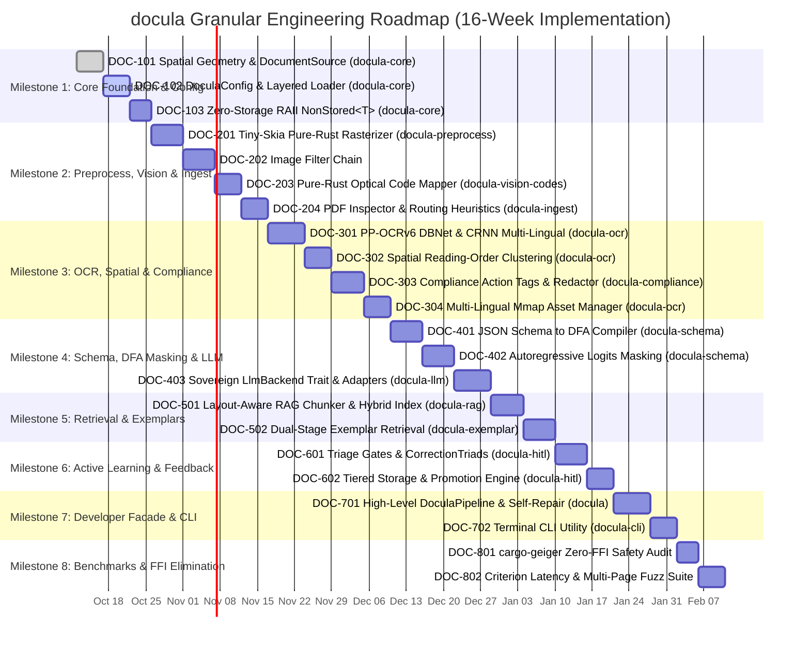

# Development Plan & Engineering Roadmap: `docula`

## 1. Executive Roadmap & Workspace Blueprint

This document specifies the end-to-end development roadmap for `docula`. The implementation is organized into an **8-Milestone phased execution model** across a 13-crate Cargo Monorepo Workspace.



---

## 2. Monorepo Structure & Package Manifests

```text
docula/
├── Cargo.toml                  # Workspace Manifest
├── Cargo.lock
├── README.md
├── Docula.toml                 # Default consumer configuration template
├── docs/                       # Comprehensive Architecture & Specification Suite
│   ├── 00_MASTER_SPECIFICATION.md
│   ├── 01_DEVELOPMENT_PLAN.md
│   ├── 02_DESIGN_PATTERNS_AND_ARCHITECTURE.md
│   ├── 03_INGESTION_AND_ROUTING.md
│   ├── 04_RASTERIZATION_AND_PREPROCESSING.md
│   ├── 05_OCR_AND_SPATIAL_EXTRACTION.md
│   ├── 06_LLM_AND_LOCAL_EMBEDDED_BACKENDS.md
│   ├── 07_STRUCTURED_EXTRACTION_AND_CONSTRAINED_DECODING.md
│   ├── 08_INVOICE_AND_GENERIC_SCHEMA_EXAMPLE.md
│   ├── 09_BENCHMARK_AND_COMPARISON.md
│   ├── 10_IMAGE_STITCHING_AND_DEDUPLICATION.md
│   ├── 11_RAG_AND_LARGE_DOCUMENT_RETRIEVAL.md
│   ├── 12_FEW_SHOT_AND_EXEMPLAR_MANAGEMENT.md
│   ├── 13_HUMAN_IN_THE_LOOP_AND_ACTIVE_LEARNING.md
│   ├── 14_COMPLIANCE_NON_STORING_AND_OPTICAL_CODES.md
│   ├── 15_CONSUMER_CONFIGURATION_AND_TOML.md
│   └── 16_MULTI_LINGUAL_OCR_AND_ASSET_MANAGEMENT.md
├── data/
│   ├── corrections/            # Tier 1: Cold Storage (Append-only immutable JSONL)
│   └── examples/               # Tier 2: Curated Few-Shot Pool
├── crates/
│   ├── docula-core/            # Core primitives, BoundingBox, NonStored<T>, DoculaConfig
│   ├── docula-preprocess/      # Tiny-skia rendering, Hough deskew, binarization, stitching
│   ├── docula-vision-codes/    # Pure-Rust rxing 1D & QR barcode detector
│   ├── docula-schema/          # schemars JSON Schema reflection, typedlm DFA masking
│   ├── docula-ingest/          # lopdf hierarchy inspection, routing heuristics
│   ├── docula-ocr/             # PP-OCRv6 DBNet detection, CRNN 50-language recognition
│   ├── docula-compliance/      # Spatial blackout, PII sanitization, action directives
│   ├── docula-llm/             # oxibonsai 1-bit, candle, tract, remote adapters
│   ├── docula-rag/             # Optional table-aware chunking and HNSW vector store
│   ├── docula-exemplar/        # Dual-stage retrieval, template pairing, few-shot builder
│   ├── docula-hitl/            # Active learning flywheel, triage gates, correction triads
│   ├── docula/                 # High-level developer facade offering typed API
│   └── docula-cli/             # Sovereign command-line tool
└── tests/
    ├── fixtures/               # Test PDFs, bills, receipts, QR invoices
    └── integration_tests/      # End-to-end integration and fuzz suites
```

---

## 3. Detailed Milestone & Single-Responsibility Ticket Breakdown

### Milestone 1: Core Foundation & Consumer Configuration (`docula-core`)

#### Ticket DOC-101: Spatial Coordinate Primitives & Universal Input Abstraction
* **Reference Spec:** [`03_INGESTION_AND_ROUTING.md`](file:///Users/yasuomaidana/RustRoverProjects/docula/docs/03_INGESTION_AND_ROUTING.md)
* **Single Responsibility:** Implement spatial geometry primitives (`BoundingBox`, `Point`, `SpatialSpan`, `Polygon`) and universal input source `DocumentSource`.
* **Design Pattern:** **Value Object Pattern** (immutable, normalized spatial coordinates $[0.0, 1.0]$).
* **Structures:**
  ```rust
  pub struct Point { pub x: f32, pub y: f32 }
  pub struct BoundingBox { pub top_left: Point, pub bottom_right: Point }
  pub enum DocumentSource {
      PdfBytes(Vec<u8>),
      PdfPath(PathBuf),
      ImageBytes(Vec<u8>),
      ImagePath(PathBuf),
      BatchImages(Vec<DynamicImage>),
  }
  ```
* **Acceptance Criteria:**
  1. `BoundingBox::area()`, `intersection()`, and `union()` calculate geometric overlaps.
  2. `DocumentSource` supports zero-copy byte slices and file paths.
  3. `BoundingBox` implements `Serialize` and `Deserialize`.
* **Test Scenarios:**
  * `test_bbox_intersection_disjoint`: Non-overlapping boxes return `None`.
  * `test_bbox_intersection_contained`: Nested box returns inner box.
  * `test_document_source_from_bytes`: Construct `DocumentSource::PdfBytes` and verify byte payload integrity.

#### Ticket DOC-102: Consumer-Driven `DoculaConfig` & Layered Loader
* **Reference Spec:** [`15_CONSUMER_CONFIGURATION_AND_TOML.md`](file:///Users/yasuomaidana/RustRoverProjects/docula/docs/15_CONSUMER_CONFIGURATION_AND_TOML.md)
* **Single Responsibility:** Create `DoculaConfig` and `DoculaConfigBuilder` allowing consumers to configure pipeline settings programmatically or via TOML strings/files.
* **Design Pattern:** **Builder Pattern** and **Layered Configuration Pattern**.
* **Structures:**
  ```rust
  #[derive(Clone, Debug, Serialize, Deserialize)]
  pub struct DoculaConfig {
      pub general: GeneralConfig,
      pub exemplars: ExemplarConfig,
      pub hitl: HitlConfig,
      pub compliance: ComplianceConfig,
      pub ocr: OcrConfig,
  }
  ```
* **Acceptance Criteria:**
  1. `DoculaConfig::default()` provides in-memory defaults with zero required filesystem access.
  2. `DoculaConfig::from_toml_str(toml)` parses custom configuration strings.
  3. `DoculaConfig::from_file(path)` loads from an arbitrary consumer-specified path.
  4. Builder supports fluent overrides (`builder.with_triage_confidence(0.90)`).
* **Test Scenarios:**
  * `test_config_default_is_valid`: Verify default values match documented invariants without disk I/O.
  * `test_config_builder_overrides`: Set custom pool directory and assert it overrides the default.
  * `test_config_from_toml_str_malformed`: Pass malformed TOML and assert typed `ConfigError::ParseFailure`.

#### Ticket DOC-103: Zero-Storage RAII Smart Pointer `NonStored<T>`
* **Reference Spec:** [`14_COMPLIANCE_NON_STORING_AND_OPTICAL_CODES.md`](file:///Users/yasuomaidana/RustRoverProjects/docula/docs/14_COMPLIANCE_NON_STORING_AND_OPTICAL_CODES.md)
* **Single Responsibility:** Create `NonStored<T>` wrapper that implements `Deref`, zeroes memory on drop, and is omitted from persistent serialization.
* **Design Pattern:** **RAII Smart Pointer Pattern** & **Type-Level Erasure**.
* **Structures:**
  ```rust
  #[derive(Clone, Debug)]
  pub struct NonStored<T: Zeroize>(pub T);
  ```
* **Acceptance Criteria:**
  1. Implements `Deref<Target = T>` and `DerefMut<Target = T>`.
  2. Implements `ZeroizeOnDrop` to scrub memory when dropped.
  3. Custom `Serialize` implementation outputs nothing or skips serialization.
  4. Custom `Deserialize` allows instantiating the field from LLM JSON responses.
* **Test Scenarios:**
  * `test_non_stored_deref`: Read wrapped string value seamlessly.
  * `test_non_stored_serde_skip`: Serialize struct containing `NonStored<String>`; verify field is absent from JSON output.
  * `test_non_stored_zeroize_on_drop`: Verify byte buffer is zeroed out upon destruction.

---

### Milestone 2: Preprocessing, Optical Codes & Ingestion (`docula-preprocess`, `docula-vision-codes`, `docula-ingest`)

#### Ticket DOC-201: Pure-Rust PDF Rasterization Bridge
* **Reference Spec:** [`04_RASTERIZATION_AND_PREPROCESSING.md`](file:///Users/yasuomaidana/RustRoverProjects/docula/docs/04_RASTERIZATION_AND_PREPROCESSING.md)
* **Single Responsibility:** Render PDF pages into memory-backed RGBA pixmaps using `pdf_oxide` (`tiny-skia` renderer).
* **Design Pattern:** **Strategy Pattern** (concrete rasterization strategy).
* **Structures:**
  ```rust
  pub struct TinySkiaRasterizer;
  impl Rasterizer for TinySkiaRasterizer {
      fn render_page(&self, pdf_bytes: &[u8], page_idx: usize, dpi: u32) -> Result<RgbaImage, PreprocessError>;
  }
  ```
* **Acceptance Criteria:**
  1. Renders single and multi-page PDFs to memory buffers at configurable DPI (150/300 DPI).
  2. Zero linkage against Poppler, MuPDF, or external C dynamic libraries.
  3. Fails cleanly with `PreprocessError::InvalidPdf` on corrupt input.
* **Test Scenarios:**
  * `test_render_single_page_pdf`: Render 1-page sample at 300 DPI; assert resulting dimensions match expected pixels.
  * `test_render_invalid_pdf_bytes`: Pass random bytes; assert graceful error return.

#### Ticket DOC-202: Image Filter Chain (Hough Deskew, Adaptive Binarization, SIMD Resize)
* **Reference Spec:** [`04_RASTERIZATION_AND_PREPROCESSING.md`](file:///Users/yasuomaidana/RustRoverProjects/docula/docs/04_RASTERIZATION_AND_PREPROCESSING.md)
* **Single Responsibility:** Implement modular image filter passes using `imageproc` and `fast_image_resize`.
* **Design Pattern:** **Chain of Responsibility Pattern**.
* **Structures:**
  ```rust
  pub trait ImageFilter: Send + Sync {
      fn apply(&self, img: &mut RgbaImage) -> Result<(), PreprocessError>;
  }
  pub struct PreprocessingFilterChain {
      filters: Vec<Box<dyn ImageFilter>>,
  }
  ```
* **Acceptance Criteria:**
  1. `HoughDeskewFilter` detects angles between $-45^\circ$ and $+45^\circ$ and rotates within $\pm 0.5^\circ$ accuracy.
  2. `AdaptiveBinarizeFilter` removes shadows and normalizes uneven lighting.
  3. `SimdResizeFilter` rescales images using AVX2/NEON intrinsics without memory leaks.
* **Test Scenarios:**
  * `test_deskew_rotated_image`: Pass image rotated by $15^\circ$; assert detected angle is $15^\circ \pm 0.5^\circ$.
  * `test_simd_resize_aspect_ratio`: Scale $1920\times 1080$ to width 960; verify height is 540.

#### Ticket DOC-203: Pure-Rust Optical Code Spatial Detector (`docula-vision-codes`)
* **Reference Spec:** [`14_COMPLIANCE_NON_STORING_AND_OPTICAL_CODES.md`](file:///Users/yasuomaidana/RustRoverProjects/docula/docs/14_COMPLIANCE_NON_STORING_AND_OPTICAL_CODES.md)
* **Single Responsibility:** Detect QR codes and 1D barcodes on rendered images using `rxing` and extract bounding boxes and payloads.
* **Design Pattern:** **Strategy Pattern** & **Adapter Pattern** (adapting `rxing` results to `docula-core` geometry).
* **Structures:**
  ```rust
  pub struct OpticalCodeResult {
      pub code_type: CodeType,
      pub payload: String,
      pub bbox: BoundingBox,
  }
  ```
* **Acceptance Criteria:**
  1. Detects QR, Aztec, PDF417, and Code 128 barcodes.
  2. Returns normalized bounding box coordinates matching the page coordinate space.
  3. Returns decoded text payloads.
* **Test Scenarios:**
  * `test_detect_qr_code`: Pass image with QR code containing `"https://example.com"`; assert payload and bbox.
  * `test_detect_no_barcode`: Pass plain text image; assert empty result vector without error.

#### Ticket DOC-204: PDF Object Tree Inspector & Routing Classifier (`docula-ingest`)
* **Reference Spec:** [`03_INGESTION_AND_ROUTING.md`](file:///Users/yasuomaidana/RustRoverProjects/docula/docs/03_INGESTION_AND_ROUTING.md)
* **Single Responsibility:** Inspect PDF object trees with `lopdf` to classify pages as born-digital or rasterized.
* **Design Pattern:** **Routing Heuristic / Decision Strategy Pattern**.
* **Structures:**
  ```rust
  pub enum PageRoute {
      BornDigital { text_layer: Vec<SpatialSpan> },
      NeedsOcr { raster_job: RasterJob },
  }
  pub struct DocumentRouter;
  ```
* **Acceptance Criteria:**
  1. Checks for font descriptors and `/ToUnicode` stream integrity.
  2. Corrupted `/ToUnicode` streams are routed to `NeedsOcr`.
  3. Uncorrupted digital text is routed to `BornDigital` fast-path.
* **Test Scenarios:**
  * `test_route_born_digital_pdf`: Verify text PDF routes to `BornDigital`.
  * `test_route_scanned_receipt_pdf`: Verify scanned PDF routes to `NeedsOcr`.
  * `test_route_corrupt_tounicode`: Verify PDF with missing `/ToUnicode` routes to `NeedsOcr`.

---

### Milestone 3: Multi-Lingual OCR, Reading-Order Clustering & Compliance (`docula-ocr`, `docula-compliance`)

#### Ticket DOC-301: PP-OCRv6 Neural Text Detection & Recognition (`docula-ocr`)
* **Reference Spec:** [`05_OCR_AND_SPATIAL_EXTRACTION.md`](file:///Users/yasuomaidana/RustRoverProjects/docula/docs/05_OCR_AND_SPATIAL_EXTRACTION.md)
* **Single Responsibility:** Execute DBNet text detection and CRNN character recognition across 50 languages using `rusto-rs` and `rayon`.
* **Design Pattern:** **Strategy Pattern** (concrete `OcrEngine` implementation).
* **Structures:**
  ```rust
  pub struct NeuralOcrEngine;
  impl OcrEngine for NeuralOcrEngine {
      fn extract_spans(&self, image: &RgbaImage) -> Result<Vec<SpatialSpan>, OcrError>;
  }
  ```
* **Acceptance Criteria:**
  1. DBNet detects text bounding polygons and returns unclipped bounding boxes.
  2. CRNN recognizes characters across English, Spanish, Japanese, Chinese, Arabic.
  3. Rayon parallelizes OCR inference across batches of bounding boxes.
* **Test Scenarios:**
  * `test_ocr_latin_text`: Recognize standard English invoice snippet with CER $< 1.5\%$.
  * `test_ocr_cjk_text`: Recognize Chinese/Japanese receipt sample.

#### Ticket DOC-302: Spatial Reading-Order Clustering & Coordinate Serialization
* **Reference Spec:** [`05_OCR_AND_SPATIAL_EXTRACTION.md`](file:///Users/yasuomaidana/RustRoverProjects/docula/docs/05_OCR_AND_SPATIAL_EXTRACTION.md)
* **Single Responsibility:** Group raw detected text spans into lines, cluster into columns, and generate layout-preserving text.
* **Design Pattern:** **Composite Pattern** (Spans $\to$ Lines $\to$ Blocks $\to$ `SpatialLayoutMap`).
* **Structures:**
  ```rust
  pub struct SpatialLayoutMap {
      pub lines: Vec<TextLine>,
      pub page_dimensions: (u32, u32),
  }
  ```
* **Acceptance Criteria:**
  1. Horizontal text clustering groups spans within character-spacing tolerance into lines.
  2. Preserves tabular columns by snapping bounding boxes to vertical alignment boundaries.
  3. Output serialization formats spatial layout cleanly for LLM comprehension.
* **Test Scenarios:**
  * `test_table_reading_order`: Verify table with 3 columns is serialized row-by-row rather than column-stacked.
  * `test_multiline_invoice_header`: Verify invoice header lines are properly ordered from top to bottom.

#### Ticket DOC-303: Compliance Action Tag Processor & Pixel Blackout (`docula-compliance`)
* **Reference Spec:** [`14_COMPLIANCE_NON_STORING_AND_OPTICAL_CODES.md`](file:///Users/yasuomaidana/RustRoverProjects/docula/docs/14_COMPLIANCE_NON_STORING_AND_OPTICAL_CODES.md)
* **Single Responsibility:** Execute schema directives (`@censor`, `@mask`, `@decode`, `@ignore`) and sanitize PII.
* **Design Pattern:** **Command / Action Strategy Pattern**.
* **Structures:**
  ```rust
  pub enum ActionDirective { Censor, Mask, Decode, Ignore }
  pub struct ComplianceRedactor;
  impl ComplianceRedactor {
      pub fn apply_blackout(image: &mut RgbaImage, bbox: &BoundingBox);
      pub fn purge_text_spans(spans: &mut Vec<SpatialSpan>, bbox: &BoundingBox);
  }
  ```
* **Acceptance Criteria:**
  1. `@censor`: Overwrites pixels in bounding box with pure black (`[0, 0, 0, 255]`) and purges text spans from layout map.
  2. `@mask`: Extracts raw visual artifact without decoded text.
  3. `@decode`: Injects decoded optical payload into text layer and drops pixels.
  4. Deterministic regex masks IBANs, Credit Cards, and SSNs.
* **Test Scenarios:**
  * `test_blackout_boundary_pixels`: Assert pixel values inside bbox are `[0, 0, 0, 255]` and pixels outside remain untouched.
  * `test_purge_text_span_overlap`: Assert spans falling inside censored bbox are removed from layout.

#### Ticket DOC-304: Multi-Lingual Mmap Asset Manager & Feature Gating (`docula-ocr`)
* **Reference Spec:** [`16_MULTI_LINGUAL_OCR_AND_ASSET_MANAGEMENT.md`](file:///Users/yasuomaidana/RustRoverProjects/docula/docs/16_MULTI_LINGUAL_OCR_AND_ASSET_MANAGEMENT.md)
* **Single Responsibility:** Manage OCR weights and dictionaries via zero-copy memory mapping (`memmap2`) and feature gating (`ocr-latin` vs `ocr-multilingual`).
* **Design Pattern:** **Flyweight / Memory-Mapped Asset Manager Pattern**.
* **Structures:**
  ```rust
  pub struct LanguageAssetManager {
      model_cache: HashMap<String, Arc<Mmap>>,
  }
  ```
* **Acceptance Criteria:**
  1. Compiling with default `ocr-latin` excludes heavy multi-lingual dictionaries.
  2. Compiling with `ocr-multilingual` enables 50-language dictionary with lazy memory mapping.
  3. Process RSS remains below 150 MB during idle state.
* **Test Scenarios:**
  * `test_mmap_lazy_init`: Memory is mapped only when first recognition query executes.
  * `test_custom_model_dir_override`: Load weights from custom path provided in `DoculaConfig`.

---

### Milestone 4: Schema Reflection, DFA Logits Masking & LLM Backends (`docula-schema`, `docula-llm`)

#### Ticket DOC-401: Dynamic JSON Schema to DFA State Machine Compiler (`docula-schema`)
* **Reference Spec:** [`07_STRUCTURED_EXTRACTION_AND_CONSTRAINED_DECODING.md`](file:///Users/yasuomaidana/RustRoverProjects/docula/docs/07_STRUCTURED_EXTRACTION_AND_CONSTRAINED_DECODING.md)
* **Single Responsibility:** Compile `schemars` JSON Schema AST into a Deterministic Finite Automaton (DFA) state machine.
* **Design Pattern:** **Visitor Pattern** (traversing schema AST) & **State Machine Pattern** (DFA tracking).
* **Structures:**
  ```rust
  pub struct DfaStateMachine;
  impl DfaStateMachine {
      pub fn from_json_schema(schema: &serde_json::Value) -> Result<Self, SchemaError>;
      pub fn advance(&mut self, token: TokenId) -> Result<(), DfaError>;
      pub fn allowed_tokens(&self, vocab: &Vocabulary) -> BitSet;
  }
  ```
* **Acceptance Criteria:**
  1. Recursively compiles objects, arrays, strings, numbers, booleans, and enums into DFA transitions.
  2. Queries vocabulary to return a bitset of valid next tokens for any DFA state.
* **Test Scenarios:**
  * `test_dfa_nested_object_compilation`: Compile struct with nested fields; verify initial state permits `{`.
  * `test_dfa_invalid_transition`: Attempt to advance with an invalid token; assert transition failure.

#### Ticket DOC-402: Token Logits Masking Processor (`docula-schema`)
* **Reference Spec:** [`07_STRUCTURED_EXTRACTION_AND_CONSTRAINED_DECODING.md`](file:///Users/yasuomaidana/RustRoverProjects/docula/docs/07_STRUCTURED_EXTRACTION_AND_CONSTRAINED_DECODING.md)
* **Single Responsibility:** Intercept autoregressive LLM token logits and set invalid out-of-grammar token logits to $-\infty$.
* **Design Pattern:** **Decorator / Interceptor Pattern**.
* **Structures:**
  ```rust
  pub struct DfaLogitsProcessor { state_machine: DfaStateMachine }
  impl LogitsProcessor for DfaLogitsProcessor {
      fn process_logits(&mut self, logits: &mut [f32], vocab: &Vocabulary);
  }
  ```
* **Acceptance Criteria:**
  1. Invalid tokens according to DFA state receive $-\infty$ (`f32::NEG_INFINITY`).
  2. Valid tokens retain their raw logit scores.
  3. DFA state advances when the sampled token is confirmed.
* **Test Scenarios:**
  * `test_masking_disallows_illegal_tokens`: Tokens not in the grammar bitset are masked to $-\infty$.
  * `test_complete_token_sequence_yields_valid_json`: Generate simulated token stream; assert `serde_json::from_str` succeeds.

#### Ticket DOC-403: Sovereign LLM Backend Trait and Dispatcher (`docula-llm`)
* **Reference Spec:** [`06_LLM_AND_LOCAL_EMBEDDED_BACKENDS.md`](file:///Users/yasuomaidana/RustRoverProjects/docula/docs/06_LLM_AND_LOCAL_EMBEDDED_BACKENDS.md)
* **Single Responsibility:** Define `LlmBackend` trait and provide pure-Rust implementations (`oxibonsai` 1-bit, `candle` GGUF, `tract` ONNX).
* **Design Pattern:** **Strategy Pattern**.
* **Structures:**
  ```rust
  #[async_trait]
  pub trait LlmBackend: Send + Sync {
      async fn complete(
          &self,
          prompt: &str,
          logits_processor: Option<&mut dyn LogitsProcessor>,
      ) -> Result<String, LlmError>;
  }
  ```
* **Acceptance Criteria:**
  1. Feature flags `local-embedded` (`oxibonsai`), `local-candle`, `local-onnx` compile cleanly.
  2. Pass `LogitsProcessor` dynamically into autoregressive generation loops.
  3. Air-gapped execution with zero network socket allocation in local modes.
* **Test Scenarios:**
  * `test_mock_llm_backend`: Test prompt completion using deterministic mock backend.
  * `test_logits_processor_called_per_token`: Verify logits processor is invoked on every generated token.

---

### Milestone 5: Optional Retrieval & Few-Shot Management (`docula-rag`, `docula-exemplar`)

#### Ticket DOC-501: Layout-Aware Table Chunker & Pure-Rust Embedder (`docula-rag`)
* **Reference Spec:** [`11_RAG_AND_LARGE_DOCUMENT_RETRIEVAL.md`](file:///Users/yasuomaidana/RustRoverProjects/docula/docs/11_RAG_AND_LARGE_DOCUMENT_RETRIEVAL.md)
* **Single Responsibility:** Chunk 10–100+ page document sets while preserving table grid structures, and compute dense vector embeddings using `candle-core`.
* **Design Pattern:** **Chunker Strategy Pattern**.
* **Structures:**
  ```rust
  pub struct SpatialChunker;
  pub struct RagChunk { pub page_idx: usize, pub content: String, pub bbox: BoundingBox }
  ```
* **Acceptance Criteria:**
  1. Preserves table cells without splitting table rows across arbitrary token boundaries.
  2. Pure-Rust embedding generation (`bge-small` / `all-MiniLM`) using `candle`.
* **Test Scenarios:**
  * `test_chunk_preserves_table_grid`: Verify multi-column table stays in a single chunk.
  * `test_embedding_dimension`: Assert generated vector matches expected dimension (e.g. 384-d).

#### Ticket DOC-502: Dual-Stage Exemplar Retrieval Engine (`docula-exemplar`)
* **Reference Spec:** [`12_FEW_SHOT_AND_EXEMPLAR_MANAGEMENT.md`](file:///Users/yasuomaidana/RustRoverProjects/docula/docs/12_FEW_SHOT_AND_EXEMPLAR_MANAGEMENT.md)
* **Single Responsibility:** Implement Stage 1 fast geometric fingerprint matching (<1ms) and Stage 2 HNSW vector fallback for few-shot prompt injection.
* **Design Pattern:** **Dual-Stage Hierarchical Cache Pattern**.
* **Structures:**
  ```rust
  pub struct ExemplarRetriever;
  impl ExemplarRetriever {
      pub fn retrieve_exemplars(&self, layout: &SpatialLayoutMap, top_k: usize) -> Vec<ExemplarPair>;
  }
  ```
* **Acceptance Criteria:**
  1. Stage 1 computes 64-bit spatial layout fingerprint and executes Hamming distance match ($< 500\,\mu\text{s}$).
  2. Stage 2 executes HNSW cosine similarity search when Stage 1 does not hit.
  3. Dynamic prompt builder caps injected exemplars to 1–2 examples to prevent prompt bloat.
* **Test Scenarios:**
  * `test_stage1_fingerprint_exact_match`: Match identical layout within $< 100\,\mu\text{s}$.
  * `test_stage2_hnsw_fallback`: Query altered layout; verify fallback retrieves nearest semantic exemplar.

---

### Milestone 6: Active Learning & Feedback (`docula-hitl`)

#### Ticket DOC-601: Automated Triage Gates & Validation Failure Interceptor (`docula-hitl`)
* **Reference Spec:** [`13_HUMAN_IN_THE_LOOP_AND_ACTIVE_LEARNING.md`](file:///Users/yasuomaidana/RustRoverProjects/docula/docs/13_HUMAN_IN_THE_LOOP_AND_ACTIVE_LEARNING.md)
* **Single Responsibility:** Intercept extractions failing confidence thresholds or domain validation, and flag for review.
* **Design Pattern:** **Gatekeeper / Interceptor Pattern**.
* **Structures:**
  ```rust
  pub struct TriageGate {
      min_confidence: f32,
  }
  impl TriageGate {
      pub fn evaluate(&self, confidence: f32, validation_res: &Result<(), ValidationError>) -> TriageDecision;
  }
  ```
* **Acceptance Criteria:**
  1. Token confidence $< \text{threshold}$ triggers triage.
  2. `InvorcValidate` failures route to human review queue.
* **Test Scenarios:**
  * `test_triage_low_confidence`: Confidence 0.75 triggers `TriageDecision::ReviewRequired`.
  * `test_triage_validation_fail`: Failed arithmetic triggers `TriageDecision::ReviewRequired`.

#### Ticket DOC-602: Immutable `CorrectionTriad` Capture & Tiered Storage Engine (`docula-hitl`)
* **Reference Spec:** [`13_HUMAN_IN_THE_LOOP_AND_ACTIVE_LEARNING.md`](file:///Users/yasuomaidana/RustRoverProjects/docula/docs/13_HUMAN_IN_THE_LOOP_AND_ACTIVE_LEARNING.md)
* **Single Responsibility:** Record immutable review triads in cold archive and enforce promotion thresholds before updating curated few-shot pool.
* **Design Pattern:** **Event Sourcing / Immutable Triad Pattern**.
* **Structures:**
  ```rust
  pub struct CorrectionTriad {
      pub triad_id: Uuid,
      pub timestamp: DateTime<Utc>,
      pub source_sha256: String,
      pub spatial_ocr_text: String,
      pub erroneous_json: Value,
      pub ground_truth_json: Value,
      pub rfc6902_diff: Value,
  }
  ```
* **Acceptance Criteria:**
  1. Captures immutable `CorrectionTriad` with SHA-256 integrity hash.
  2. Stores records in cold archive (`/data/corrections/`) as append-only JSONL.
  3. Requires recurrence threshold ($N \ge 3$) before promoting to curated pool (`/data/examples/`).
* **Test Scenarios:**
  * `test_triad_immutability_checksum`: Verify SHA-256 matches input artifact.
  * `test_promotion_policy_enforcement`: Attempt promotion with $N=1$; assert promotion rejected.

---

### Milestone 7: Developer Surface, Self-Repair & CLI (`docula`, `docula-cli`)

#### Ticket DOC-701: High-Level `DoculaPipeline` Facade & Self-Repair Loop (`docula`)
* **Reference Spec:** [`00_MASTER_SPECIFICATION.md`](file:///Users/yasuomaidana/RustRoverProjects/docula/docs/00_MASTER_SPECIFICATION.md)
* **Single Responsibility:** Provide `DoculaPipeline` and `extract_structure::<T>()` coordinating ingestion, OCR, LLM, validation, and self-repair.
* **Design Pattern:** **Facade Pattern**, **Typestate Pattern**, and **Template Method (Self-Repair)**.
* **Structures:**
  ```rust
  pub struct DoculaPipeline {
      config: DoculaConfig,
      backend: Arc<dyn LlmBackend>,
      ocr: Arc<dyn OcrEngine>,
  }
  impl DoculaPipeline {
      pub fn builder() -> DoculaPipelineBuilder;
      pub async fn extract<T: DeserializeOwned + JsonSchema>(&self, source: &DocumentSource) -> Result<T, DoculaError>;
  }
  ```
* **Acceptance Criteria:**
  1. Accepts `DoculaConfig` programmatically via builder.
  2. Orchestrates end-to-end two-step pipeline.
  3. If `T` implements `InvorcValidate`, executes validation and triggers path-targeted repair prompt on failure up to $N$ retries.
  4. If `T` does not implement `InvorcValidate`, returns raw output with zero validation overhead.
* **Test Scenarios:**
  * `test_end_to_end_invoice_extraction`: Extract strongly typed `InvoiceData` from sample document.
  * `test_self_repair_loop_arithmetic_mismatch`: Intentionally cause line items sum $\ne$ total; verify repair prompt triggers and repairs value.
  * `test_pipeline_with_custom_in_memory_config`: Instantiate pipeline with non-default config; assert custom thresholds are respected.

#### Ticket DOC-702: Autonomous Terminal CLI Utility (`docula-cli`)
* **Reference Spec:** [`01_DEVELOPMENT_PLAN.md`](file:///Users/yasuomaidana/RustRoverProjects/docula/docs/01_DEVELOPMENT_PLAN.md)
* **Single Responsibility:** Implement command-line tool for CLI document extraction, batch processing, and triage queue inspection.
* **Design Pattern:** **Command Pattern**.
* **Acceptance Criteria:**
  1. Supports `docula extract --input invoice.pdf --schema schema.json --output out.json`.
  2. Supports `docula triage list` and `docula triage promote <id>`.
  3. Returns standard exit codes and formats errors via `tracing-subscriber`.
* **Test Scenarios:**
  * `test_cli_extract_file`: Run extraction command against test PDF fixture.
  * `test_cli_missing_file`: Assert error code 1 when input file does not exist.

---

### Milestone 8: Performance Optimization, FFI Elimination Audit & Benchmarks

#### Ticket DOC-801: `cargo-geiger` Zero-FFI Safety Audit
* **Reference Spec:** [`09_BENCHMARK_AND_COMPARISON.md`](file:///Users/yasuomaidana/RustRoverProjects/docula/docs/09_BENCHMARK_AND_COMPARISON.md)
* **Single Responsibility:** Audit all crates in the workspace to guarantee 0 foreign C libraries linked dynamically.
* **Acceptance Criteria:**
  1. `cargo-geiger` verifies 0 non-Rust dynamic links.
  2. All unsafe blocks in pure-Rust image intrinsics are documented with safety comments.

#### Ticket DOC-802: Criterion End-to-End Latency & Throughput Benchmark Suite
* **Reference Spec:** [`09_BENCHMARK_AND_COMPARISON.md`](file:///Users/yasuomaidana/RustRoverProjects/docula/docs/09_BENCHMARK_AND_COMPARISON.md)
* **Single Responsibility:** Profile end-to-end latency across single invoices, multi-page bills, and multi-image batches.
* **Acceptance Criteria:**
  1. Single-page born-digital PDF completes in $< 15\,\text{ms}$.
  2. Scanned receipt OCR + 1-bit LLM completes in $< 1.2\,\text{s}$ on standard CPU.
