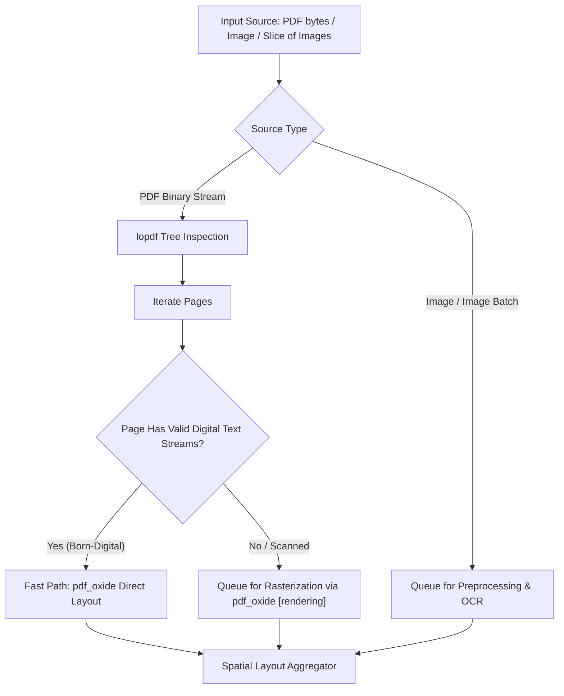

# Module 01: Ingestion & Intelligent Routing

## 1. Overview & Purpose

The **Ingestion & Intelligent Routing** module is the entry point for all incoming document artifacts. Financial and operational documents arrive in varied forms:
- Single-page raster images (JPEG, PNG, WebP, TIFF).
- Multi-page raster images or collections of images (e.g., photo sets of a multi-page invoice).
- Born-digital PDFs containing structured text streams and embedded fonts.
- Scanned PDFs containing only embedded images with no text layer.
- Hybrid PDFs where some pages have digital text and others are scanned attachments or receipts.

Running a full rasterization + deep learning OCR pipeline on every single page is computationally wasteful. The Ingestion & Routing module inspects incoming payloads, unpacks PDF hierarchies, detects text layer presence, and dispatches each page to either a **Fast-Path Spatial Text Extractor** or an **Image Preprocessing & OCR Pipeline**.



---

## 2. Technical Stack & Pure-Rust Dependencies

| Crate       | Version Target                 | Purpose                                                                                         |
|:------------|:-------------------------------|:------------------------------------------------------------------------------------------------|
| `pdf_oxide` | `^0.2` (features: `rendering`) | High-performance pure-Rust PDF parser, layout extractor, and `tiny-skia` based page rasterizer. |
| `lopdf`     | `^0.33` (Optional/Internal)    | Low-level PDF dictionary inspection, cross-reference repair, and object graph analysis.         |
| `image`     | `^0.25`                        | Native Rust decoding and representation of raster formats (PNG, JPEG, TIFF, BMP).               |
| `rayon`     | `^1.10`                        | Parallel page inspection and processing across multi-core CPUs.                                 |

---

## 3. Detailed Architecture & Mechanisms

### 3.1 Input Abstraction: `DocumentSource`

To handle single PDFs, single images, and collections of images uniformly, the module defines the `DocumentSource` enum and `DocumentPage` representation:

```rust
use std::path::PathBuf;

pub enum DocumentSource {
    PdfBytes(Vec<u8>),
    PdfPath(PathBuf),
    ImageBytes { format: ImageFormat, data: Vec<u8> },
    ImagePath(PathBuf),
    ImageBatch(Vec<DocumentSource>),
}

pub enum PageContent {
    /// Born-digital page text with native bounding boxes
    Digital(NativePageText),
    /// Page requires rasterization and deep learning OCR
    ScannedPdfPage { page_num: u32, pdf_data: Vec<u8> },
    /// Raw raster image ready for preprocessing
    RawImage(image::DynamicImage),
}
```

### 3.2 PDF Object Tree Inspection (`lopdf`)

When a PDF is received, `lopdf::Document::load_mem` inspects the internal object model:
1. **Catalog & Pages Traversal:** Extract page objects and their associated `/Contents` and `/Resources` dictionaries.
2. **Font & ToUnicode Evaluation:** Inspect whether fonts contain valid `ToUnicode` mapping streams. In many corrupted or legacy PDFs, text is encoded with custom glyph indices lacking Unicode mappings; these must be marked as scanned.
3. **Text Density vs. Image XObjects:** Calculate the ratio of text extraction operators (`Tj`, `TJ`, `'`, `"`) against `/XObject` `/Subtype /Image` occurrences.

```rust
pub fn evaluate_pdf_page(doc: &lopdf::Document, page_id: lopdf::ObjectId) -> PageRoutingDecision {
    if let Ok(page_dict) = doc.get_object(page_id).and_then(|obj| obj.as_dict()) {
        // Check for content stream text operators
        let has_text_streams = inspect_content_streams(doc, page_dict);
        let has_embedded_images = inspect_xobject_images(doc, page_dict);
        
        if has_text_streams && !is_tounicode_corrupted(doc, page_dict) {
            PageRoutingDecision::DirectDigitalExtraction
        } else if has_embedded_images || !has_text_streams {
            PageRoutingDecision::RasterizeAndOcr
        } else {
            PageRoutingDecision::RasterizeAndOcr
        }
    } else {
        PageRoutingDecision::RasterizeAndOcr
    }
}
```

### 3.3 Fast-Path Spatial Extraction (`pdfsink-rs` / `pdf_oxide`)

For born-digital pages:
- Direct spatial extractors evaluate bounding boxes of individual glyph runs.
- They merge bounding boxes into words, lines, and table cells (using segment snapping: `edges -> snap/merge -> intersections -> cells`).
- This bypasses image rendering and OCR entirely, delivering instantaneous layout-preserved text blocks in sub-millisecond execution times.

---

## 4. Module Deliverables & Outputs

The Ingestion & Routing module outputs a vector of `RoutedPageTask` objects:

```rust
pub struct RoutedPageTask {
    pub page_index: usize,
    pub task_type: PageExecutionType,
}

pub enum PageExecutionType {
    /// Spatial text is already extracted directly from digital vector stream
    ReadyText(SpatialPageData),
    /// Needs rasterization (Module 02) followed by OCR (Module 03)
    RequiresRasterization { page_num: u32, doc_bytes: Vec<u8> },
    /// Image already decoded; needs preprocessing (Module 02) and OCR (Module 03)
    RequiresOcr(image::DynamicImage),
}
```
