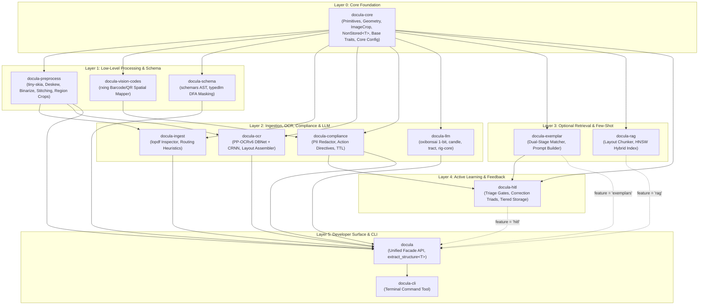

# Architecture Blueprint: Crate Topology, Design Patterns & Consumer Integration

## 1. Executive Summary & Monorepo Crate Architecture

`docula` is designed as a zero-FFI, sovereign, pure-Rust document intelligence engine. It is consumable both as an
embeddable Rust library crate (`docula`) and as an autonomous CLI utility (`docula-cli`).

To guarantee zero circular dependencies, high maintainability, fast incremental compilation, and strict encapsulation,
the codebase is partitioned into 13 crates organized across 6 hierarchical layers.

### Monorepo Crate Topology (Directed Acyclic Graph)



---

## 2. Crate Creation Order & Dependency Specification

The crates must be created in strict topological order to guarantee zero circular dependencies:

1. **`docula-core`**: Core primitives, `BoundingBox`, `Point`, `ImageCrop`, `RegionCropper`, `DocumentSource`,
   `NonStored<T>`, `DoculaConfig`, and foundational traits (`LlmBackend`, `OcrEngine`, `DocuValidate`).
2. **`docula-preprocess`**: Tiny-skia rasterization bridge, Hough deskew, adaptive binarization, SIMD scaling, keypoint
   stitching, sub-image region slicing and page screenshot extraction.
3. **`docula-vision-codes`**: Pure-Rust QR and 1D barcode detection via `rxing` and spatial coordinate mapping
   (scheduled for Milestone 7).
4. **`docula-schema`**: `schemars` JSON Schema AST reflection, `typedlm` DFA state machine compiler, and logits masking.
5. **`docula-ingest`**: PDF object inspection via `lopdf`, digital vs. raster routing heuristics, born-digital
   extraction.
6. **`docula-ocr`**: PP-OCRv6 neural text detection (DBNet) and 50-language character recognition (CRNN), reading-order
   line clustering.
7. **`docula-compliance`**: Spatial pixel blackout, PII sanitization regex, `@censor`/`@ignore`/`@non-storing` schema
   directives.
8. **`docula-llm`**: Local 1-bit `oxibonsai`, `candle` GGUF/VLM, `tract` ONNX, and remote adapters.
9. **`docula-rag`** *(optional)*: In-memory table-aware chunking and hybrid BM25/vector search for 10–100+ page document
   packets.
10. **`docula-exemplar`** *(optional)*: Dual-stage few-shot exemplar retrieval (Stage 1 geometric fingerprint, Stage 2
    HNSW fallback).
11. **`docula-hitl`** *(optional)*: Active learning flywheel, triage gates, immutable `CorrectionTriad` capture, tiered
    storage.
12. **`docula`** *(facade)*: Unified developer API surface, `DoculaPipeline`, `extract_structure::<T>()`, self-repair
    loop.
13. **`docula-cli`** *(binary)*: Command-line application tool.

---

## 3. Design Patterns Evaluation & Architecture Rationale

Applying the right design patterns in Rust requires leveraging Rust's unique strengths: ownership, affine type systems,
zero-cost abstractions, traits, and strict memory safety.

| Context & Component                      | Target Design Pattern                                       | Why This Pattern Aligns Best for the Context                                                                                                                                                                                 | Key Rust Idioms & Structures                                                                                           |
|:-----------------------------------------|:------------------------------------------------------------|:-----------------------------------------------------------------------------------------------------------------------------------------------------------------------------------------------------------------------------|:-----------------------------------------------------------------------------------------------------------------------|
| **Two-Step Processing Pipeline**         | **Typestate Pattern**                                       | Guarantees at compile time that documents cannot be processed out-of-order (e.g. attempting OCR on un-rasterized PDF buffers, or LLM inference on unmapped spatial text). Zero runtime overhead.                             | Phantom types: `Pipeline<Unprocessed>`, `Pipeline<Preprocessed>`, `Pipeline<SpatialReady>`, consuming `self` by value. |
| **Inference & OCR Engines**              | **Strategy Pattern**                                        | Allows swapping between local 1-bit (`oxibonsai`), pure-Rust GGUF/VLM (`candle`), pure-Rust ONNX (`tract`), or mock backends without touching pipeline logic. Supports both zero-cost monomorphization and dynamic dispatch. | `pub trait LlmBackend: Send + Sync { async fn complete(...) }`, `pub trait OcrEngine`.                                 |
| **Pipeline Configuration**               | **Builder Pattern**                                         | Prevents parameter explosion and allows fluent, validated pipeline setup with sensible defaults (DPI, thresholds, feature toggles).                                                                                          | `DoculaPipelineBuilder::new().with_dpi(300).with_deskew(true).build()?` with terminal validation.                      |
| **Developer API Surface**                | **Facade Pattern**                                          | Hides the complexity of 11 underlying sub-crates behind a single ergonomic one-liner (`docula::extract_structure::<T>()`).                                                                                                   | `docula::extract_structure::<T>(&source, &backend)` coordinating ingestion, OCR, schema, and LLM steps.                |
| **Image Preprocessing Filters**          | **Chain of Responsibility / Pipeline Pattern**              | Decouples distinct image transformations (deskew, binarization, SIMD resize, pixel blackout) into modular, independently testable filters that process pixels sequentially.                                                  | `pub trait ImageFilter { fn apply(&self, img: &mut RgbaImage) -> Result<()>; }`, `FilterChain`.                        |
| **Visual Region Cropping & Screenshots** | **Flyweight / Sub-Image Memory View Pattern**               | Allows taking full-page screenshots and cropping arbitrary spatial ROIs (signatures, seals, logos) without cloning entire page pixmaps in memory until export.                                                               | `image::GenericImageView::view`, `PageRasterBuffer::crop_region`, `pub struct ImageCrop`.                              |
| **JSON Schema to DFA Logits Masking**    | **Visitor & Interpreter Pattern**                           | Traverses complex recursive JSON Schema ASTs (`schemars::schema_for!`) to construct a deterministic finite automaton state machine that interprets schema rules into logits masks during token sampling.                     | `SchemaVisitor` traversing JSON schema nodes to generate `DfaStateMachine` transitions.                                |
| **Domain Validation & Self-Repair**      | **Template Method / Active Repair Loop Pattern**            | The framework defines the fixed algorithmic skeleton (Deserialize -> Check Invariants -> If Err, build targeted repair prompt -> Re-infer -> Validate up to $N$ retries), while the user struct supplies the hook.           | `pub trait DocuValidate { fn validate(&self) -> Result<(), ValidationError>; }`, repair loop runner.                   |
| **Exemplar Retrieval Hierarchy**         | **Dual-Stage Hierarchical Cache Pattern**                   | Guarantees sub-millisecond latency on CPU for repetitive document layouts. Stage 1 executes exact Vendor ID and 64-bit layout geometric fingerprint matching (<1ms); Stage 2 falls back to HNSW vector search only on miss.  | `Stage1Matcher` (Hamming distance on spatial bitsets) + `Stage2Matcher` (HNSW cosine similarity).                      |
| **Correction Triad Archival**            | **Append-Only Event Sourcing / Immutable Triad Pattern**    | Forensic immutability for active learning. Guarantees raw data lineage (Source SHA-256, OCR text, bad output, corrected ground truth, RFC 6902 diff) without risking prompt poisoning in the active pool.                    | `CorrectionTriad` struct with cryptographic checksum, append-only JSONL storage.                                       |
| **In-Memory Sensitive Fields**           | **RAII Smart Pointer / Zero-Copy Wrapper (`NonStored<T>`)** | Enables in-memory parsing and arithmetic validation for sensitive data (CVVs, temporary tokens) while strictly forbidding them from disk serialization or persistent storage.                                                | `pub struct NonStored<T>(T);` with `Deref`, `ZeroizeOnDrop`, and `Serialize` implemented as a no-op / skip.            |
| **Optical Codes & Action Tags**          | **Registry / Action Strategy Pattern**                      | Decouples spatial detection of barcodes and QR codes from business schema directives (`@decode`, `@censor`, `@ignore`).                                                                                                      | `ActionTagRegistry` dispatching bounding box transformations based on struct doc comments.                             |
| **Multi-Lingual Asset Management**       | **Flyweight / Memory-Mapped Asset Manager Pattern**         | Allows sharing massive multi-script neural weights across threads via `memmap2` without duplicating memory in RAM.                                                                                                           | `LanguageAssetManager` caching read-only `Arc<Mmap>` slices across workers.                                            |
| **Persistent Layer & Storage Engine**    | **Throwaway Containerized Test Isolation Pattern ([Testcontainers](https://rust.testcontainers.org))** | Eliminates mock drift and environmental divergence when testing cold archives, database adapters, and stateful storage. Guarantees real filesystem, socket, and storage semantics via ephemeral containers. | `testcontainers::runners::AsyncRunner`, `testcontainers::GenericImage`, `testcontainers-modules`. |

---

## 4. Consumer Configuration Strategy (Aligning TOML & Programmatic Injection)

### The Anti-Pattern

Relying on a static `./Docula.toml` file in the working directory breaks when `docula` is used as an embedded dependency
inside a web server, AWS Lambda, microservice, or desktop app. The consumer's working directory may not have write
permissions or may not contain that file.

### The Idiomatic Solution: Layered Configuration & Builder Injection

1. **First-Class Rust Type (`DoculaConfig`)**:
   `DoculaConfig` implements `Clone`, `Debug`, `Serialize`, `Deserialize`, and `Default`. Consumers can construct it
   programmatically via `DoculaConfigBuilder`.
2. **Multiple Loading Sources**:
    - `DoculaConfig::default()`: Safe in-memory defaults (no disk dependencies).
    - `DoculaConfig::builder()`: Programmatic fluent API.
    - `DoculaConfig::from_toml_str(&str)`: Embedded string / config mapping.
    - `DoculaConfig::from_file(path)`: Custom consumer-specified path.
    - `DoculaConfig::from_env()`: Environment variable overrides.
3. **Pipeline Injection**:
   ```rust
   let config = DoculaConfig::builder()
       .with_triage_confidence(0.90)
       .with_compliance_ttl(3600)
       .build();
   ```

---

## 5. Persistent Layer Architecture & Mandatory Testcontainers Verification

Docula integrates persistence at multiple critical interfaces:
- **`docula-hitl` Cold Storage Archive**: Immutable append-only event logs (`/data/corrections/` and remote object/database stores).
- **Curated Few-Shot Vector & Template Index**: Persistent HNSW vectors, SQLite/PostgreSQL metadata, and disk-backed indices.
- **Consumer Database Integrations**: Downstream database connections configured via `DoculaConfig`.

### The Testcontainers Testing Mandate ([rust.testcontainers.org](https://rust.testcontainers.org))
To guarantee forensic data integrity, ACID transactional behavior, and zero mock drift:
- **Mandatory for Persistence**: Integration tests verifying storage adapters, databases, object stores (e.g. MinIO), or vector repositories **MUST** use [Testcontainers for Rust](https://rust.testcontainers.org).
- **Ephemeral & Isolated**: Each test suite or test scenario provisions an isolated, throwaway container instance, avoiding cross-test pollution and host pollution.
- **Strict Prohibition of Mock-Only Storage Tests**: While unit tests may test serialization in isolation, any test claiming persistence or storage readiness without Testcontainers verification is considered incomplete work.
