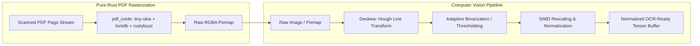

# Module 02: Rasterization & Image Preprocessing

## 1. Overview & Purpose

When a document page is classified as scanned or provided as a raw image, optical character recognition (OCR) models require high-contrast, normalized, and correctly oriented pixel tensors. Real-world documents exhibit physical degradation:
- Rotational skew (e.g., mobile camera captures, crooked scanner feeders).
- Low contrast, uneven lighting, shadows, and watermarks.
- Non-optimal resolution (DPI too low for fine tabular numerals or too high for neural inference throughput).

To adhere strictly to the zero-FFI, pure-Rust mandate, this module replaces C++ dependencies (`pdfium`, `poppler`, `OpenCV`, `Leptonica`) with pure-Rust crates (`pdf_oxide` [rendering], `imageproc`, `oximedia`, `fast_image_resize`).



---

## 2. Technical Stack & Pure-Rust Dependencies

| Crate               | Version Target                 | Purpose                                                                                           |
|:--------------------|:-------------------------------|:--------------------------------------------------------------------------------------------------|
| `pdf_oxide`         | `^0.2` (features: `rendering`) | Sovereign pure-Rust PDF parser and `tiny-skia` based high-fidelity rasterizer.                    |
| `imageproc`         | `^0.25`                        | Geometric transformations, Hough line detection, morphology, and filtering.                       |
| `oximedia`          | `^0.1`                         | Kitasan stack pure-Rust OpenCV replacement for color space conversions and adaptive thresholding. |
| `fast_image_resize` | `^5.0`                         | AVX2/AVX-512/NEON SIMD-accelerated image scaling and resampling with high edge preservation.      |
| `image`             | `^0.25`                        | Generic in-memory image buffer representation and color channel conversions.                      |

---

## 3. Detailed Architecture & Mechanisms

### 3.1 Pure-Rust PDF Rasterization (`pdf_oxide` with `tiny-skia`)

`pdf_oxide` includes a production-ready rendering pipeline built on `tiny-skia`, `fontdb`, and `rustybuzz`. It interprets PDF vector graphics, font glyph outlines, and inline raster images, rendering them directly into an RGBA pixmap or image buffer at arbitrary DPI without external C dependencies.

```rust
use pdf_oxide::{PdfDocument, RenderOptions};
use image::{DynamicImage, RgbaImage};

pub fn rasterize_pdf_page(pdf_bytes: &[u8], page_num: u32, target_dpi: f32) -> Result<DynamicImage, DocumentError> {
    let doc = PdfDocument::from_bytes(pdf_bytes)?;
    let page = doc.get_page(page_num)?;
    
    let render_opts = RenderOptions::builder()
        .dpi(target_dpi)
        .render_annotations(true)
        .build();
    
    let pixmap = page.render_pixmap(&render_opts)?;
    let rgba_img = RgbaImage::from_raw(pixmap.width(), pixmap.height(), pixmap.take_data())
        .ok_or(DocumentError::RasterizationError("Buffer size mismatch".into()))?;
        
    Ok(DynamicImage::ImageRgba8(rgba_img))
}
```

### 3.2 Deskewing via Hough Line Detection (`imageproc`)

Invoices with skewed text lines degrade character recognition and column bounding. The module estimates the dominant orientation angle using Hough line transformation on edge-detected text baselines and applies affine rotational correction.

```rust
use imageproc::hough::{detect_lines, LineDetectionOptions};
use imageproc::geometric_transformations::{rotate_about_center, Interpolation};
use image::GrayImage;

pub fn deskew_image(gray: &GrayImage) -> GrayImage {
    // Detect dominant lines (baselines of text and table borders)
    let options = LineDetectionOptions {
        vote_threshold: 120,
        suppression_radius: 8,
    };
    let lines = detect_lines(gray, options);
    
    // Calculate median angle of near-horizontal lines
    let mut angles: Vec<f32> = lines.iter()
        .map(|l| l.angle_in_degrees)
        .filter(|&a| (a >= -45.0 && a <= 45.0) || (a >= 135.0 && a <= 225.0))
        .collect();
        
    if angles.is_empty() {
        return gray.clone();
    }
    
    angles.sort_by(|a, b| a.partial_cmp(b).unwrap());
    let median_angle = angles[angles.len() / 2];
    let correction_radians = (-median_angle).to_radians();
    
    // Rotate with bilinear interpolation around image center
    rotate_about_center(gray, correction_radians, Interpolation::Bilinear, 255)
}
```

### 3.3 Adaptive Binarization (`oximedia` / `imageproc`)

To handle uneven lighting (e.g. mobile photo receipts with shadows), local Otsu or Bradley-Roth adaptive thresholding computes a local mean pixel intensity across a sliding window, converting the image to high-contrast binary black/white.

### 3.4 SIMD Resampling (`fast_image_resize`)

OCR detection models (such as DBNet) operate best at normalized input dimensions where text height is typically 16 to 48 pixels. `fast_image_resize` utilizes SIMD instructions (AVX2 on x86_64, NEON on ARM64/Apple Silicon) to rescale multi-megapixel images in milliseconds with zero CPU bottlenecks.

---

## 4. Module Deliverables & Outputs

The module outputs a normalized `PreprocessedImage`:

```rust
pub struct PreprocessedImage {
    pub original_width: u32,
    pub original_height: u32,
    pub processed_buffer: image::GrayImage,
    pub rgb_normalized_tensor: Vec<f32>, // Shape: [1, 3, H, W] for model inference
    pub scale_factor_x: f32,
    pub scale_factor_y: f32,
}
```
