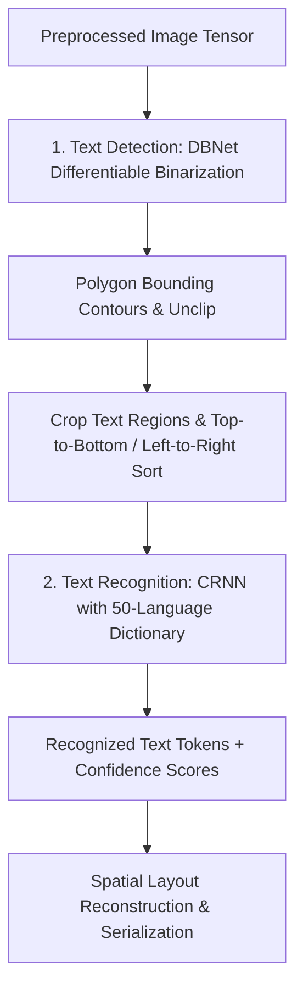

# Module 03: Multi-Lingual OCR & Spatial Extraction

## 1. Overview & Purpose

The **Multi-Lingual OCR & Spatial Extraction** module is the text recognition core of Step 1. It receives normalized image tensors, detects text polygon boundaries across complex layouts (dense invoice tables, multi-column bank statements), and recognizes character sequences across global languages.

Key operational requirements:
1. **Multi-Lingual Coverage:** Support 50+ languages simultaneously (Latin, Cyrillic, CJK, Devanagari, Arabic) in a single model pass without requiring manual language switching.
2. **Dense Tabular Detection:** Accurately delineate micro-fonts in line-item tables adjacent to large header titles.
3. **Spatial Preservation:** Maintain exact 2D bounding boxes $(x_0, y_0, x_1, y_1)$ to preserve spatial layout (e.g. proximity of "Total Due" to "$1,250.00").



---

## 2. Technical Stack & Pure-Rust Dependencies

| Crate      | Version Target            | Purpose                                                                                                                               |
|:-----------|:--------------------------|:--------------------------------------------------------------------------------------------------------------------------------------|
| `rusto-rs` | `^0.3`                    | Pure-Rust RapidOCR/PP-OCRv6 engine, zero-OpenCV, powered by Alibaba MNN lightweight inference backend. Native 50-language dictionary. |
| `ocrs`     | `^0.8` (Optional feature) | Pure-Rust lightweight OCR engine running on RTen backend (optimized for Latin-script fast inference).                                 |
| `rayon`    | `^1.10`                   | Concurrent batch inference across cropped text bounding boxes.                                                                        |

---

## 3. Detailed Architecture & Mechanisms

### 3.1 Two-Stage PP-OCRv6 Neural Pipeline

The PP-OCRv6 architecture decouples detection from recognition:

#### Stage 1: Text Detection (DBNet)
- **Model:** `det.mnn` (Differentiable Binarization Network).
- **Mechanism:** Computes a probability map and a threshold map across the full image. By applying differentiable binarization, it predicts precise polygonal bounding boxes around text of arbitrary aspect ratios and angles.
- **Post-processing:** Polygon contours are unclipped using Vatti clipping algorithms in pure safe Rust to recover full word boundaries.

#### Stage 2: Text Recognition (CRNN)
- **Model:** `rec.mnn` (Convolutional Recurrent Neural Network).
- **Unified Dictionary:** Includes 50+ scripts in `ppocrv6_dict.txt`.
- **Parallel Batching:** Cropped text strips are batched into a contiguous tensor and processed in parallel across available CPU threads using `rayon`.

```rust
use rusto_rs::{OcrEngine, OcrConfig, OcrResult};

pub struct SpatialOcrService {
    engine: OcrEngine,
}

impl SpatialOcrService {
    pub fn new(det_model_path: &str, rec_model_path: &str, dict_path: &str) -> Result<Self, OcrError> {
        let config = OcrConfig {
            det_model: det_model_path.into(),
            rec_model: rec_model_path.into(),
            dict_file: dict_path.into(),
            use_gpu: false, // Default pure-CPU portable execution
            num_threads: num_cpus::get(),
        };
        let engine = OcrEngine::init(config)?;
        Ok(Self { engine })
    }

    pub fn process_image(&self, img: &image::DynamicImage) -> Result<SpatialLayoutMap, OcrError> {
        let results: Vec<OcrResult> = self.engine.detect_and_recognize(img)?;
        
        let mut text_blocks = Vec::new();
        for item in results {
            text_blocks.push(SpatialTextBlock {
                text: item.text,
                confidence: item.confidence,
                bbox: BoundingBox {
                    top_left: (item.polygon[0].x, item.polygon[0].y),
                    bottom_right: (item.polygon[2].x, item.polygon[2].y),
                },
            });
        }
        
        Ok(SpatialLayoutMap::from_blocks(text_blocks))
    }
}
```

### 3.2 Spatial Layout Reconstruction (`SpatialLayoutMap`)

To feed spatial data into Step 2 (LLMs) effectively, raw bounding boxes are converted into a layout-preserving, 2D-aligned representation:

1. **Topological Sorting:** Blocks are sorted primarily by vertical baseline $Y$ and secondarily by horizontal $X$.
2. **Line Clustering:** Words with overlapping vertical extents are merged into coherent horizontal lines.
3. **Column Snapping:** Tabular columns are detected by analyzing $X$-coordinate alignments, outputting Markdown-like tabular layouts or 2D coordinate-stamped text:

```text
[PAGE 1]
[0045, 0120] INVOICE #: INV-2026-9941          [0650, 0120] Date: 2026-10-07
[0045, 0180] Vendor: Acme Industrial Solutions  [0650, 0180] Due Date: 2026-11-07

[TABLE]
Line | Description                  | Qty | Unit Price | Total
1    | High-Torque Servo Motor 48V  | 2   | $450.00    | $900.00
2    | DIN-Rail Power Supply 240W   | 1   | $150.00    | $150.00
-------------------------------------------------------------
Subtotal: $1,050.00
Tax (10%): $105.00
Total Due: $1,155.00
```

---

## 4. Module Deliverables & Outputs

The module outputs a structured `SpatialDocument` ready for consumption by Step 2:

```rust
pub struct SpatialDocument {
    pub pages: Vec<SpatialPageData>,
}

pub struct SpatialPageData {
    pub page_number: usize,
    pub blocks: Vec<SpatialTextBlock>,
    pub layout_text: String, // Clean, 2D-formatted text representation
}

pub struct SpatialTextBlock {
    pub text: String,
    pub confidence: f32,
    pub bbox: BoundingBox,
}

pub struct BoundingBox {
    pub top_left: (f32, f32),
    pub bottom_right: (f32, f32),
}
```
