# Module 02: Rasterization & Image Preprocessing

## 1. Overview & Purpose

When a document page is classified as scanned or provided as a raw image, optical character recognition (OCR) models require high-contrast, normalized, and correctly oriented pixel tensors. Real-world documents exhibit physical degradation:
- Rotational skew (e.g., mobile camera captures, crooked scanner feeders).
- Low contrast, uneven lighting, shadows, and watermarks.
- Non-optimal resolution (DPI too low for fine tabular numerals or too high for neural inference throughput).

To adhere strictly to the zero-FFI, pure-Rust mandate, this module completely replaces legacy C++ dependencies (`pdfium`, `poppler`, `OpenCV`, `Leptonica`) with the **KitaSan sovereign stack (`oximedia`)**, the **`oxipix` accelerated pixmap engine**, and pure-Rust engines (`pdf_oxide`, `tiny-skia`, `fast_image_resize`).

```mermaid
flowchart LR
    subgraph Rasterization["Pure-Rust PDF Rasterization"]
        PDFPage[Scanned PDF Page Stream] --> PdfOxide[pdf_oxide: tiny-skia + fontdb + rustybuzz]
        PdfOxide --> Pixmap[64-Byte Aligned oxipix::FrameBuffer]
    end

    subgraph Preprocessing["oximedia & oxipix Hardware Accelerated CV Pipeline"]
        RawImg[oxipix FrameBuffer] --> Deskew["Deskew: Hough Line Transform (oximedia-cv / SIMD)"]
        Deskew --> Binarize["Adaptive Binarization: Otsu & Bradley-Roth (oximedia-cv)"]
        Binarize --> Morph["Morphological Cleaning & Shadow Suppression (oximedia-cv)"]
        Morph --> Resample["SIMD Rescaling & Normalization (oxipix / fast_image_resize)"]
        Resample --> ModelTensor["Normalized OCR-Ready Tensor Buffer"]
    end

    Pixmap --> RawImg
```



---

## 2. Technical Stack & Pure-Rust Dependencies

| Crate | Version Target | Purpose | Zero-FFI Guarantee |
|:---|:---|:---|:---|
| **`oximedia`** | `^0.2` | **KitaSan stack sovereign OpenCV & FFmpeg replacement (108 crates).** Powers color conversions, morphological filters, adaptive thresholding, Hough transforms, and pure-Rust computer vision algorithms. | **100% Pure Rust (`fail0 + Clippy0`)** |
| **`oxipix`** | `^0.1` | **Sovereign hardware-accelerated pixmap & patent-clean codec engine.** 64-byte aligned `FrameBuffer<Rgba8, Shared>`, zero-allocation `SubPixView`, and pure-Rust ISO/IEC 10918-1 JPEG/PNG codecs. | **100% Pure Rust (`fail0 + Clippy0`)** |
| **`pdf_oxide`** | `^0.3` (features: `rendering`) | Sovereign pure-Rust PDF parser and `tiny-skia` based high-fidelity rasterizer. | **100% Pure Rust** |
| **`fast_image_resize`** | `^5.0` | AVX2/AVX-512/NEON SIMD-accelerated image scaling and resampling with high edge preservation. | **100% Pure Rust** |

---

## 3. Detailed Architecture & Mechanisms

### 3.1 Pure-Rust PDF Rasterization (`pdf_oxide` with `tiny-skia` & `oxipix`)

`pdf_oxide` includes a production-ready rendering pipeline built on `tiny-skia`, `fontdb`, and `rustybuzz`. It interprets PDF vector graphics, font glyph outlines, and inline raster images, rendering them directly into a 64-byte aligned `oxipix::FrameBuffer` without intermediate buffer cloning or external C dependencies.

```rust
use pdf_oxide::{PdfDocument, RenderOptions};
use oxipix::{FrameBuffer, Rgba8, state::Shared};

pub fn rasterize_pdf_page(pdf_bytes: &[u8], page_num: u32, target_dpi: f32) -> Result<FrameBuffer<Rgba8, Shared>, DocumentError> {
    let doc = PdfDocument::from_bytes(pdf_bytes)?;
    let page = doc.get_page(page_num)?;
    
    let render_opts = RenderOptions::builder()
        .dpi(target_dpi)
        .render_annotations(true)
        .build();
    
    let pixmap = page.render_pixmap(&render_opts)?;
    // Zero-copy wrapping of tiny-skia pixel buffer into 64-byte aligned oxipix frame
    let frame = FrameBuffer::<Rgba8>::from_raw_parts(
        pixmap.width(),
        pixmap.height(),
        pixmap.take_data(),
    )?.freeze();
        
    Ok(frame)
}
```

### 3.2 Deskewing via Hough Line Detection (`oximedia-cv`)

Invoices with skewed text lines degrade character recognition and column bounding. The module estimates the dominant orientation angle using Hough line transformation on edge-detected text baselines and applies affine rotational correction directly via `oximedia-cv::transform::warp_affine_image` and `oxipix` SIMD buffers.

### 3.3 Pure-Rust Adaptive Binarization & Shadow Suppression (`oximedia-cv`)

To handle uneven lighting (e.g. mobile photo receipts with shadows), `oximedia`'s pure-Rust computer vision algorithms execute local Otsu or Bradley-Roth adaptive thresholding across sliding windows:
1. Calculates local mean pixel intensity and variance without any C++ OpenCV FFI.
2. Applies morphological opening/closing to eliminate salt-and-pepper noise while preserving delicate invoice borders and decimals.
3. Produces high-contrast binary pixel matrices that maximize OCR CRNN character recognition accuracy.

### 3.4 SIMD Resampling (`fast_image_resize` & `oxipix`)

OCR detection models (such as DBNet) operate best at normalized input dimensions where text height is typically 16 to 48 pixels. SIMD instructions (AVX2/AVX-512 on x86_64, NEON on ARM64/Apple Silicon) rescale multi-megapixel images in milliseconds with zero CPU bottlenecks.

### 3.5 Sovereign Buffer Migration: Resolving the Dual Hard Boundaries with `oxipix`

As detailed in [`21_SOVEREIGN_PIXMAP_AND_ACCELERATOR_EXTIRPATION.md`](file:///Users/yasuomaidana/RustRoverProjects/docula/docs/21_SOVEREIGN_PIXMAP_AND_ACCELERATOR_EXTIRPATION.md) and [`docs/oxipix/00_TECHNICAL_ASSESSMENT.md`](file:///Users/yasuomaidana/RustRoverProjects/docula/docs/oxipix/00_TECHNICAL_ASSESSMENT.md):
1. **Resolving Codec Boundary 1 (Patent-Free JPEG)**:
   KitaSan rejects JPEG encoding due to patent policy. `oxipix` integrates a clean-room, patent-unencumbered implementation of ISO/IEC 10918-1 baseline process, enabling direct `CropFormat::Jpeg { quality }` encoding with zero C dependencies.
2. **Resolving Buffer Boundary 2 (Unified Pixmap)**:
   `PageRasterBuffer` is transitioned from `image::RgbaImage` to `oxipix::FrameBuffer<Rgba8, Shared>`, providing 64-byte alignment and $0.2 \mu\text{s}$ zero-allocation `SubPixView` slicing.

---

## 4. Module Deliverables & Outputs

The module outputs a normalized `PreprocessedImage`:

```rust
use oxipix::{FrameBuffer, Luma8, state::Shared};

pub struct PreprocessedImage {
    pub original_width: u32,
    pub original_height: u32,
    pub processed_buffer: FrameBuffer<Luma8, Shared>,
    pub rgb_normalized_tensor: Vec<f32>, // Shape: [1, 3, H, W] for model inference
    pub scale_factor_x: f32,
    pub scale_factor_y: f32,
}
```
