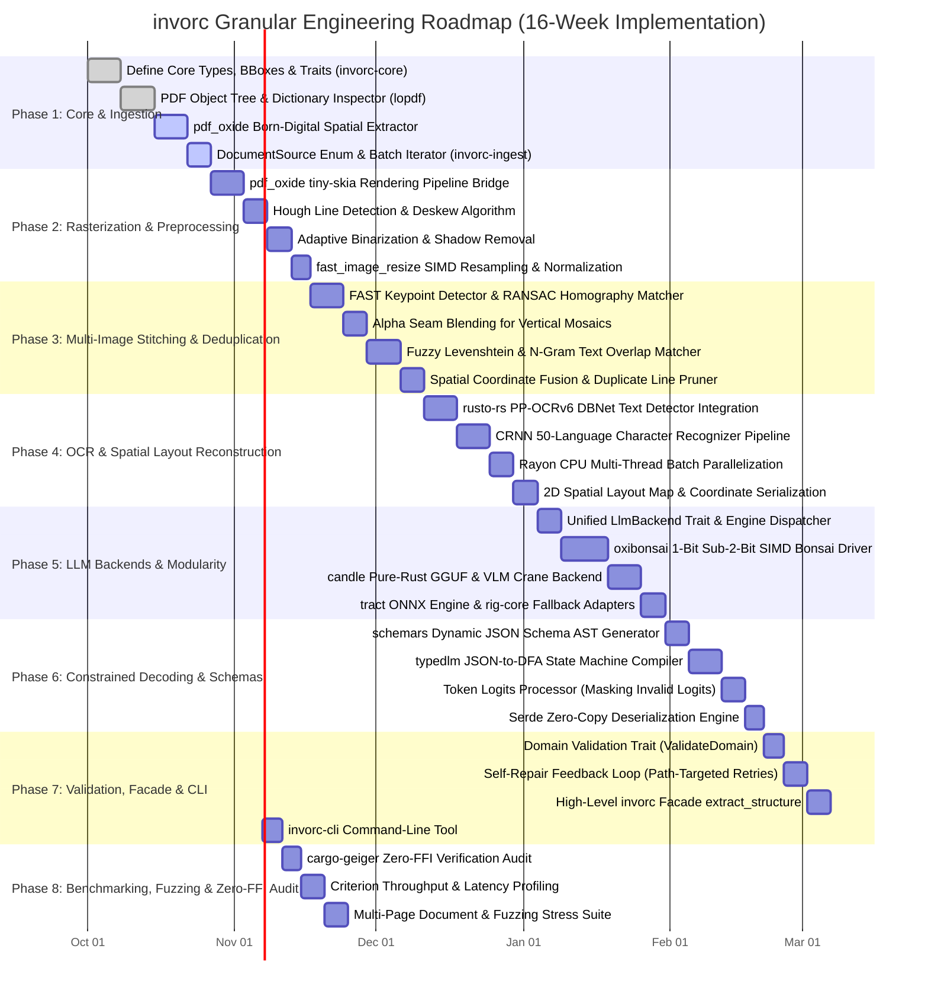

# Development Plan & Engineering Roadmap: `invorc`

## 1. Executive Roadmap & Workspace Blueprint

This document specifies the end-to-end development roadmap for `invorc`. The implementation is organized into an 8-stage phased execution model within a Cargo Monorepo Workspace.



---

## 2. Monorepo Structure & Package Manifests

```text
invorc/
├── Cargo.toml                  # Workspace Manifest
├── Cargo.lock
├── README.md
├── docs/                       # Technical Specifications & Architecture Suite
│   ├── 00_MASTER_SPECIFICATION.md
│   ├── 01_INGESTION_AND_ROUTING.md
│   ├── 02_RASTERIZATION_AND_PREPROCESSING.md
│   ├── 03_OCR_AND_SPATIAL_EXTRACTION.md
│   ├── 04_LLM_AND_LOCAL_EMBEDDED_BACKENDS.md
│   ├── 05_STRUCTURED_EXTRACTION_AND_CONSTRAINED_DECODING.md
│   ├── 06_INVOICE_AND_GENERIC_SCHEMA_EXAMPLE.md
│   ├── 07_DEVELOPMENT_PLAN.md
│   └── 08_BENCHMARK_AND_COMPARISON.md
├── crates/
│   ├── invorc-core/            # Core primitives, traits, bounding boxes, errors
│   ├── invorc-ingest/          # PDF hierarchy inspection, doc-router heuristics, digital parsing
│   ├── invorc-preprocess/      # hayro PDF rendering, Hough deskew, adaptive binarization, SIMD scaling
│   ├── invorc-ocr/             # PP-OCRv6 DBNet detection, CRNN 50-language recognition, spatial map
│   ├── invorc-llm/             # oxibonsai 1-bit, candle, tract, and rig-core LLM backends
│   ├── invorc-schema/          # schemars JSON Schema reflection, typedlm DFA logits masking, repair
│   ├── invorc/                 # Facade crate offering high-level extract_structure::<T>() API
│   └── invorc-cli/             # Sovereign command-line tool
└── tests/
    ├── fixtures/               # Test PDFs, multi-image sets, scanned invoices, receipts
    └── integration_tests/      # End-to-end integration and fuzz suites
```

---

## 3. Detailed Milestone & Development Stages

### Milestone 1: Core Foundation & Ingestion Engine (`invorc-core` & `invorc-ingest`)
* **Reference Spec:** [`01_INGESTION_AND_ROUTING.md`](file:///Users/yasuomaidana/RustRoverProjects/invorc/docs/01_INGESTION_AND_ROUTING.md)
* **Target Crates:** `lopdf`, `pdfsink-rs`, `pdf_oxide`, `image`, `rayon`, `thiserror`.
* **Features Implemented:**
  1. Universal input abstraction [`DocumentSource`](file:///Users/yasuomaidana/RustRoverProjects/invorc/docs/01_INGESTION_AND_ROUTING.md#L39-L49) supporting PDF bytes/paths, single images, and batches of images.
  2. PDF object tree parser inspecting fonts, `/ToUnicode` streams, and text operator frequencies using `lopdf`.
  3. Routing heuristic classifier distinguishing born-digital pages from rasterized/damaged pages.
  4. Fast-path born-digital spatial table and text extractor (`pdf_oxide` / `pdfsink-rs`).
* **Test Plan:**
  * **Unit Tests:** `test_pdf_structure_inspection()`, `test_tounicode_corruption_detection()`, `test_image_batch_iterator()`.
  * **Integration Tests:** Test ingestion against born-digital PDF invoices vs. scanned receipts; assert correct dispatching to fast-path vs. raster queue.
  * **Fuzz Testing:** Fuzz `lopdf` stream parser with malformed PDF binary blobs using `cargo-fuzz`.

---

### Milestone 2: Pure-Rust Rasterization & Preprocessing (`invorc-preprocess`)
* **Reference Spec:** [`02_RASTERIZATION_AND_PREPROCESSING.md`](file:///Users/yasuomaidana/RustRoverProjects/invorc/docs/02_RASTERIZATION_AND_PREPROCESSING.md)
* **Target Crates:** `pdf_oxide` (features: `rendering` via `tiny-skia` + `fontdb` + `rustybuzz`), `imageproc`, `oximedia`, `fast_image_resize`, `image`.
* **Features Implemented:**
  1. Pure-Rust PDF page rasterization into memory-backed RGBA pixmaps via `pdf_oxide` (`tiny-skia` renderer).
  2. Hough line transform angle detection and bilinear rotational deskewing via `imageproc`.
  3. Adaptive local thresholding / binarization for uneven illumination via `oximedia`.
  4. SIMD-accelerated (AVX2/NEON) image scaling and tensor normalization via `fast_image_resize`.
* **Test Plan:**
  * **Unit Tests:** `test_hough_angle_calculation()`, `test_adaptive_binarization_contrast()`, `test_simd_rescale_dimensions()`.
  * **Visual Regression Tests:** Render PDF pages at 150/300 DPI; compare structural similarity index (SSIM > 0.98) against reference renders.
  * **Property-Based Testing:** `proptest` random rotation angles $(-45^\circ \text{ to } +45^\circ)$ to verify deskew convergence within $\pm 0.5^\circ$.

---

### Milestone 3: Multi-Lingual OCR & Spatial Layout Reconstruction (`invorc-ocr`)
* **Reference Spec:** [`03_OCR_AND_SPATIAL_EXTRACTION.md`](file:///Users/yasuomaidana/RustRoverProjects/invorc/docs/03_OCR_AND_SPATIAL_EXTRACTION.md)
* **Target Crates:** `rusto-rs` (PP-OCRv6 / Alibaba MNN), `ocrs` (optional RTen feature), `rayon`.
* **Features Implemented:**
  1. Deep learning text detection (DBNet) outputting polygonal bounding contours and Vatti unclip algorithms.
  2. Multi-lingual character recognition (CRNN) with unified 50-language dictionary.
  3. Rayon-powered batch inference across cropped text bounding boxes.
  4. 2D spatial layout reconstruction, horizontal line clustering, column snapping, and spatial coordinate stamping.
* **Test Plan:**
  * **Multi-Lingual Character Accuracy Tests:** Validate character error rate (CER < 1.5%) across English, Spanish, Japanese, Chinese, Arabic, and Devanagari test samples.
  * **Spatial Ordering Tests:** Assert that table rows and columns preserve correct reading order in generated `SpatialLayoutMap`.
  * **Stress/Concurrency Tests:** Benchmark parallel multi-page OCR throughput across 4, 8, and 16 CPU threads.

---

### Milestone 4: Local & Embedded LLM Backends (`invorc-llm`)
* **Reference Spec:** [`04_LLM_AND_LOCAL_EMBEDDED_BACKENDS.md`](file:///Users/yasuomaidana/RustRoverProjects/invorc/docs/04_LLM_AND_LOCAL_EMBEDDED_BACKENDS.md)
* **Target Crates:** `oxibonsai`, `candle-core`, `candle-transformers`, `tract-onnx`, `rig-core`.
* **Features Implemented:**
  1. [`LlmBackend`](file:///Users/yasuomaidana/RustRoverProjects/invorc/docs/04_LLM_AND_LOCAL_EMBEDDED_BACKENDS.md#L62-L76) trait unifying all execution backends.
  2. Embedded 1-bit / sub-2-bit quantized PrismML Bonsai model driver via `oxibonsai` (default sovereign mode, <2 GB RAM).
  3. Hugging Face `candle` backend for GGUF/Safetensors models (and Vision-Language Model support via Crane).
  4. Pure-Rust ONNX execution engine via `tract`.
  5. Feature-flagged remote adapters (`rig-core/ollama`, `rig-core/openai`).
* **Test Plan:**
  * **Backend Parity Tests:** Run standard prompt completions across `oxibonsai`, `candle`, and mock backends; verify deterministic output.
  * **Memory Ceiling Tests:** Assert that `oxibonsai` inference remains strictly below 2.0 GB allocated resident memory (RSS).
  * **Feature Gating Tests:** Compile workspace with various flag combinations (`--no-default-features --features local-candle`, etc.) ensuring zero compile warnings or missing symbol errors.

---

### Milestone 5: Structured Extraction & Constrained Decoding (`invorc-schema`)
* **Reference Spec:** [`05_STRUCTURED_EXTRACTION_AND_CONSTRAINED_DECODING.md`](file:///Users/yasuomaidana/RustRoverProjects/invorc/docs/05_STRUCTURED_EXTRACTION_AND_CONSTRAINED_DECODING.md)
* **Target Crates:** `schemars`, `typedlm`, `serde`, `serde_json`.
* **Features Implemented:**
  1. Compile-time JSON Schema extraction from arbitrary user Rust structs (`schemars::schema_for!`).
  2. JSON-Schema-to-DFA compilation.
  3. Token logits masking processor setting invalid out-of-grammar token logits to $-\infty$ during autoregression.
  4. Zero-copy deserialization into the user's strongly typed struct `T`.
* **Test Plan:**
  * **Grammar Invariant Tests:** Verify that 1,000 generated token streams with constrained decoding produce 100% syntactically valid JSON matching complex nested schemas.
  * **Type Coercion Tests:** Test edge-case types (optional fields, nested vectors, floating-point numbers, enums).

---

### Milestone 6: Facade, High-Level API & Optional Validation (`invorc` & `invorc-cli`)
* **Reference Specs:** [`00_MASTER_SPECIFICATION.md`](file:///Users/yasuomaidana/RustRoverProjects/invorc/docs/00_MASTER_SPECIFICATION.md) & [`06_INVOICE_AND_GENERIC_SCHEMA_EXAMPLE.md`](file:///Users/yasuomaidana/RustRoverProjects/invorc/docs/06_INVOICE_AND_GENERIC_SCHEMA_EXAMPLE.md)
* **Target Crates:** `invorc`, `clap` (for CLI).
* **Features Implemented:**
  1. Top-level typed API: `invorc::extract_structure::<T>(source, &backend).await` (returns raw output directly).
  2. Optional integrity validation trait (`InvorcValidate`) and self-repair feedback loop when implemented.
  3. `invorc-cli` binary allowing users to extract JSON schemas directly from terminal:
     ```bash
     invorc extract --input invoice.pdf --schema invoice_schema.json --output invoice.json
     ```
* **Test Plan:**
  * **End-to-End Integration Tests:** Run full two-step pipeline on real invoice PDFs and multi-page receipts extracting [`InvoiceData`](file:///Users/yasuomaidana/RustRoverProjects/invorc/docs/06_INVOICE_AND_GENERIC_SCHEMA_EXAMPLE.md#L17-L43).
  * **Raw Output vs. Validated Tests:** Verify unvalidated structs return raw output with 0 validation cycles; test `InvorcValidate` structs triggering repair on intentional arithmetic mismatches (`sum(line_items) != total`).

---

### Milestone 7: Performance Optimization, FFI Elimination Audit & Benchmarks
* **Reference Spec:** [`08_BENCHMARK_AND_COMPARISON.md`](file:///Users/yasuomaidana/RustRoverProjects/invorc/docs/08_BENCHMARK_AND_COMPARISON.md)
* **Target Tools:** `criterion`, `cargo-audit`, `cargo-geiger`.
* **Features Implemented:**
  1. `cargo-geiger` audit guaranteeing 0 dynamic C libraries and pure-Rust memory safety.
  2. SIMD optimization passes for image filtering and quantization bit-scatter operations.
  3. Continuous benchmarking suite comparing latency, memory, and throughput against C++/Python baselines.
