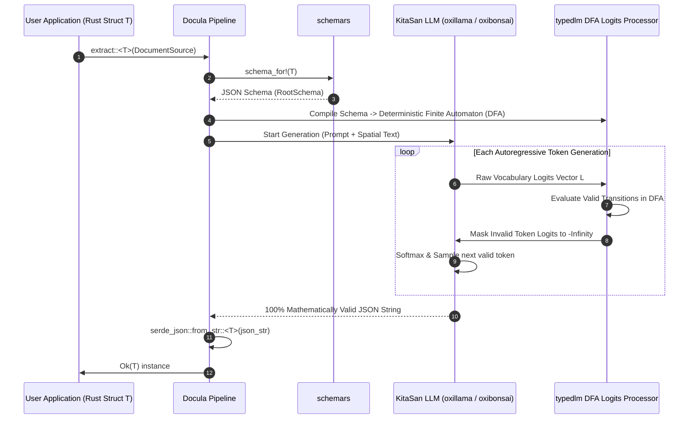

# Module 05: Structured Extraction & Constrained Decoding

## 1. Overview & Purpose

The **Structured Extraction & Constrained Decoding** module is the mathematical core of Step 2. Its mission is to transform spatial text into a concrete, strongly typed Rust data structure `T` supplied by the user (such as `InvoiceData`, `BankStatement`, or any custom domain model).

Standard LLM prompting ("Return JSON matching this format") is inherently non-deterministic and prone to syntax errors (unclosed brackets, trailing commas, incorrect field names, string instead of float). `Docula` solves this through **Logits-Level Grammar Enforcement (Constrained Decoding)** executed natively within the **KitaSan sovereign LLM engines (`oxillama` & `oxibonsai`)** and **Automated Self-Repair Loops**.



---

## 2. Technical Stack & Pure-Rust Dependencies

| Crate | Version Target | Purpose | Zero-FFI Guarantee |
|:---|:---|:---|:---|
| **`schemars`** | `^1.0` | Compile-time and runtime JSON Schema reflection from arbitrary Rust structs. | **100% Pure Rust** |
| **`serde` & `serde_json`** | `^1.0` | High-performance, zero-copy serialization/deserialization into Rust types. | **100% Pure Rust** |
| **`oxillama`** | `^0.1` | **KitaSan general GGUF LLM engine.** Exposes native logits interceptor hooks in `oxillama-runtime`. | **100% Pure Rust (`fail0 + Clippy0`)** |
| **`oxibonsai`** | `^0.1` | **KitaSan sub-2-bit LLM engine.** Native support for `generate_with_logits_processor`. | **100% Pure Rust (`fail0 + Clippy0`)** |
| **`typedlm`** | `^0.1` | JSON-Schema-to-DFA compilation and step-by-step logits masking. | **100% Pure Rust** |

---

## 3. Detailed Architecture & Mechanisms

### 3.1 Generic Pipeline Interface

The user interacts with a single high-level typed function:

```rust
pub async fn extract_structure<T>(
    source: DocumentSource,
    backend: &dyn LlmBackend,
) -> Result<T, DoculaError>
where
    T: schemars::JsonSchema + serde::de::DeserializeOwned + Send + Sync,
{
    // Step 1: Content Reading & Spatial Extraction
    let spatial_doc = read_document_content(source).await?;
    let layout_text = spatial_doc.format_spatial_layout();

    // Step 2: Schema Extraction & Constrained Decoding
    let schema = schemars::schema_for!(T);
    let system_prompt = "You are a precise document data extractor. Extract all required fields from the spatial document layout accurately according to the provided schema.";

    let raw_json = backend.generate_constrained(
        system_prompt,
        &layout_text,
        &schema,
    ).await?;

    let parsed_data: T = serde_json::from_str(&raw_json)?;
    Ok(parsed_data)
}
```

### 3.2 Constrained Decoding via DFA Logits Masking in KitaSan Engines

During autoregressive token generation in `oxillama` or `oxibonsai`, the model outputs raw unnormalized log-probabilities (logits) $L \in \mathbb{R}^{|V|}$ across the vocabulary $V$. In standard decoding, softmax generates the probability distribution:

$$P(y = i \mid \mathbf{Z}) = \frac{e^{L_i}}{\sum_{j=1}^{|V|} e^{L_j}}$$

To enforce the JSON Schema:
1. `schemars::schema_for!(T)` creates a JSON Schema AST.
2. `typedlm` converts this AST into a **Deterministic Finite Automaton (DFA)**.
3. At generation step $t$, the logits processor intercepts the vocabulary logits before softmax within the `oxillama-runtime` loop or `oxibonsai` engine.
4. For every token $i \in V$ that would cause an invalid transition (e.g. emitting a letter when a number is required, or omitting quotes):

$$L_i \leftarrow -\infty$$

5. This guarantees $e^{-\infty} = 0$, giving invalid tokens zero probability. The generated text stream is mathematically guaranteed to be syntactically and structurally valid JSON matching struct `T`.

### 3.3 Optional Integrity Validation & Feedback: `DocuValidate` Trait

Validation and feedback loops are completely **optional**:
- **Default Behavior (Raw Output):** Any struct `T` implementing `JsonSchema + DeserializeOwned` can be extracted directly with `extract_structure::<T>()`. The engine performs constrained decoding, deserializes the JSON, and immediately returns the raw output with zero validation overhead.
- **Optional Integrity Validation:** If domain-specific consistency checks are desired (such as verifying arithmetic `sum(line_items.total) == total_amount` or date format rules), the struct implements the `DocuValidate` trait.

```rust
/// Optional integrity validation trait.
/// If not implemented for a struct, Docula simply returns the raw extracted output.
pub trait DocuValidate {
    /// Validates internal field integrity, arithmetic consistency, or business rules.
    fn validate_integrity(&self) -> Result<(), Vec<ValidationError>>;
}

pub struct ValidationError {
    pub field_path: String,
    pub error_message: String,
}
```

#### How the Optional Self-Repair Flow Works

```rust
/// Extracts a struct, and if it implements DocuValidate, performs optional integrity checks.
pub async fn extract_structure_validated<T>(
    source: DocumentSource,
    backend: &dyn LlmBackend,
    max_retries: usize,
) -> Result<T, DoculaError>
where
    T: schemars::JsonSchema + serde::de::DeserializeOwned + DocuValidate + Send + Sync,
{
    // Step 1: Extract raw instance via constrained decoding
    let mut instance: T = extract_structure(source, backend).await?;
    
    // Step 2: Perform optional integrity validation
    for _attempt in 0..max_retries {
        match instance.validate_integrity() {
            Ok(()) => return Ok(instance),
            Err(errors) => {
                // If validation fails, construct targeted feedback prompt with exact error paths
                let feedback_prompt = format!(
                    "Integrity validation failed with the following errors:\n{}\nPlease correct these specific fields while keeping the rest unchanged.",
                    format_validation_errors(&errors)
                );
                
                // Prompt LLM for self-repair
                let corrected_json = backend.generate_constrained(
                    "You are fixing validation errors in an extracted document.",
                    &feedback_prompt,
                    &schemars::schema_for!(T),
                ).await?;
                
                instance = serde_json::from_str(&corrected_json)?;
            }
        }
    }
    
    // Return final instance after retries
    Ok(instance)
}
```
