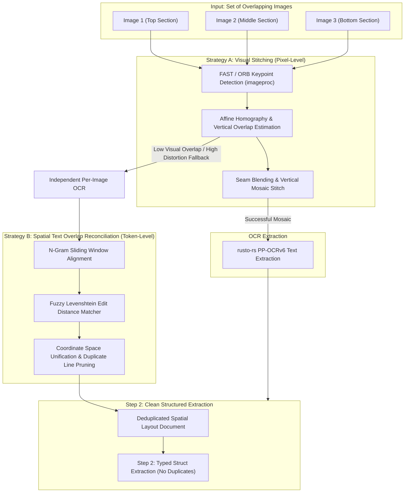

# Module 09: Multi-Image Stitching & Overlap Deduplication

## 1. Overview & Purpose

In real-world mobile and edge document capture, long physical invoices, continuous receipts, or large blueprints cannot fit into a single camera frame. Users capture these documents by taking multiple overlapping photos (e.g., top, middle, and bottom sections).

Handling multi-image sets presents two major challenges:
1. **Geometric & Visual Distortion:** Photos have slight perspective shifts, uneven zoom, shadows, and angular skew.
2. **Duplicate Line Items & Hallucinated Repeats:** Overlapping regions capture identical line items twice. If fed blindly into Step 2, the LLM will duplicate financial entries (e.g., doubling the invoice total or repeating line items).

`Docula` solves this using a **Dual-Layer Merge Strategy**:
1. **Layer A: Geometric / Visual Keypoint Stitching** (Pixel Level)
2. **Layer B: Fuzzy Spatial Text Overlap & Line-Item Deduplication** (OCR & Spatial Level)



---

## 2. Technical Stack & Pure-Rust Dependencies

| Crate | Version Target | Purpose |
| :--- | :--- | :--- |
| `imageproc` | `^0.25` | FAST corner detection, feature descriptors, and image warping. |
| `oximedia` | `^0.1` | Pure-Rust RANSAC homography estimation and image affine blending. |
| `strsim` | `^0.11` | Pure-Rust fuzzy string matching (Levenshtein, Jaro-Winkler, Damerau-Levenshtein) for text overlap scoring. |
| `rayon` | `^1.10` | Parallel per-image OCR and pairwise string alignment. |

---

## 3. Dual-Layer Merging & Deduplication Mechanisms

### 3.1 Layer A: Visual Keypoint Stitching (Pixel Level)

When consecutive camera captures have sufficient visual overlap (>15%), `Docula` stitches them into a single vertical canvas before running OCR:

1. **Feature Extraction:** FAST corner detector detects distinctive keypoints in the bottom $30\%$ of Image $N$ and the top $30\%$ of Image $N+1$.
2. **Homography Estimation:** A pure-Rust RANSAC algorithm fits a vertical affine transformation matrix:
   $$\begin{bmatrix} x' \\ y' \\ 1 \end{bmatrix} = \begin{bmatrix} 1 & 0 & t_x \\ 0 & 1 & t_y \\ 0 & 0 & 1 \end{bmatrix} \begin{bmatrix} x \\ y \\ 1 \end{bmatrix}$$
3. **Linear Alpha Blending:** At the estimated seam boundary $y_{\text{seam}}$, an alpha ramp smoothly blends the pixel transitions, eliminating hard exposure edges.

---

### 3.2 Layer B: Spatial Text Overlap & Deduplication (OCR Level)

If photos suffer from extreme perspective changes or varied focal distances, visual stitching may introduce blur. In this case, `Docula` executes **Spatial Text Overlap Reconciliation**:

1. **Independent Parallel OCR:** Each image is processed through PP-OCRv6 independently, generating separate spatial text blocks.
2. **$N$-Gram Sliding Window Search:** The engine extracts a rolling window of text lines from the bottom of Document $N$ and compares them against lines from the top of Document $N+1$.
3. **Fuzzy Levenshtein Edit Distance:**
   $$\text{Similarity}(S_1, S_2) = 1.0 - \frac{\text{LevenshteinDistance}(S_1, S_2)}{\max(|S_1|, |S_2|)}$$
   Lines with $\text{Similarity} \ge 0.85$ (accounting for minor OCR typos in repeated lines) are flagged as **Overlapping Boundary Text**.
4. **Coordinate Space Fusion & Pruning:** 
   - Duplicate header/footer lines and repeated line-item rows in the overlap zone are pruned.
   - The bounding boxes of the non-overlapping segments are offset by $Y_{\text{offset}} = Y_{\text{match}_1} - Y_{\text{match}_2}$ to produce a continuous spatial coordinate layout.

```rust
use strsim::normalized_levenshtein;

pub struct TextOverlapMerger {
    pub similarity_threshold: f64, // e.g. 0.85
    pub min_matching_lines: usize, // e.g. 2 consecutive matching lines
}

impl TextOverlapMerger {
    pub fn merge_spatial_blocks(
        &self,
        top_page: SpatialPageData,
        bottom_page: SpatialPageData,
    ) -> SpatialPageData {
        let top_lines = top_page.extract_lines();
        let bottom_lines = bottom_page.extract_lines();

        // Find longest common fuzzy substring of lines
        if let Some((top_idx, bottom_idx)) = self.find_overlap_anchor(&top_lines, &bottom_lines) {
            let mut merged_blocks = Vec::new();

            // 1. Keep top page blocks up to top_idx
            merged_blocks.extend(top_page.blocks_up_to_line(top_idx));

            // 2. Calculate vertical coordinate offset
            let y_offset = top_lines[top_idx].bbox.bottom_right.1 - bottom_lines[bottom_idx].bbox.top_left.1;

            // 3. Append bottom page blocks starting strictly after bottom_idx (skipping duplicates)
            for mut block in bottom_page.blocks_after_line(bottom_idx) {
                block.bbox.top_left.1 += y_offset;
                block.bbox.bottom_right.1 += y_offset;
                merged_blocks.push(block);
            }

            SpatialPageData::from_merged(merged_blocks)
        } else {
            // No confident overlap found; concatenate with standard page separation
            SpatialPageData::concatenate(top_page, bottom_page)
        }
    }

    fn find_overlap_anchor(&self, top: &[TextLine], bottom: &[TextLine]) -> Option<(usize, usize)> {
        for (t_idx, t_line) in top.iter().enumerate().rev().take(10) {
            for (b_idx, b_line) in bottom.iter().enumerate().take(10) {
                if normalized_levenshtein(&t_line.text, &b_line.text) >= self.similarity_threshold {
                    // Verify adjacent line consistency
                    if self.verify_consecutive_match(top, bottom, t_idx, b_idx) {
                        return Some((t_idx, b_idx));
                    }
                }
            }
        }
        None
    }

    fn verify_consecutive_match(&self, top: &[TextLine], bottom: &[TextLine], t: usize, b: usize) -> bool {
        if t + 1 < top.len() && b + 1 < bottom.len() {
            normalized_levenshtein(&top[t + 1].text, &bottom[b + 1].text) >= self.similarity_threshold
        } else {
            true
        }
    }
}
```

---

## 4. LLM Semantic Deduplication Prompt Rule

In addition to algorithmic pruning, the system prompt injected into Step 2 includes a strict deduplication directive:

```text
IMPORTANT DOCUMENT CONTINUITY DIRECTIVE:
The provided spatial document may be composed of multiple overlapping camera photos.
- If a line item appears multiple times with identical or near-identical descriptions, quantities, and prices across page/photo boundaries, count it ONCE.
- Verify that the sum of all individual extracted line item totals matches the document Grand Total.
```

---

## 5. Summary of Deduplication Guarantees

1. **No Doubled Line Items:** Prevents accidental doubling of amounts when receipts are photographed in parts.
2. **Resilience to Blur & Distortion:** If visual stitching fails, fuzzy OCR string alignment handles the overlap gracefully.
3. **Pure Rust Execution:** 100% zero-FFI implementation using safe string metrics and geometry.
