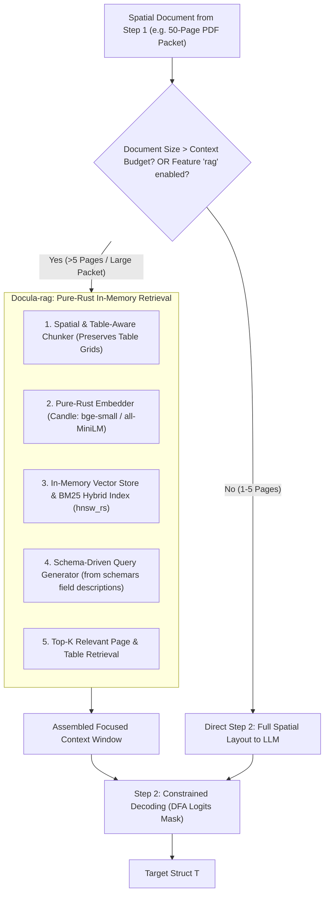

# Module 10: RAG & Large Document Retrieval Architecture

## 1. Executive Evaluation: Do We Need a RAG Module?

### The Core Trade-Off
* **For Standard Documents (1–5 Pages: Invoices, Receipts, Short Statements):**
  * **No RAG Needed:** The entire spatial text fits comfortably within modern context windows (typically 1,000–3,000 tokens). Feeding the full spatial layout directly to Step 2 yields lower latency, higher accuracy, and eliminates retrieval recall errors.
* **For Large Documents & Document Packets (10–100+ Pages: Mortgage Bundles, Financial Audits, Annual Reports, Multi-Contract Portfolios):**
  * **RAG is Essential:** Local embedded models (such as `oxibonsai` 1-bit or lightweight `candle` models) operate best with context windows under 4,000 tokens to maintain <2 GB RAM usage and sub-second latency. Feeding 50 pages directly causes context window truncation and massive memory spikes.

### Architectural Verdict
* **RAG must be 100% OPTIONAL and feature-gated (`feature = "rag"`).**
* The core two-step pipeline remains the fast, zero-overhead default.
* RAG is activated only when extracting data from massive document sets or when the token count of a document exceeds the local model's context budget.



---

## 2. Where to Place RAG in the Monorepo

We place RAG as a dedicated optional crate: **`crates/Docula-rag/`**.

```text
Docula/
├── crates/
│   ├── Docula-core/
│   ├── Docula-ingest/
│   ├── Docula-preprocess/
│   ├── Docula-ocr/
│   ├── Docula-rag/          # <-- Dedicated Optional RAG & Indexing Crate
│   ├── Docula-llm/
│   ├── Docula-schema/
│   └── Docula/              # Facade exposing extract_structure_rag::<T>()
```

In the execution pipeline, `Docula-rag` sits squarely between **Step 1 (Spatial Text Extraction)** and **Step 2 (Constrained LLM Decoding)**.

---

## 3. How `Docula-rag` Works in Pure Rust (Zero-FFI)

### 3.1 Spatial & Table-Aware Chunking
Standard RAG chunkers split text by character length, which destroys invoice table borders. `Docula-rag` implements **Layout-Aware Chunking**:
* Tables are kept intact as unified Markdown/coordinate blocks.
* Document pages and sections are indexed with spatial bounding box headers (e.g. `[PAGE 12: Balance Sheet Table]`).

### 3.2 Pure-Rust Embedding & Vector Storage
To maintain the pure-Rust, zero-C-dependency mandate:
* **Embedder (`candle`):** Executes quantized embedding models (`all-MiniLM-L6-v2` or `bge-small-en-v1.5` in Safetensors format) locally on CPU via SIMD.
* **Vector Index (`hnsw_rs` / In-Memory Cosine):** An in-memory Hierarchical Navigable Small World (HNSW) index builds in <10ms for a 100-page document.
* **Optional Keyword Search (`tantivy`):** Pure-Rust Lucene-equivalent for exact keyword lookups (e.g. searching exact invoice numbers or tax IDs).

### 3.3 Schema-Driven Query Formulation
Instead of requiring the user to type natural language search queries, `Docula-rag` inspects the target Rust struct `T` via `schemars`:
1. It reads each struct field and its `#[schemars(description = "...")]` attribute.
2. It generates targeted retrieval embeddings for each field cluster (e.g., "vendor payment remittance details", "transaction line item table", "tax summary").
3. It retrieves the top-$k$ relevant spatial blocks.
4. It merges these blocks into a compact context window and passes it to the `LlmBackend`.

---

## 4. Technical Stack & Cargo Feature Gating

In `Cargo.toml`:

```toml
[features]
default = ["local-embedded"]

# Optional RAG Feature
rag = ["dep:Docula-rag"]

[dependencies]
# Feature-gated sub-crate
Docula-rag = { path = "crates/Docula-rag", optional = true }
```

Within `Docula-rag/Cargo.toml`:

| Crate | Target Version | Purpose |
| :--- | :--- | :--- |
| `candle-core` / `candle-nn` | `^0.8` | Pure-Rust local embedding inference (`all-MiniLM-L6-v2`). |
| `hnsw_rs` | `^0.3` | Pure-Rust in-memory approximate nearest neighbor vector search. |
| `strsim` | `^0.11` | Fuzzy lexical re-ranking. |
| `tantivy` | `^0.22` (Optional) | Pure-Rust full-text search engine for exact keyword matching. |

---

## 5. Code Example: Standard vs. RAG Extraction

### Mode A: Standard Direct Extraction (Default for Invoices & Receipts)
```rust
// 1-5 pages: Instantaneous, zero vector overhead
let invoice: InvoiceData = Docula::extract_structure(doc_source, &backend).await?;
```

### Mode B: RAG-Powered Extraction for Massive Document Bundles
```rust
#[cfg(feature = "rag")]
use Docula_rag::RagConfig;

// 50-page financial packet: RAG retrieves only relevant pages for each schema field
let config = RagConfig {
    top_k_chunks: 5,
    embedding_model: "bge-small-en-v1.5",
    hybrid_bm25: true,
};

let audit_report: AuditSummary = Docula::extract_structure_with_rag(
    doc_source,
    &backend,
    config,
).await?;
```

---

## 6. Summary Comparison: Direct Pipeline vs. RAG Pipeline

| Dimension                      | Default Two-Step Pipeline                  | Optional RAG Pipeline (`Docula-rag`)                     |
|:-------------------------------|:-------------------------------------------|:---------------------------------------------------------|
| **Best Used For**              | Invoices, receipts, 1–5 page statements    | 10–100+ page contracts, annual reports, mortgage packets |
| **Memory Overhead**            | Minimal (<35 MB baseline)                  | +50 MB (In-memory embedding model & vector index)        |
| **Execution Latency**          | **~300ms** total                           | **~450ms** total (adds ~100ms for embedding & search)    |
| **Context Window Consumption** | Scales with full document size             | Fixed small window (e.g. capped at 1,500 tokens)         |
| **Local Model Compatibility**  | Requires model context $\ge$ document size | Works on ultra-compact models (2k context budget)        |
