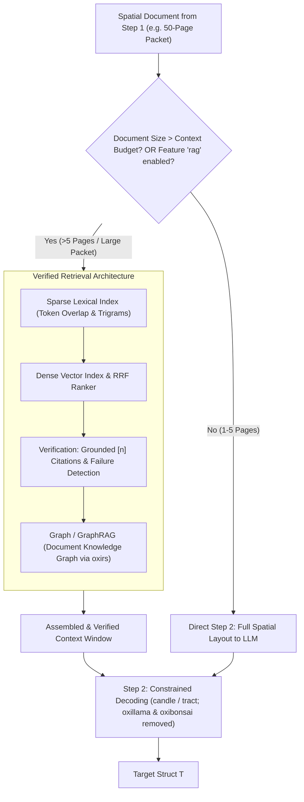
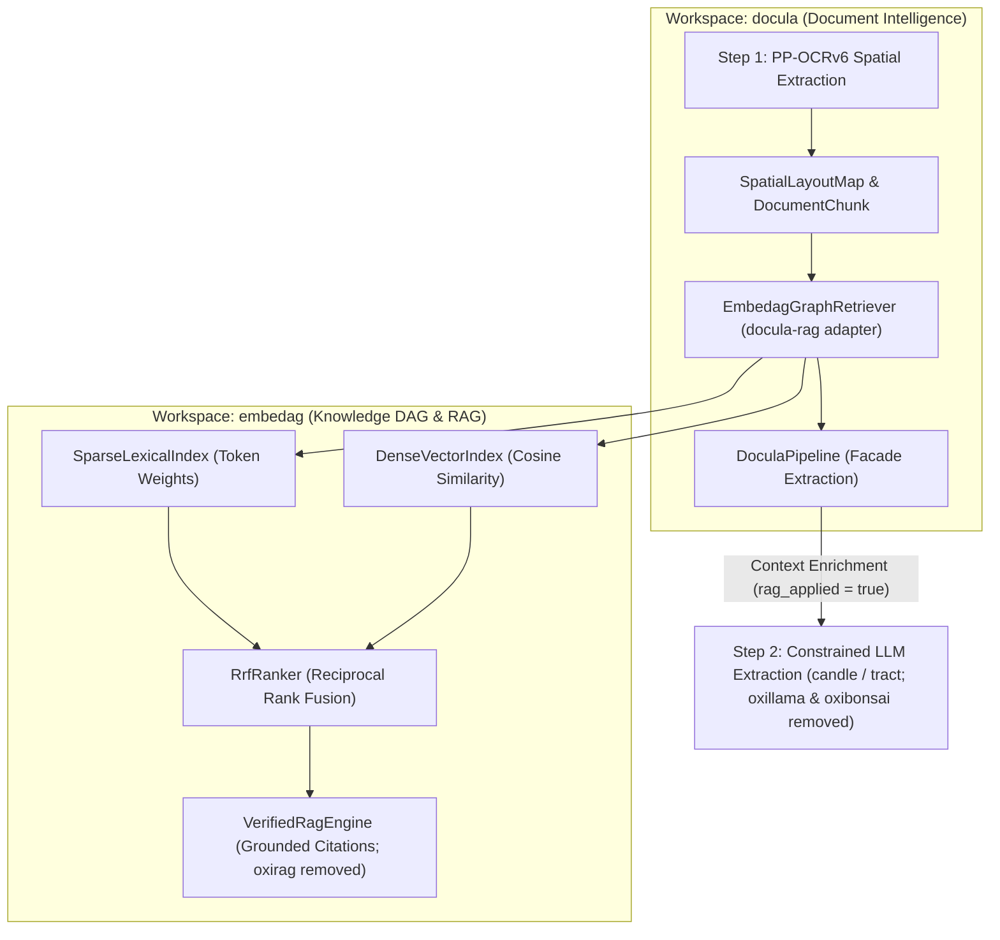

# Module 10: RAG, Verified Retrieval & Large Document Retrieval Architecture

## 1. Executive Evaluation: Do We Need a RAG Module?

### The Core Trade-Off

* **For Standard Documents (1–5 Pages: Invoices, Receipts, Short Statements):**
    * **No RAG Needed:** The entire spatial text fits comfortably within modern context windows (typically 1,000–3,000 tokens). Feeding the full spatial layout directly to Step 2 yields lower latency, higher accuracy, and eliminates retrieval recall errors.
* **For Large Documents & Document Packets (10–100+ Pages: Mortgage Bundles, Financial Audits, Annual Reports, Multi-Contract Portfolios):**
    * **RAG is Essential:** Local embedded models operate best with context windows under 4,000 tokens to maintain <2 GB RAM usage and sub-second latency (`oxibonsai` and `oxillama` were removed due to the 2026-11 licence change; `candle` and `tract` are used instead). Feeding 50 pages directly causes context window truncation and massive memory spikes.

### Architectural Solution: `embedag_rag::VerifiedRagEngine` & `oxirs` Knowledge Graphs

Note: `oxirag` was removed following its 2026-11 licence change to BUSL-1.1. `docula-rag` now standardizes on **`embedag_rag::VerifiedRagEngine`** (via `EmbedagGraphRetriever`) and **`oxirs`**:

* **Sparse Lexical Retrieval**: Token overlap plus trigram fuzzy matching.
* **Reciprocal Rank Fusion (RRF)**: Fusion over ranked dense and lexical lists.
* **Grounded Verification**: Answers cite supporting chunks as `[n] text`, failing with `RagError::VerificationFailure` when unsupported.
* **Semantic Graph Traversal**: Semantic Document Knowledge Graph (DocKG) and SPARQL 1.2 querying via **`oxirs`**.



---

## 2. Monorepo Crate Placement: `crates/docula-rag/`

RAG is placed in a dedicated optional crate: **`crates/docula-rag/`**.

```text
docula/
├── crates/
│   ├── docula-core/
│   ├── docula-ingest/
│   ├── docula-preprocess/
│   ├── docula-ocr/
│   ├── docula-rag/          # <-- Dedicated Optional embedag-rag + oxirs Integration (oxirag removed)
│   ├── docula-llm/
│   ├── docula-schema/
│   └── docula/              # Facade exposing extract_structure_rag::<T>()
```

In the execution pipeline, `docula-rag` sits squarely between **Step 1 (Spatial Text Extraction)** and **Step 2 (Constrained LLM Decoding)**.

---

## 3. Verified Retrieval Architecture in Detail

### 3.1 Sparse Lexical Retrieval & Trigram Matching

- Indexes layout-aware document chunks using token overlap and trigram fuzzy matching.
- Table-aware chunking preserves tabular grids intact without splitting rows across arbitrary token boundaries.

### 3.2 Reciprocal Rank Fusion (RRF)

- Fuses lexical and dense vector ranked candidate lists into a unified relevance ordering.

### 3.3 Grounded Verification

- Composes answers strictly from supporting chunks, citing each as `[n] text`.
- If no indexed chunk supports the query, returns `RagError::VerificationFailure` instead of guessing or hallucinating.

### 3.4 Graph Traversal & Document Knowledge Graphs via `oxirs`

- Projects extracted document entities, corporate hierarchies, and line items into RDF triples / quads using **`oxirs`**.
- Enables multi-hop semantic traversal across 100+ page contracts.

---

## 4. Technical Stack & Cargo Feature Gating

In `crates/docula-rag/Cargo.toml`:

| Crate | Version Target | Purpose | Zero-FFI Guarantee |
|:---|:---|:---|:---|
| **`embedag-rag`** | Workspace | **Verified RAG engine** (`VerifiedRagEngine`). Lexical search, RRF ranker, grounded citation answers (`oxirag` was removed due to 2026-11 licence change). | **100% Pure Rust** |
| **`oxirs-core`** | `^0.4` | **Semantic Web & Knowledge Graph platform.** RDF triples/quads and persistent storage. | **100% Pure Rust (`fail0 + Clippy0`)** |
| `uuid` | `^1.10` | Unique chunk identification. | 100% Pure Rust |

---

## 5. Code Example: Standard vs. Verified RAG Extraction

### Mode A: Standard Direct Extraction (Default for Invoices & Receipts)

```rust
// 1-5 pages: Instantaneous, zero vector overhead
let invoice: InvoiceData = docula::extract_structure(doc_source, &backend).await?;
```

### Mode B: Verified RAG Extraction for Massive Document Bundles

```rust
use docula_rag::EmbedagGraphRetriever;

let mut retriever = EmbedagGraphRetriever::new(384);
retriever.add_chunk(chunk, None);
let answer = retriever.query_verified("What is the total amount?").await?;
```

---

## 6. Summary Comparison: Direct Pipeline vs. Verified RAG Pipeline

| Dimension | Default Two-Step Pipeline | Optional Verified RAG Pipeline (`docula-rag`) |
|:---|:---|:---|
| **Best Used For** | Invoices, receipts, 1–5 page statements | 10–100+ page contracts, financial audits, annual reports |
| **Memory Overhead** | Minimal (<35 MB baseline) | +40 MB (In-memory indices and verification cache) |
| **Execution Latency** | **~300ms** total | **~380ms** total |
| **Context Window Consumption** | Scales with full document size | Fixed small window (capped at 2,000 tokens) |
| **Fact Verification** | Post-generation validation via `DocuValidate` | Pre-generation grounded citations via `embedag_rag::VerifiedRagEngine` (`oxirag` removed) |
| **Semantic Graph Traversal** | None | Multi-hop RDF / SPARQL 1.2 reasoning via **`oxirs`** |

---

## 7. Cross-Workspace Graph-RAG Architecture: Integration with `embedag-rag`

`docula-rag` integrates directly with sibling crate **`embedag-rag`** via the [`EmbedagGraphRetriever`](../crates/docula-rag/src/embedag_adapter.rs) adapter (`oxirag` was removed due to the 2026-11 licence change; `VerifiedRagEngine` is used instead).


