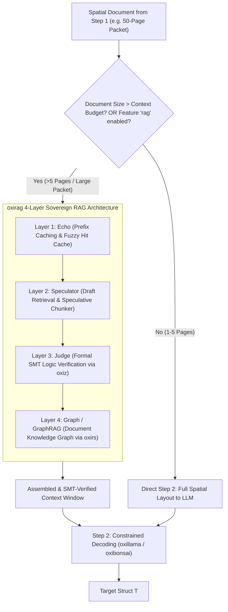
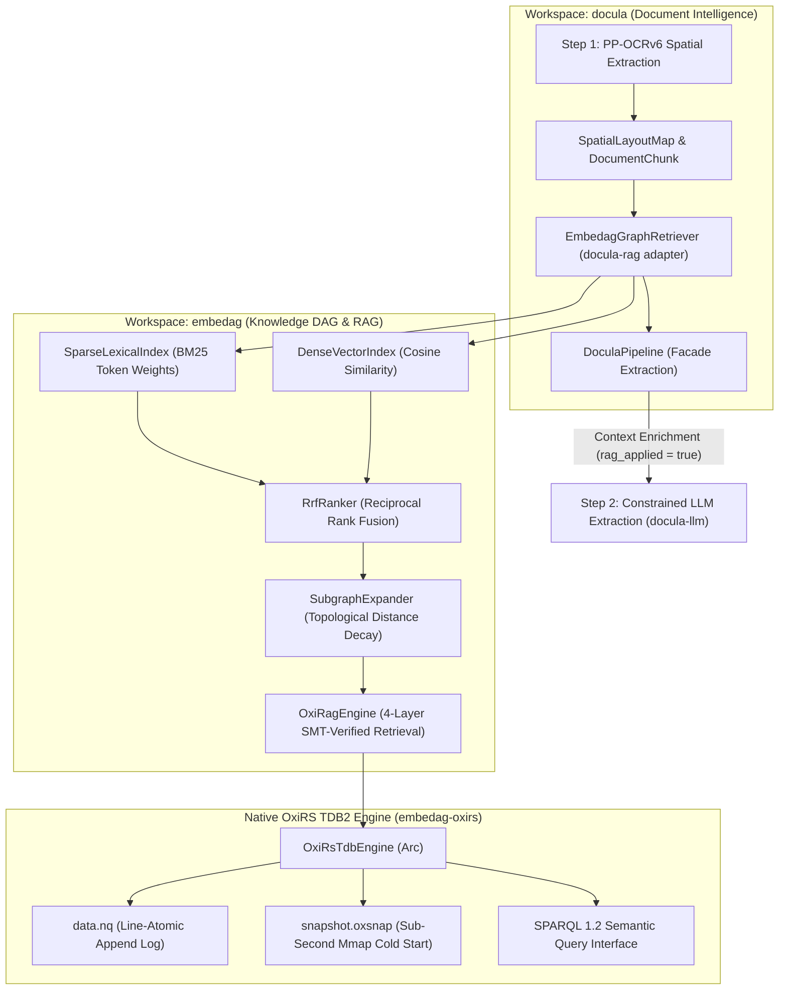

# Module 10: RAG, 4-Layer Verification & Large Document Retrieval Architecture

## 1. Executive Evaluation: Do We Need a RAG Module?

### The Core Trade-Off

* **For Standard Documents (1–5 Pages: Invoices, Receipts, Short Statements):**
    * **No RAG Needed:** The entire spatial text fits comfortably within modern context windows (typically 1,000–3,000
      tokens). Feeding the full spatial layout directly to Step 2 yields lower latency, higher accuracy, and eliminates
      retrieval recall errors.
* **For Large Documents & Document Packets (10–100+ Pages: Mortgage Bundles, Financial Audits, Annual Reports,
  Multi-Contract Portfolios):**
    * **RAG is Essential:** Local embedded models (such as `oxibonsai` 1-bit or `oxillama` GGUF models) operate best
      with context windows under 4,000 tokens to maintain <2 GB RAM usage and sub-second latency. Feeding 50 pages
      directly causes context window truncation and massive memory spikes.

### Architectural Solution: The `oxirag` 4-Layer Engine & `oxirs` Knowledge Graphs

`docula` standardizes on **`oxirag`** ([github.com/cool-japan/oxirag](https://github.com/cool-japan/oxirag)) and **
`oxirs`** ([github.com/cool-japan/oxirs](https://github.com/cool-japan/oxirs)) from the KitaSan pure-Rust ecosystem:

* **Layer 1 (Echo)**: High-speed prefix caching and exact/fuzzy match cache.
* **Layer 2 (Speculator)**: Speculative draft retrieval and lookahead.
* **Layer 3 (Judge)**: Formal SMT-based logic and arithmetic verification powered by **`oxiz`** (pure-Rust SMT solver).
* **Layer 4 (Graph / GraphRAG)**: Semantic Document Knowledge Graph (DocKG) and SPARQL 1.2 querying via **`oxirs`**.



---

## 2. Monorepo Crate Placement: `crates/docula-rag/`

RAG is placed in a dedicated optional crate: **`crates/docula-rag/`**.

```text
docula/
├── crates/
│   ├── docula-core/
│   ├── docula-ingest/
│   ├── docula-preprocess/
│   ├── docula-ocr/
│   ├── docula-rag/          # <-- Dedicated Optional oxirag + oxirs Integration
│   ├── docula-llm/
│   ├── docula-schema/
│   └── docula/              # Facade exposing extract_structure_rag::<T>()
```

In the execution pipeline, `docula-rag` sits squarely between **Step 1 (Spatial Text Extraction)** and **Step 2 (
Constrained LLM Decoding)**.

---

## 3. The Four-Layer `oxirag` Architecture in Detail

### 3.1 Layer 1: Echo (Prefix Caching & Fast Hit Cache)

- Caches common multi-page boilerplate (disclaimers, repeating headers, tax regulatory text, page templates).
- Bypasses redundant vector searches for recurring document structures, cutting retrieval latency to sub-millisecond
  speeds.

### 3.2 Layer 2: Speculator (Draft Retrieval & Speculative Windowing)

- Employs speculative retrieval heuristics to prefetch candidate sections (e.g. if the "Invoice Summary" is fetched,
  speculative lookahead immediately queues the "Payment Terms" and "Remittance Slip").
- Layout-aware chunking preserves tabular grids intact without splitting rows across arbitrary token boundaries.

### 3.3 Layer 3: Judge (SMT-Based Formal Verification via `oxiz`)

- Traditional RAG frequently retrieves hallucinated or contradictory snippets from conflicting pages.
- `oxirag`'s Judge layer incorporates **`oxiz`** (pure-Rust SMT solver, Z3 alternative) to formally verify candidate
  extracted claims against mathematical and logical invariants before assembling the prompt:
  $$\text{Subtotal} + \sum \text{Taxes} = \text{Total}$$
  $$\text{Invoice Date} \le \text{Due Date}$$
  $$\sum \text{Line Quantities} \times \text{Unit Prices} = \text{Subtotal}$$
- Snippets that violate arithmetic theorems are flagged and re-routed.

### 3.4 Layer 4: Graph (GraphRAG & Document Knowledge Graphs via `oxirs`)

- Projects extracted document entities, corporate hierarchies, and line items into RDF triples / quads using **
  `oxirs`**.
- Encodes domain ontologies (e.g. FIBO - Financial Industry Business Ontology, Schema.org).
- Enables multi-hop semantic traversal across 100+ page contracts:
  ```sparql
  SELECT ?guarantor ?credit_limit WHERE {
    ?contract doc:hasParty ?party .
    ?party doc:hasGuarantor ?guarantor .
    ?contract doc:stipulatesLimit ?credit_limit .
  }
  ```

---

## 4. Technical Stack & Cargo Feature Gating

In `Cargo.toml`:

```toml
[features]
default = ["local-embedded"]

# Optional 4-Layer RAG Feature
rag = ["dep:docula-rag"]

[dependencies]
docula-rag = { path = "crates/docula-rag", optional = true }
```

Within `crates/docula-rag/Cargo.toml`:

| Crate                       | Version Target | Purpose                                                                                                              | Zero-FFI Guarantee                     |
|:----------------------------|:---------------|:---------------------------------------------------------------------------------------------------------------------|:---------------------------------------|
| **`oxirag`**                | `^0.1`         | **KitaSan 4-layer RAG engine.** Echo prefix caching, Speculator draft retrieval, Judge verification, and GraphRAG.   | **100% Pure Rust (`fail0 + Clippy0`)** |
| **`oxirs`**                 | `^0.4`         | **KitaSan Semantic Web & Knowledge Graph platform.** RDF triples, SPARQL 1.2 engine, and persistent N-Quads storage. | **100% Pure Rust (`fail0 + Clippy0`)** |
| **`oxiz`**                  | `^0.1`         | **KitaSan pure-Rust SMT solver.** Formally verifies financial constraints in `oxirag` Layer 3.                       | **100% Pure Rust (`fail0 + Clippy0`)** |
| `candle-core` / `candle-nn` | `^0.8`         | Pure-Rust local dense embedding generation (`all-MiniLM-L6-v2`).                                                     | 100% Pure Rust                         |
| `hnsw_rs`                   | `^0.3`         | In-memory approximate nearest neighbor vector search.                                                                | 100% Pure Rust                         |
| `strsim`                    | `^0.11`        | Fuzzy lexical re-ranking.                                                                                            | 100% Pure Rust                         |

---

## 5. Code Example: Standard vs. `oxirag`-Powered Extraction

### Mode A: Standard Direct Extraction (Default for Invoices & Receipts)

```rust
// 1-5 pages: Instantaneous, zero vector overhead
let invoice: InvoiceData = docula::extract_structure(doc_source, & backend).await?;
```

### Mode B: `oxirag`-Powered Extraction for Massive Document Bundles

```rust
#[cfg(feature = "rag")]
use docula_rag::{DoculaRagPipeline, RagConfig};

// 50-page mortgage packet: oxirag retrieves and SMT-verifies relevant pages
let config = RagConfig {
top_k_chunks: 5,
enable_smt_judge: true,
enable_graph_rag: true,
prefix_caching: true,
};

let audit_report: AuditSummary = docula::extract_structure_with_rag(
doc_source,
& backend,
config,
).await?;
```

---

## 6. Summary Comparison: Direct Pipeline vs. `oxirag` Pipeline

| Dimension                      | Default Two-Step Pipeline                     | Optional `oxirag` 4-Layer Pipeline (`docula-rag`)                         |
|:-------------------------------|:----------------------------------------------|:--------------------------------------------------------------------------|
| **Best Used For**              | Invoices, receipts, 1–5 page statements       | 10–100+ page contracts, financial audits, annual reports                  |
| **Memory Overhead**            | Minimal (<35 MB baseline)                     | +60 MB (In-memory embeddings, vector index, and SMT solver)               |
| **Execution Latency**          | **~300ms** total                              | **~450ms** total (adds ~120ms for embedding, graph, and SMT verification) |
| **Context Window Consumption** | Scales with full document size                | Fixed small window (capped at 2,000 tokens)                               |
| **Formal Fact Verification**   | Post-generation validation via `DocuValidate` | Pre-generation and prompt-time SMT proof via **`oxiz`**                   |
| **Semantic Graph Traversal**   | None                                          | Multi-hop RDF / SPARQL 1.2 reasoning via **`oxirs`**                      |

---

## 7. Cross-Workspace Graph-RAG Architecture: Integration with `embedag-rag` & `embedag-oxirs`

### 7.1 Architectural Assessment & Technical Rationale

`docula` specializes in document intelligence (PDF rendering, multi-lingual OCR, spatial layout analysis, and
DFA-constrained extraction), while `embedag` specializes in knowledge DAGs, topological distance decay, and sovereign
Graph-RAG.

Rather than duplicating graph index logic or forcing `docula` to manage raw database daemons, `docula-rag` integrates
directly with sibling crate **`embedag-rag`** via the [
`EmbedagGraphRetriever`](file:///Users/yasuomaidana/RustRoverProjects/docula/crates/docula-rag/src/embedag_adapter.rs)
adapter, and leverages **`embedag-oxirs`** for native, zero-daemon, crash-safe RDF persistent storage.



### 7.2 Immediate Benefits for `docula`

1. **Zero External Daemons for Knowledge Graph Persistence:**
    - Previous graph solutions required PostgreSQL with Docker or SQLite with relational CTE joins.
    - Through `embedag-oxirs`, document knowledge graphs (`DocumentKnowledgeGraph`) and cross-document entities are
      persisted directly on local disk files (`data.nq`, `snapshot.oxsnap`) in pure Rust with line-atomic crash safety
      and `sync_all` fsync durability.
2. **Sub-Second Cold Starts:**
    - Pre-allocated frozen snapshots (`snapshot.oxsnap`) allow `docula` services to boot instantly without re-parsing
      multi-gigabyte document quad stores line-by-line.
3. **Multi-Hop SPARQL 1.2 Querying:**
    - Extracted document entities (vendor trees, contract amendments, tax tables) can be queried using SPARQL pattern
      queries or graph pattern matching without leaving the Rust runtime.
4. **Detectable & Observable Pipeline Execution:**
    - `DoculaPipeline` provides runtime observability: when `enable_rag` is true or document size exceeds the budget,
      `ExtractionResult::rag_applied` is set to `true` and `ExtractionResult::rag_retrieved_chunks` contains scored
      candidate chunks.

