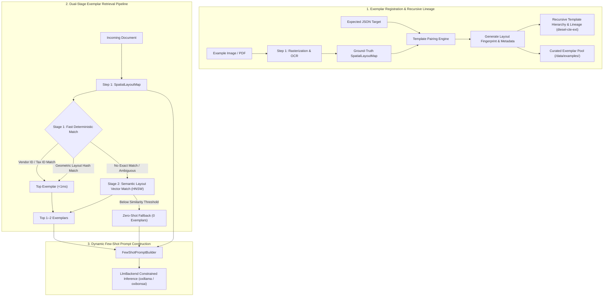

# Module 11: Few-Shot Exemplar Management, Recursive Lineage & Dual-Stage Retrieval

## 1. Overview & Purpose

Certain document types—such as utility bills (electricity, water, gas), tax forms, customs declarations, and specialized medical records—possess rigid or idiosyncratic layout architectures. While zero-shot LLM inference is effective for standard invoices, complex layout variations can lead to field hallucination or misattributed line items.

The **Few-Shot Exemplar Management** module enables users to register reference examples (image or PDF + expected JSON structure). During inference, the engine identifies similar incoming documents and dynamically injects the most relevant exemplar into the LLM context.

Furthermore, enterprise document templates naturally evolve and form inheritance hierarchies (e.g., *Base Corporate Invoice Template* $\rightarrow$ *Regional German Subsidiary Variant* $\rightarrow$ *2026 Fiscal Revision*). To navigate and query these template inheritance trees without client-side iterative queries, `docula` incorporates **`diesel-cte-ext`** ([github.com/leynos/diesel-cte-ext](https://github.com/leynos/diesel-cte-ext)) for recursive Common Table Expressions.



---

## 2. Technical Stack & Pure-Rust Dependencies

| Crate | Version Target | Purpose | Zero-FFI Guarantee |
|:---|:---|:---|:---|
| **`diesel-cte-ext`** | `^0.3` | **Recursive Common Table Expressions for Diesel.** Manages template inheritance trees, parent-child template lineages, and ancestor metadata resolution. | **100% Pure Rust (`PostgreSQL`, `SQLite`, `diesel_async`)** |
| **`oxirs`** | `^0.4` | **KitaSan Semantic Web platform.** Semantic exemplar linking and RDF ontology classification. | **100% Pure Rust (`fail0 + Clippy0`)** |
| `docula-core` | Workspace | `SpatialLayoutMap`, `BoundingBox`, and core document primitives. | 100% Pure Rust |
| `docula-ocr` | Workspace | Step 1 OCR layout extraction for exemplar image inputs. | 100% Pure Rust |
| `serde` & `serde_json` | `^1.0` | Serialization/deserialization of expected ground-truth JSON payloads. | 100% Pure Rust |
| `hnsw_rs` | `^0.3` | Pure-Rust approximate nearest neighbor search for Stage 2 vector matching. | 100% Pure Rust |
| `strsim` | `^0.11` | Fast string similarity for vendor identification and token matching. | 100% Pure Rust |

---

## 3. Recursive Template Hierarchy via `diesel-cte-ext`

Corporate templates frequently inherit fields and spatial regions from base master forms. Using `diesel-cte-ext`, `docula` resolves the full inheritance ancestry of a template in a single recursive SQL query:

```rust
use diesel::prelude::*;
use diesel_cte_ext::{RecursiveCTEExt, RecursiveParts, sql};
use diesel::sql_types::{Integer, Text};

/// Resolves complete ancestor template hierarchy for an exemplar using recursive CTE.
pub fn get_template_ancestors<C>(
    conn: &mut C,
    target_template_id: i32,
) -> QueryResult<Vec<(i32, String, Option<i32>)>>
where
    C: RecursiveCTEExt + diesel::connection::Connection,
{
    // WITH RECURSIVE template_lineage(id, name, parent_id, depth) AS (...)
    conn.with_recursive(
        "template_lineage",
        &["id", "name", "parent_id", "depth"],
        RecursiveParts::new(
            // Seed Query: select the initial target template
            sql::<(Integer, Text, diesel::sql_types::Nullable<Integer>, Integer)>(
                "SELECT id, name, parent_id, 0 AS depth FROM templates WHERE id = $1"
            ),
            // Recursive Step: traverse upward to parent templates
            sql::<(Integer, Text, diesel::sql_types::Nullable<Integer>, Integer)>(
                "SELECT t.id, t.name, t.parent_id, l.depth + 1 \
                 FROM templates t \
                 INNER JOIN template_lineage l ON t.id = l.parent_id"
            ),
            // Body Query: select the resolved lineage ordered by depth
            sql::<(Integer, Text, diesel::sql_types::Nullable<Integer>)>(
                "SELECT id, name, parent_id FROM template_lineage ORDER BY depth DESC"
            ),
        ),
    )
    .load(conn)
}
```

---

## 4. Dual-Stage Retrieval Architecture

To prevent prompt bloat, high token costs, and inference latency, the system never injects an entire library of examples into a prompt. Instead, it utilizes a **Dual-Stage Retrieval Strategy** capped at a maximum of 1–2 exemplars:

```
Incoming Document ──► [Stage 1: Fast Deterministic (<1ms)] ──► Match Found? ──► YES ──► Inject Top Exemplar
                                 │
                                 └──► NO / Ambiguous
                                        │
                                        ▼
                             [Stage 2: HNSW Vector Search] ──► Cosine >= 0.82? ──► YES ──► Inject Exemplar
                                        │
                                        └──► NO ──► Zero-Shot Fallback
```

### 4.1 Stage 1: Fast Deterministic Matching (<1 ms)
Stage 1 executes on CPU with zero neural network overhead:
1. **Vendor / Entity Exact Match**: Checks extracted vendor tax IDs, VAT numbers, or merchant strings against exemplar metadata.
2. **64-Bit Geometric Layout Fingerprinting (SimHash)**:
   - Each bounding box $(x_0, y_0, x_1, y_1)$ and its normalized spatial bucket are converted into a spatial feature hash.
   - The document's layout is summarized into a 64-bit integer fingerprint.
   - If the Hamming distance between the incoming document and an exemplar fingerprint is $\le 3$, it represents an identical form layout.

### 4.2 Stage 2: Semantic Layout Vector Matching (HNSW Fallback)
If Stage 1 does not yield an exact match:
1. The spatial text tokens and structural headers are passed through a lightweight pure-Rust layout embedding model (`all-MiniLM-L6-v2`).
2. An in-memory HNSW index (`hnsw_rs`) queries nearest exemplar candidates.
3. If the highest cosine similarity $\ge \tau_{\text{threshold}}$ (default: `0.82`), the candidate is selected.
4. If no candidate exceeds the threshold, the system automatically falls back to **zero-shot inference**, preserving token economy and avoiding misleading context.

---

## 5. Exemplar Registration & Template Pairing

### 5.1 Data Structures

```rust
use std::path::PathBuf;
use serde::{Deserialize, Serialize};
use docula_core::{BoundingBox, DoculaError, SpatialLayoutMap};

/// Metadata identifying a curated document exemplar.
#[derive(Debug, Clone, Serialize, Deserialize, PartialEq, Eq)]
pub struct ExemplarMetadata {
    pub exemplar_id: String,
    pub vendor_name: Option<String>,
    pub vendor_tax_id: Option<String>,
    pub document_type: String, // e.g. "electricity_bill", "utility", "customs_declaration"
    pub layout_fingerprint: u64,
    pub parent_template_id: Option<String>, // Tracks inheritance lineage
    pub created_at_unix: u64,
}

/// A registered exemplar pairing spatial OCR representation with ground truth JSON.
#[derive(Debug, Clone, Serialize, Deserialize)]
pub struct TemplatePair {
    pub metadata: ExemplarMetadata,
    pub source_artifact_path: Option<PathBuf>,
    pub spatial_layout: SpatialLayoutMap,
    pub ground_truth_json: serde_json::Value,
}
```

---

## 6. Few-Shot Prompt Construction

The prompt builder wraps the extracted spatial text and pairs it with the selected exemplars. When exemplars are omitted, the prompt seamlessly collapses into zero-shot mode without extra tokens:

```rust
pub struct FewShotPromptBuilder;

impl FewShotPromptBuilder {
    pub fn build(
        system_instructions: &str,
        exemplars: &[TemplatePair],
        target_spatial_map: &SpatialLayoutMap,
    ) -> String {
        let mut prompt = String::with_capacity(4096);
        prompt.push_str(system_instructions);
        prompt.push_str("\n\n");

        if !exemplars.is_empty() {
            prompt.push_str("### REFERENCE DOCUMENT EXAMPLES:\n");
            prompt.push_str("Learn the spatial key-value mappings and layout structures from these verified examples.\n\n");

            for (idx, ex) in exemplars.iter().enumerate() {
                prompt.push_str(&format!("--- [Example {}] Document Type: {} ---\n", idx + 1, ex.metadata.document_type));
                prompt.push_str("Spatial Layout Input:\n");
                prompt.push_str(&ex.spatial_layout.format_spatial_layout());
                prompt.push_str("\nTarget JSON Output:\n");
                prompt.push_str(&serde_json::to_string_pretty(&ex.ground_truth_json).unwrap_or_default());
                prompt.push_str("\n\n");
            }

            prompt.push_str("### TARGET DOCUMENT FOR EXTRACTION:\n");
        }

        prompt.push_str("Extract all data strictly matching the requested schema from this document:\n");
        prompt.push_str(&target_spatial_map.format_spatial_layout());
        prompt.push_str("\nJSON Output:");
        prompt
    }
}
```

---

## 7. Testing & Verification

1. **Recursive CTE Lineage Verification**:
   - `test_recursive_template_lineage_diesel_cte`: Uses `diesel-cte-ext` with an in-memory SQLite connection or Postgres testcontainer to verify recursive parent-child traversal across a 4-tier template hierarchy.
2. **Deterministic Fingerprint Invariance**:
   - `test_layout_fingerprint_rotation_tolerance`: Asserts that layout fingerprints remain stable across minor $\pm 1^\circ$ rotations or 5% scaling differences.
3. **Retrieval Speed Benchmark**:
   - `test_stage1_retrieval_latency`: Asserts that Stage 1 fingerprint queries complete in $< 500\,\mu\text{s}$ across an index of 1,000 templates.
4. **Zero-Shot Token Verification**:
   - `test_zero_shot_prompt_overhead`: Asserts that when no matching exemplar is found, prompt size is identical to zero-shot baseline.
