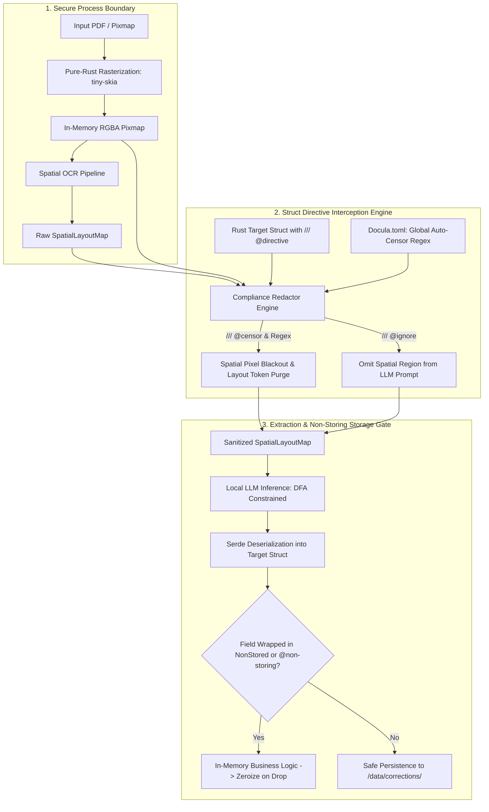

# Module 13: Edge Compliance, Non-Storing Directives & Data Redaction

## 1. Overview & Purpose

Enterprise document AI systems frequently process documents containing high-risk financial identifiers and Personally Identifiable Information (PII):
- Bank accounts, International Bank Account Numbers (IBAN), and credit/debit card numbers.
- National tax IDs, Social Security Numbers (SSNs), and government identifiers.
- Single-use authentication codes, ephemeral session tokens, and security hashes.

Traditional cloud-based OCR pipelines transmit raw document images and extracted text over external networks, introducing severe regulatory liabilities under **GDPR (Article 17 Right to Erasure / Article 32 Security of Processing)**, **HIPAA**, and **PCI-DSS**.

The **Edge Compliance, Non-Storing Directives & Data Redaction** module enforces strict, deterministic edge compliance in pure safe Rust:
1. **Zero Data Egress Invariant**: All buffers remain strictly confined to the local process memory; zero telemetry, zero external network socket calls.
2. **Declarative Struct Directives (`/// @censor`, `/// @ignore`, `/// @non-storing`)**: Developers annotate fields to control data visibility and persistence at compile time.
3. **Deterministic Spatial Blackout**: Hard pixel-level redaction overwrites raw in-memory pixmaps with opaque blackout masks (`[0, 0, 0, 255]`) and purges underlying text tokens prior to downstream storage or human review.
4. **Zero-Storage RAII Smart Pointer (`NonStored<T>`)**: Permits transient in-memory extraction and business validation (e.g., verifying a security token) while cryptographically zeroing memory on drop and guaranteeing exclusion from persistent serialization.



---

## 2. Technical Stack & Pure-Rust Dependencies

| Crate | Version Target | Purpose |
|:---|:---|:---|
| `image` | `^0.25` | In-memory RGBA pixel buffer manipulation and spatial blackout rendering. |
| `schemars` | `^1.0` | Compile-time JSON schema generation and doc-comment directive inspection. |
| `serde` & `serde_json` | `^1.0` | Custom serialization policies excluding non-storing fields. |
| `zeroize` | `^1.8` | Cryptographic memory zeroization on drop (`ZeroizeOnDrop`) for ephemeral buffers. |
| `regex` | `^1.11` | Deterministic PII regular expressions applied during spatial preprocessing. |

---

## 3. Struct-Level Compliance Annotations

Developers decorate target extraction structs using standard Rust documentation comments. `docula-schema` extracts these directives via `schemars` reflection:

```rust
use schemars::JsonSchema;
use serde::{Deserialize, Serialize};
use docula_core::NonStored;

#[derive(JsonSchema, Serialize, Deserialize, Debug, PartialEq)]
pub struct PayrollStatement {
    /// Employee legal full name.
    pub employee_name: String,

    /// Pay period end date (YYYY-MM-DD).
    pub period_end: String,

    /// Gross pay amount.
    pub gross_pay: f64,

    /// Net pay amount deposited.
    pub net_pay: f64,

    /// @censor
    /// Social Security Number / National ID; must be permanently blacked out on disk and in UI.
    pub ssn_or_national_id: String,

    /// @censor
    /// Direct deposit bank account / IBAN.
    pub direct_deposit_iban: Option<String>,

    /// @ignore
    /// Internal employer legal disclaimers and union notices; omitted from LLM prompt.
    pub legal_disclaimer: Option<String>,

    /// @non-storing
    /// One-time session verification code from document header; verified in-memory and never stored.
    pub payroll_verification_token: NonStored<String>,
}
```

### Directive Specifications:

| Directive Tag | Scope | Architectural Guarantee & Runtime Behavior |
|:---|:---|:---|
| `/// @censor` | PII / Sensitive Fields | **Spatial Blackout & Token Purge**: Permanently overwrites pixels within the bounding box with `[0, 0, 0, 255]`. Purges intersecting text spans from `SpatialLayoutMap` before the document is archived or passed to human review. |
| `/// @ignore` | Boilerplate / Layout Noise | **Prompt Omission**: Excludes matching spatial regions and text spans from the LLM context prompt entirely, reducing token spend. |
| `/// @non-storing` | Ephemeral Security Data | **Zero Persistence**: Value is deserialized into memory for active pipeline validation, but serializes to `null` or is omitted from JSON exports and cold feedback archives (`/data/corrections/`). |

---

## 4. Global Configuration & Defaults in `Docula.toml`

Global compliance policies and automatic regex filters are declared in `Docula.toml`:

```toml
[compliance]
zero_data_egress = true
ephemeral_image_ttl_seconds = 86400  # Discard raw image buffers after 24 hours

[compliance.auto_censor]
enabled = true
patterns = [
    { name = "iban", regex = "^[A-Z]{2}\\d{2}[A-Z0-9]{4}\\d{7}([A-Z0-9]?){0,16}$", action = "censor" },
    { name = "credit_card", regex = "^\\b(?:\\d[ -]*?){13,16}\\b$", action = "censor" },
    { name = "ssn", regex = "^\\b\\d{3}-\\d{2}-\\d{4}\\b$", action = "censor" }
]

[compliance.storage]
redact_cold_archive = true          # Enforce pixel blackouts before writing to /data/corrections/
strip_non_storing_fields = true     # Strip NonStored<T> fields during serialization
```

---

## 5. Non-Storing & Ephemeral Field Architecture

### 5.1 The `NonStored<T>` Smart Pointer
`docula-core` provides `NonStored<T>` wrapped with RAII memory zeroization:

```rust
use std::ops::{Deref, DerefMut};
use zeroize::{Zeroize, ZeroizeOnDrop};

/// A memory-safe container for ephemeral values that are extracted and validated
/// in-memory but zeroed out on drop and excluded from persistent storage.
#[derive(Debug, Clone, PartialEq, Eq)]
pub struct NonStored<T: Zeroize>(pub Option<T>);

impl<T: Zeroize> NonStored<T> {
    pub fn new(val: T) -> Self {
        NonStored(Some(val))
    }

    pub fn value(&self) -> Option<&T> {
        self.0.as_ref()
    }

    pub fn take(mut self) -> Option<T> {
        self.0.take()
    }
}

impl<T: Zeroize> Deref for NonStored<T> {
    type Target = Option<T>;
    fn deref(&self) -> &Self::Target {
        &self.0
    }
}

impl<T: Zeroize> DerefMut for NonStored<T> {
    fn deref_mut(&mut self) -> &mut Self::Target {
        &mut self.0
    }
}

impl<T: Zeroize> Drop for NonStored<T> {
    fn drop(&mut self) {
        if let Some(mut val) = self.0.take() {
            val.zeroize();
        }
    }
}

// 1. Deserializes seamlessly from LLM JSON output
impl<'de, T: serde::Deserialize<'de> + Zeroize> serde::Deserialize<'de> for NonStored<T> {
    fn deserialize<D>(deserializer: D) -> Result<Self, D::Error>
    where
        D: serde::Deserializer<'de>,
    {
        T::deserialize(deserializer).map(|val| NonStored(Some(val)))
    }
}

// 2. Serializes to None / null (or skipped with skip_serializing_if)
impl<T: Zeroize> serde::Serialize for NonStored<T> {
    fn serialize<S>(&self, serializer: S) -> Result<S::Ok, S::Error>
    where
        S: serde::Serializer,
    {
        serializer.serialize_none()
    }
}

// 3. Transparently reflects inner schema for LLM structured extraction
impl<T: schemars::JsonSchema + Zeroize> schemars::JsonSchema for NonStored<T> {
    fn schema_name() -> String {
        T::schema_name()
    }
    fn json_schema(gen: &mut schemars::gen::SchemaGenerator) -> schemars::schema::Schema {
        T::json_schema(gen)
    }
}
```

---

## 6. Spatial Blackout & Redaction Implementation

When a field is annotated with `/// @censor` or matches auto-censor regex rules, the compliance redactor operates on both image pixels and layout text tokens:

```rust
use image::{Rgba, RgbaImage};
use docula_core::{BoundingBox, SpatialSpan};

pub struct ComplianceRedactor;

impl ComplianceRedactor {
    /// Overwrites all pixels inside the bounding box with pure black [0, 0, 0, 255].
    pub fn apply_pixel_blackout(image: &mut RgbaImage, bbox: &BoundingBox) {
        let (width, height) = image.dimensions();
        let x0 = (bbox.top_left.x * width as f32).clamp(0.0, width as f32) as u32;
        let y0 = (bbox.top_left.y * height as f32).clamp(0.0, height as f32) as u32;
        let x1 = (bbox.bottom_right.x * width as f32).clamp(0.0, width as f32) as u32;
        let y1 = (bbox.bottom_right.y * height as f32).clamp(0.0, height as f32) as u32;

        for y in y0..y1 {
            for x in x0..x1 {
                image.put_pixel(x, y, Rgba([0, 0, 0, 255]));
            }
        }
    }

    /// Purges all text spans that overlap with the redacted bounding box.
    pub fn purge_intersecting_spans(spans: &mut Vec<SpatialSpan>, redacted_bbox: &BoundingBox) {
        spans.retain(|span| {
            let overlaps = span.bbox.intersects(redacted_bbox);
            !overlaps
        });
    }
}
```

---

## 7. Testing & Verification

1. **Spatial Pixel Blackout Verification**:
   - `test_pixel_blackout_bounds()`: Asserts that all pixels within $[x_0, y_0, x_1, y_1]$ are `[0, 0, 0, 255]` while perimeter pixels remain unchanged.
2. **Text Span Purge Verification**:
   - `test_purge_intersecting_spans()`: Ingests layout spans; validates that text tokens inside the redacted bounding box are cleanly purged.
3. **Non-Storing Serialization Invariant**:
   - `test_non_stored_serialization_omits_field()`: Confirms `serde_json::to_string` serializes `NonStored<String>` as `null` or skips it.
4. **Zeroize on Drop Memory Scrubbing**:
   - `test_non_stored_memory_zeroized_on_drop()`: Validates that memory buffer allocated to sensitive data is zeroed when dropped.
