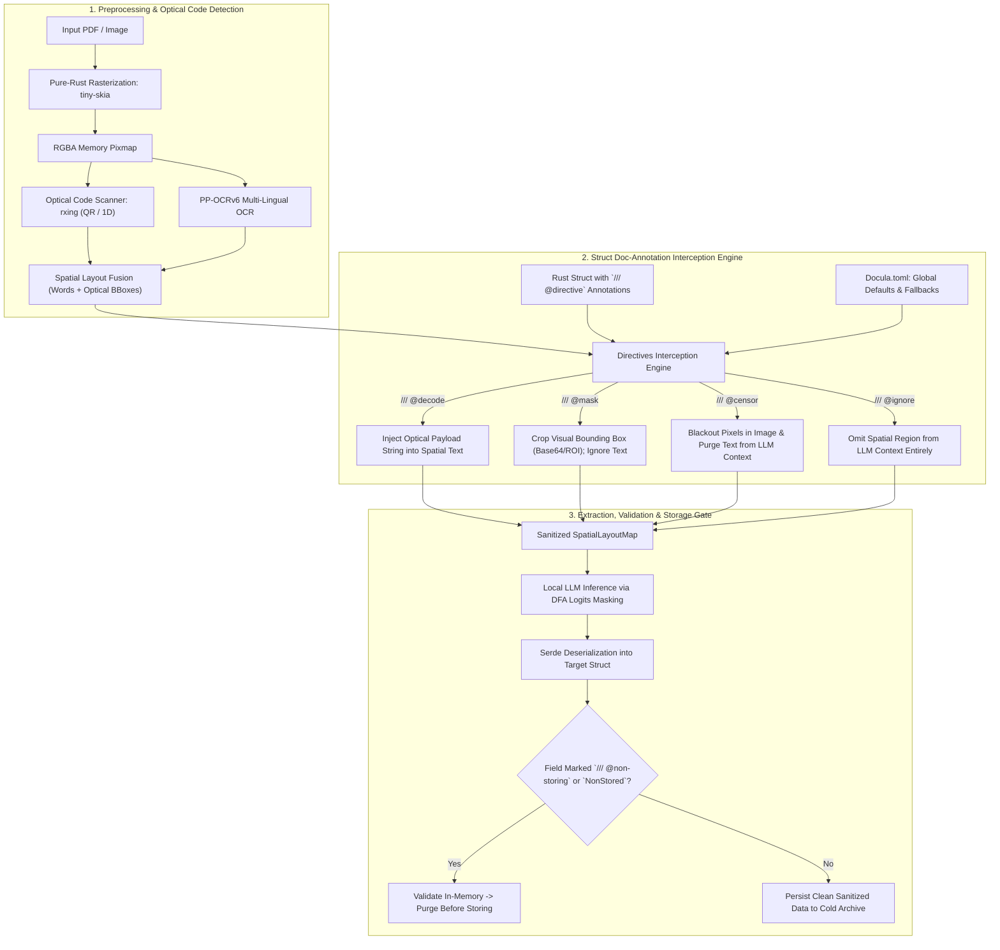

# Module 13: Edge Compliance, Non-Storing Directives & Optical Code Extraction

## 1. Overview & Purpose

Invoices, payroll slips, utility bills, and bank statements contain sensitive financial data and Personally Identifiable Information (PII) such as bank IBANs, taxpayer identification numbers, and national IDs. Furthermore, modern invoices increasingly rely on non-alphanumeric optical codes—such as QR codes (e.g., European EPC QR, Swiss QR-bill, Mexican CFDI) and 1D barcodes—to convey machine-readable payload data.

This module specifies:
1. **Edge Regulatory Compliance & Zero Data Egress**: Local, air-gapped execution that keeps raw buffers strictly within the client boundary.
2. **Struct-Level Doc Annotations**: Declarative field-level directives (`/// @censor`, `/// @ignore`, `/// @decode`, `/// @mask`, `/// @non-storing`) complemented by default fallback behaviors defined in `Docula.toml`.
3. **Non-Storing & Ephemeral Fields**: Mechanisms allowing the model to extract and validate in-flight data (such as temporary security tokens or verification totals) while ensuring they are omitted from persistent storage and feedback archives.
4. **Pure-Rust Optical Code Extraction (`rxing`)**: Zero-FFI detection and spatial fusion of 1D and 2D barcodes into the unified `SpatialLayoutMap`.



---

## 2. Technical Stack & Pure-Rust Dependencies

| Crate           | Version Target | Purpose                                                                    |
|:----------------|:---------------|:---------------------------------------------------------------------------|
| `rxing`         | `^0.6`         | 100% pure-Rust 1D/2D optical barcode & QR detection and decoding (zero-FFI).|
| `image`         | `^0.25`        | RGBA pixel buffer manipulation and spatial blackout rendering.              |
| `schemars`      | `^1.0`         | JSON schema generation and doc-comment inspection.                          |
| `serde` & `serde_json` | `^1.0`  | Serialization and selective exclusion of non-storing fields.               |
| `regex`         | `^1.11`        | Deterministic PII regex pattern matching for edge sanitization.             |

---

## 3. Struct-Level Doc Annotations & Schema Decorators

Developers decorate their target Rust data structures using standard Rust doc comments (`/// @directive`). `docula` inspects these annotations via compile-time reflection (`schemars` descriptions) and applies them during spatial preprocessing and storage filtering.

```rust
use schemars::JsonSchema;
use serde::{Deserialize, Serialize};
use docula_core::NonStored;

#[derive(JsonSchema, Serialize, Deserialize, Debug, PartialEq)]
pub struct ElectricityBill {
    /// @decode
    /// QR Code containing utility payment link and transaction metadata.
    pub payment_qr: Option<String>,

    /// @mask
    /// Scanned utility meter barcode visual crop for physical audit verification.
    pub meter_barcode_crop: Option<String>,

    /// The legal name of the utility provider.
    pub provider_name: String,

    /// Billing period end date (YYYY-MM-DD).
    pub billing_date: String,

    /// Total kilowatt-hours consumed during the period.
    pub kwh_consumed: f64,

    /// Total bill amount due.
    pub total_amount: f64,

    /// @censor
    /// Customer national tax ID / SSN; must be permanently masked on disk.
    pub customer_tax_id: String,

    /// @censor
    /// Bank account number / IBAN used for direct debit.
    pub direct_debit_iban: Option<String>,

    /// @non-storing
    /// Single-use verification token extracted from document footer for live authentication; never persisted.
    pub ephemeral_auth_token: NonStored<String>,
}
```

### Directive Specifications:

| Directive Tag | Scope | Runtime Behavior |
|:--------------|:------|:-----------------|
| `/// @decode` | Optical Codes (QR/Barcode) | Runs `rxing` to decode payload string. Injects payload into `SpatialLayoutMap` at the code's coordinates; discards raw pixel buffer. |
| `/// @mask` | Images / Barcodes / Signatures | Extracts normalized bounding box crop $(x_0, y_0, x_1, y_1)$ as an isolated visual artifact (e.g. base64 image or file reference); ignores plaintext decoding. |
| `/// @censor` | PII / Sensitive Fields | **Spatial Blackout**: Permanently draws black pixels (`[0, 0, 0, 255]`) over bounding box coordinates in the memory image, and scrubs corresponding tokens from LLM context before storage or human review. |
| `/// @ignore` | Layout Noise / Disclaimers | Excludes the spatial bounding box and associated text from the LLM prompt and schema mapping entirely. |
| `/// @non-storing` | Ephemeral Verification Data | Deserializes from LLM output for immediate in-memory validation, but is omitted from cold archive persistence and JSON export. |

---

## 4. Global Configuration & Defaults in `Docula.toml`

While struct doc annotations dictate field-specific rules, `Docula.toml` provides global defaults, fallback policies, and automated regex patterns:

```toml
[compliance]
zero_data_egress = true
ephemeral_image_ttl_seconds = 86400  # 24-hour TTL on raw image buffers; discard after review

[compliance.defaults]
# Fallback action when an optical code is detected without explicit struct annotation
unannotated_qr_code = "decode"
unannotated_1d_barcode = "mask"

# Global deterministic PII auto-censoring (applied to all documents before LLM)
[compliance.auto_censor]
enabled = true
patterns = [
    { name = "iban", regex = "^[A-Z]{2}\\d{2}[A-Z0-9]{4}\\d{7}([A-Z0-9]?){0,16}$", action = "censor" },
    { name = "credit_card", regex = "^\\b(?:\\d[ -]*?){13,16}\\b$", action = "censor" },
    { name = "ssn", regex = "^\\b\\d{3}-\\d{2}-\\d{4}\\b$", action = "censor" }
]

[compliance.storage]
redact_cold_archive = true          # Enforce blackouts before writing to /data/corrections/
strip_non_storing_fields = true     # Automatically drop fields marked NonStored<T>
```

---

## 5. Non-Storing & Ephemeral Field Architecture

Certain operational documents require extracting sensitive verification codes or transient credentials to validate authenticity against a live internal database, but security mandates that these values **must never be stored** in logs, cold archives, or database rows.

### 5.1 The `NonStored<T>` Type Pattern
`docula-core` provides `NonStored<T>`:

```rust
/// A container for values that can be extracted and validated in memory
/// but serialize to `None` / skip serialization during storage.
#[derive(Debug, Clone, PartialEq, Eq)]
pub struct NonStored<T>(pub Option<T>);

impl<T> NonStored<T> {
    pub fn new(val: T) -> Self {
        NonStored(Some(val))
    }

    pub fn value(&self) -> Option<&T> {
        self.0.as_ref()
    }

    pub fn take(self) -> Option<T> {
        self.0
    }
}

// 1. Deserializes normally from LLM JSON output
impl<'de, T: serde::Deserialize<'de>> serde::Deserialize<'de> for NonStored<T> {
    fn deserialize<D>(deserializer: D) -> Result<Self, D::Error>
    where
        D: serde::Deserializer<'de>,
    {
        T::deserialize(deserializer).map(|val| NonStored(Some(val)))
    }
}

// 2. Serializes to None (null) or is skipped with #[serde(skip_serializing_if = "...")]
impl<T> serde::Serialize for NonStored<T> {
    fn serialize<S>(&self, serializer: S) -> Result<S::Ok, S::Error>
    where
        S: serde::Serializer,
    {
        serializer.serialize_none()
    }
}

// 3. Reflects as standard T in JSON Schema so LLM knows how to extract it
impl<T: schemars::JsonSchema> schemars::JsonSchema for NonStored<T> {
    fn schema_name() -> String {
        T::schema_name()
    }
    fn json_schema(gen: &mut schemars::gen::SchemaGenerator) -> schemars::schema::Schema {
        T::json_schema(gen)
    }
}
```

---

## 6. Pure-Rust Optical Code Extraction (`rxing`)

### 6.1 Spatial Detection & Coordinate Mapping
`rxing` scans the in-memory RGBA pixmap generated during pure-Rust rasterization (`tiny-skia`). The coordinates of the detected codes are normalized to $[0.0, 1.0]$ and merged into `SpatialLayoutMap`:

```rust
use image::RgbaImage;
use rxing::{
    common::HybridBinarizer,
    multi::GenericMultipleBarcodeReader,
    BarcodeFormat, BufferedImageLuminanceSource, DecodeOptions, MultiFormatReader,
};
use docula_core::{BoundingBox, InvorcError, SpatialToken};

pub struct OpticalCodeDetector;

impl OpticalCodeDetector {
    /// Detects all 1D and 2D barcodes across an in-memory RGBA pixmap.
    pub fn detect_codes(image: &RgbaImage) -> Result<Vec<OpticalCodeResult>, InvorcError> {
        let (width, height) = image.dimensions();
        let luminance = BufferedImageLuminanceSource::new(image.clone());
        let mut binarizer = HybridBinarizer::new(luminance);
        
        let mut reader = GenericMultipleBarcodeReader::new(MultiFormatReader::default());
        let mut hints = DecodeOptions::default();
        hints.set_try_harder(true);

        let rxing_results = reader.decode_multiple_with_hints(&mut binarizer, &hints)
            .unwrap_or_default();

        let mut detected = Vec::new();
        for res in rxing_results {
            let points = res.getPoints();
            // Calculate normalized bounding box [0.0, 1.0] from polygon points
            let bbox = BoundingBox::from_points(points, width as f32, height as f32);
            detected.push(OpticalCodeResult {
                payload: res.getText().to_string(),
                format: res.getBarcodeFormat(),
                bbox,
            });
        }

        Ok(detected)
    }
}
```

### 6.2 Spatial Blackout & Redaction Implementation
When a field is annotated with `/// @censor` or matches auto-censor regex rules, the system redacts pixels at the byte level before storage or UI presentation:

```rust
pub fn blackout_spatial_region(
    image: &mut RgbaImage,
    bbox: &BoundingBox,
) {
    let (width, height) = image.dimensions();
    let x0 = (bbox.x0 * width as f32).clamp(0.0, width as f32) as u32;
    let y0 = (bbox.y0 * height as f32).clamp(0.0, height as f32) as u32;
    let x1 = (bbox.x1 * width as f32).clamp(0.0, width as f32) as u32;
    let y1 = (bbox.y1 * height as f32).clamp(0.0, height as f32) as u32;

    for y in y0..y1 {
        for x in x0..x1 {
            image.put_pixel(x, y, image::Rgba([0, 0, 0, 255]));
        }
    }
}
```

---

## 7. Testing & Verification

1. **Pure-Rust QR & 1D Barcode Detection**:
   - `test_rxing_qr_code_decoding()`: Ingests an EPC QR code image; verifies that decoded SEPA IBAN and amount match expected values.
   - `test_rxing_code128_barcode()`: Ingests a Code 128 shipping tracking barcode; validates bounding box coordinates and payload.
2. **Spatial Pixel Blackout Verification**:
   - `test_pixel_blackout_bounds()`: Asserts all pixels within $(x_0, y_0, x_1, y_1)$ are modified to `[0, 0, 0, 255]` while exterior pixels remain untouched.
3. **Non-Storing Serialization Test**:
   - `test_non_stored_serialization_omits_field()`: Asserts that a struct with `NonStored<String>` deserializes from JSON correctly, but `serde_json::to_string` produces `null` or skips the field.
4. **Doc-Annotation Parsing Test**:
   - `test_doc_annotation_directive_extraction()`: Asserts that `/// @censor` doc comment on a struct field is properly parsed into `ActionDirective::Censor`.
