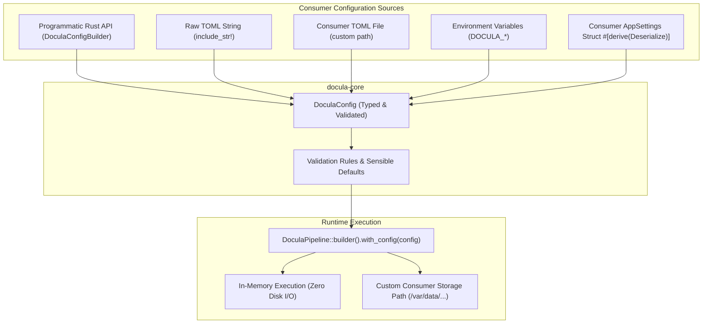

# Module 15: Consumer Configuration Strategy & TOML Integration

## 1. Overview & Purpose

When `docula` is distributed and consumed as an external Rust crate (`docula = "0.1.0"`) by downstream enterprise applications, it cannot assume control over the host application's working directory or environment.

### The Library Consumption Anti-Pattern
- **Static File Reliance**: Expecting a file `./Docula.toml` to exist in the current working directory fails when the host application runs from arbitrary directories (e.g. Docker containers, `/usr/local/bin`, cloud functions, microservices).
- **Filesystem Assumptions**: Defaulting to `./data/corrections` or `./data/examples` causes runtime `PermissionDenied` or `NotFound` errors in containerized environments with read-only root filesystems.
- **Inflexible Schema**: Downstream applications often centralize configurations in their own structures (`config.rs`, `figment`, or `app.toml`) and need to embed `docula` settings directly.

### The Architectural Solution
1. **First-Class Rust Configuration Type (`DoculaConfig`)**: Defined in `docula-core` with full `serde` serialization and deserialization support.
2. **Zero-Disk In-Memory Defaults**: `DoculaConfig::default()` functions safely in memory with zero disk requirements.
3. **Pluggable Consumer Loaders**: Consumers can load configuration from an arbitrary TOML file, an embedded TOML string, environment variables, or construct it programmatically via a fluent builder.
4. **Feature-Gated TOML Dependency**: The `toml` crate is gated behind `feature = "toml"` in `docula-core` so consumers who configure programmatically do not pay unnecessary compilation overhead.



---

## 2. Configuration Model & Structure

```rust
use serde::{Deserialize, Serialize};
use std::path::PathBuf;

#[derive(Clone, Debug, Serialize, Deserialize)]
pub struct DoculaConfig {
    #[serde(default)]
    pub general: GeneralConfig,
    #[serde(default)]
    pub exemplars: ExemplarConfig,
    #[serde(default)]
    pub hitl: HitlConfig,
    #[serde(default)]
    pub compliance: ComplianceConfig,
    #[serde(default)]
    pub ocr: OcrConfig,
}

#[derive(Clone, Debug, Serialize, Deserialize)]
pub struct GeneralConfig {
    pub engine_name: String,
    pub version: String,
    pub max_threads: Option<usize>,
}

#[derive(Clone, Debug, Serialize, Deserialize)]
pub struct ExemplarConfig {
    pub enabled: bool,
    pub pool_directory: Option<PathBuf>,
    pub max_injected_exemplars: usize,
    pub similarity_threshold: f32,
    pub stage1_fast_match: bool,
    pub stage2_hnsw_fallback: bool,
}

#[derive(Clone, Debug, Serialize, Deserialize)]
pub struct HitlConfig {
    pub enabled: bool,
    pub cold_archive_directory: Option<PathBuf>,
    pub min_token_confidence: f32,
    pub min_recurrence_for_promotion: usize,
    pub auto_promote: bool,
}

#[derive(Clone, Debug, Serialize, Deserialize)]
pub struct ComplianceConfig {
    pub zero_data_egress: bool,
    pub ephemeral_image_ttl_seconds: u64,
    pub unannotated_qr_code: String,
    pub unannotated_1d_barcode: String,
    pub auto_censor_pii: bool,
    pub strip_non_storing_fields: bool,
}

#[derive(Clone, Debug, Serialize, Deserialize)]
pub struct OcrConfig {
    pub model_dir: Option<PathBuf>,
    pub dpi: u32,
    pub default_languages: Vec<String>,
}
```

---

## 3. Consumer Integration Patterns

### Pattern A: Embedding in Downstream `AppSettings`
Consumers can embed `DoculaConfig` directly in their existing application configuration struct:

```rust
use serde::Deserialize;
use docula::DoculaConfig;

#[derive(Deserialize)]
pub struct AppConfig {
    pub server_port: u16,
    pub database_url: String,
    pub docula: DoculaConfig, // Directly deserialized from consumer's app.toml!
}
```

### Pattern B: Fluent Programmatic Builder
```rust
use docula::{DoculaConfig, DoculaPipeline};

let config = DoculaConfig::builder()
    .with_triage_confidence(0.92)
    .with_ephemeral_images(true)
    .with_exemplars_enabled(false) // Pure zero-shot mode
    .build();

let pipeline = DoculaPipeline::builder()
    .with_config(config)
    .with_backend(my_backend)
    .build()?;
```

### Pattern C: Custom File or String Loader
```rust
// From a custom file path
let config = DoculaConfig::from_file("/etc/docula/production.toml")?;

// From an embedded string
let config = DoculaConfig::from_toml_str(include_str!("../config/docula.toml"))?;
```

---

## 4. Acceptance Criteria & Test Scenarios

### Acceptance Criteria
1. `DoculaConfig::default()` produces valid configuration without performing filesystem operations or requiring environment variables.
2. If `pool_directory` or `cold_archive_directory` are `None`, the pipeline operates in **ephemeral in-memory mode**, discarding intermediate artifacts safely.
3. Deserializing missing fields in TOML falls back to field-level defaults.
4. `DoculaPipeline::builder().with_config(...)` injects configuration into all downstream components.

### Test Scenarios
- `test_default_config_is_pure_in_memory`: Verify `default()` has no disk dependencies and succeeds in read-only environments.
- `test_from_toml_str_partial`: Provide a TOML string specifying only `[compliance] auto_censor_pii = true`; verify all other sections populate default values.
- `test_builder_fluent_overrides`: Verify custom builder overrides take precedence over defaults.
- `test_embed_in_consumer_struct`: Deserialize an application configuration containing a nested `[docula]` section and verify parity.
