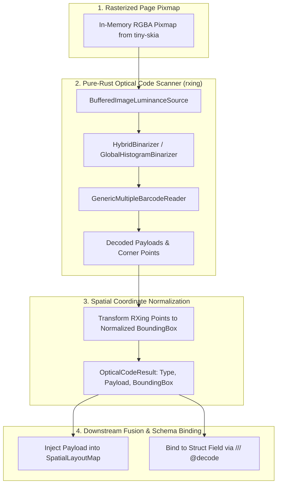

# Module 17: Pure-Rust Optical Code Extraction (QR & Barcodes)

## 1. Overview & Purpose

Modern transactional documents\u2014such as European SEPA utility bills, Swiss QR-bills, Mexican SAT CFDI invoices, retail cash register receipts, and logistics shipping manifests\u2014frequently rely on machine-readable optical codes:
- **2D Matrix Codes**: EPC QR Code (SEPA credit transfer), Swiss QR-bill (SPC), Mexican CFDI QR, GiroCode, Aztec, Data Matrix, PDF417.
- **1D Linear Barcodes**: Code 128, EAN-13, UPC-A, Code 39, ITF-14 (packaging & shipping container tracking).

Attempting to read these codes using standard OCR produces gibberish or character errors. Conversely, sending optical codes as raw visual patches to general-purpose LLMs introduces hallucinations in critical numeric transaction IDs or bank IBANs.

The **Optical Code Extraction** module provides a pure-Rust, zero-FFI detection and decoding pipeline implemented in `docula-vision-codes` powered by `rxing`:
1. **Zero Dynamic C FFI**: Eliminates dependencies on `libzbar`, `zxing-cpp`, or OpenCV.
2. **Unified Spatial Coordinate Mapping**: Maps detected optical code corner points directly into the normalized $[0.0, 1.0]$ page coordinate system.
3. **Payload Fusion**: Integrates decoded payloads into the `SpatialLayoutMap` alongside OCR text spans or binds them to target struct fields via the `/// @decode` directive.
4. **Deferred Feature Gating**: Optical code extraction is isolated behind `feature = "vision-codes"` in the workspace to keep the core binary footprint minimal.



---

## 2. Technical Stack & Pure-Rust Dependencies

| Crate | Version Target | Purpose |
|:---|:---|:---|
| `rxing` | `^0.6` | 100% pure safe Rust barcode and QR scanner/decoder (multi-format, zero C++ FFI). |
| `image` | `^0.25` | RGBA pixel buffer representation and luminance conversion. |
| `schemars` | `^1.0` | Reflection for detecting `/// @decode` doc annotations on target struct fields. |
| `serde` | `^1.0` | Serialization and deserialization of detected optical code payloads. |

---

## 3. Supported Optical Code Symbologies

`docula-vision-codes` decodes all common linear and matrix symbologies found in enterprise documents:

| Symbology Type | Standards & Formats | Typical Document Applications |
|:---|:---|:---|
| **QR Code / Micro QR** | ISO/IEC 18004 | EPC QR (SEPA payments), Swiss QR-bill, Mexican CFDI SAT invoice verification. |
| **Data Matrix** | ISO/IEC 16022 | Pharmaceutical packaging, electronic component invoices, aerospace parts. |
| **PDF417** | ISO/IEC 15438 | Airline boarding passes, customs declarations, postal shipping labels. |
| **Aztec Code** | ISO/IEC 24778 | Rail tickets, transit bills, compact document validation stamps. |
| **Code 128 / GS1-128** | ISO/IEC 15417 | Supply chain tracking, utility meter barcodes, warehouse shipment manifests. |
| **EAN-13 / UPC-A** | ISO/IEC 15420 | Supermarket receipts, retail point-of-sale invoices. |

---

## 4. Architecture & Extraction Pipeline

### 4.1 Pure-Rust Optical Code Detector
`OpticalCodeDetector` scans the in-memory RGBA pixmap generated during rasterization. Detection coordinates are converted from image pixels $(w, h)$ into normalized $[0.0, 1.0]$ bounding boxes:

```rust
use image::RgbaImage;
use rxing::{
    common::HybridBinarizer,
    multi::GenericMultipleBarcodeReader,
    BarcodeFormat, BufferedImageLuminanceSource, DecodeOptions, MultiFormatReader,
};
use docula_core::{BoundingBox, Point, DoculaError};

#[derive(Clone, Debug, PartialEq)]
pub struct OpticalCodeResult {
    pub format: BarcodeFormat,
    pub payload: String,
    pub bbox: BoundingBox,
    pub raw_points: Vec<Point>,
}

pub struct OpticalCodeDetector;

impl OpticalCodeDetector {
    /// Detects and decodes all 1D and 2D optical codes across an in-memory RGBA pixmap.
    pub fn scan_image(image: &RgbaImage) -> Result<Vec<OpticalCodeResult>, DoculaError> {
        let (width, height) = image.dimensions();
        let luminance = BufferedImageLuminanceSource::new(image.clone());
        let mut binarizer = HybridBinarizer::new(luminance);
        
        let mut reader = GenericMultipleBarcodeReader::new(MultiFormatReader::default());
        let mut hints = DecodeOptions::default();
        hints.set_try_harder(true);

        let rxing_results = reader
            .decode_multiple_with_hints(&mut binarizer, &hints)
            .unwrap_or_default();

        let mut results = Vec::with_capacity(rxing_results.len());
        for res in rxing_results {
            let points: Vec<Point> = res
                .getPoints()
                .iter()
                .map(|p| Point {
                    x: (p.getX() / width as f32).clamp(0.0, 1.0),
                    y: (p.getY() / height as f32).clamp(0.0, 1.0),
                })
                .collect();

            let bbox = BoundingBox::from_points(&points);
            results.push(OpticalCodeResult {
                format: res.getBarcodeFormat(),
                payload: res.getText().to_string(),
                bbox,
                raw_points: points,
            });
        }

        Ok(results)
    }
}
```

### 4.2 Schema Directive Integration (`/// @decode`)
When a struct field is annotated with `/// @decode`, the pipeline automatically binds the decoded string payload directly to the field without passing raw pixels or intermediate text tokens to the LLM:

```rust
use schemars::JsonSchema;
use serde::{Deserialize, Serialize};

#[derive(JsonSchema, Serialize, Deserialize, Debug)]
pub struct SwissQrInvoice {
    /// Beneficiary IBAN extracted from the Swiss QR-bill.
    pub creditor_iban: String,

    /// Total invoice amount in CHF.
    pub amount: f64,

    /// @decode
    /// Raw payload string decoded from the Swiss QR code block.
    pub raw_qr_payload: Option<String>,
}
```

---

## 5. Standard Financial QR Code Parsers

`docula-vision-codes` provides specialized standard payload parsers for structured financial QR standards:

```rust
pub enum FinancialQrPayload {
    /// European EPC SEPA Credit Transfer (BCD format)
    EpcSepa {
        service_tag: String,
        bic: String,
        beneficiary_name: String,
        iban: String,
        amount_eur: Option<f64>,
        remittance_info: String,
    },
    /// Swiss QR-bill (SPC)
    SwissQr {
        iban: String,
        creditor_name: String,
        amount: Option<f64>,
        currency: String,
        reference: String,
    },
    /// Generic or unparsed barcode payload
    Raw(String),
}
```

---

## 6. Testing & Verification

1. **Pure-Rust EPC QR Code Detection**:
   - `test_decode_sepa_epc_qr()`: Ingests an EPC QR code; validates that decoded IBAN, BIC, and amount match expected values.
2. **High-Density PDF417 Boarding Pass**:
   - `test_decode_pdf417_boarding_pass()`: Validates detection of dense 2D PDF417 barcodes.
3. **1D Shipping Code 128**:
   - `test_decode_code128_barcode()`: Ingests a warehouse shipping label; verifies bounding box spatial normalization and payload string.
4. **Resilience to Blurred or Angled Codes**:
   - `test_decode_rotated_qr()`: Verifies that QR codes tilted up to $45^\circ$ decode accurately under `try_harder = true`.
