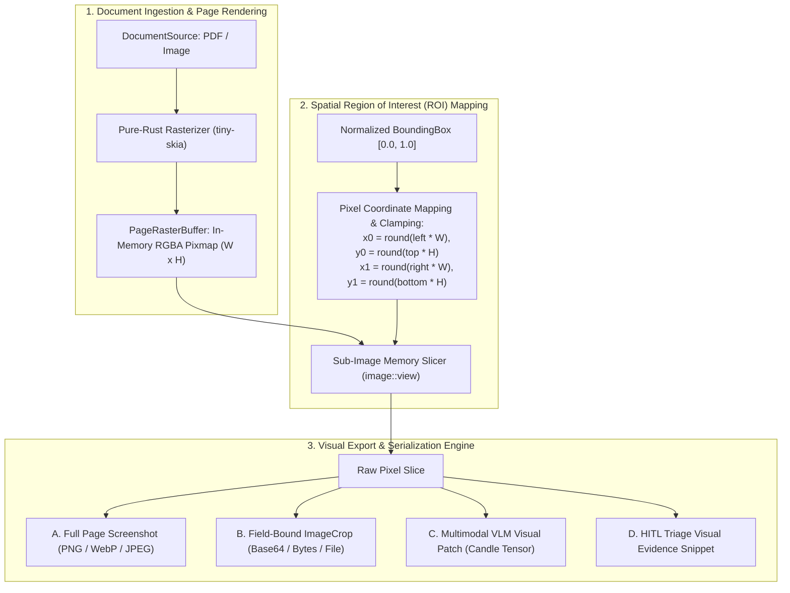

# Module 18: Document Screenshots & Visual Region Cropping

## 1. Overview & Architectural Capabilities

In real-world document processing, downstream consumers and enterprise workflows frequently require direct visual excerpts from documents rather than purely serialized text or numerical tables:
- **Visual Audit Evidence**: Cropping physical handwritten signatures, notary stamps, embossed seals, or cash register receipt headers for legal non-repudiation.
- **Physical Meter & Hardware Crops**: Slicing camera photos of utility meter dials, shipping crate markings, or damage inspection photos embedded in claims.
- **Full-Page Document Screenshots**: Rendering complete pages as clean, standardized visual raster snapshots (PNG, JPEG, WebP) for web previews, mobile client display, or thumbnail catalogs.
- **Multimodal VLM Token Patches**: Extracting high-resolution visual region-of-interest (ROI) patches to feed into Vision-Language Models (e.g. Qwen2.5-VL or Florence-2 via `candle-transformers`) for visual question answering.
- **Human-in-the-Loop (HITL) Verification Snippets**: Generating focused image snippets around low-confidence fields for rapid human specialist verification in triage queues.

### Is It Possible to Support It?
**Yes, completely and natively.** Because `docula` incorporates a pure-Rust rasterization pipeline (`tiny-skia` in `docula-preprocess`) and normalized geometric primitives (`BoundingBox` in `docula-core`), taking full-page screenshots and slicing arbitrary spatial regions is a zero-FFI operation that integrates directly with memory-backed pixel buffers.



---

## 2. Technical Stack & Pure-Rust Dependencies

| Crate | Version Target | Purpose |
|:---|:---|:---|
| `docula-core` | Workspace | Core geometry (`BoundingBox`), `ImageCrop` value object, and `RegionCropper` trait. |
| `docula-preprocess`| Workspace | `PageRasterBuffer`, `tiny-skia` rasterization, and zero-copy sub-image slicing. |
| `image` | `^0.25` | RGBA pixmap representation, sub-image views (`image::GenericImageView::view`), and format encoders. |
| `base64` | `^0.22` | Optional base64 serialization for JSON schema embedding. |

---

## 3. Day 0 Architectural Design Considerations

To prevent hard refactoring when this feature is fully activated in later milestones, the core abstractions must be established in **Day 0**:

### 3.1 Foundational Spatial Geometry (`docula-core`)
`BoundingBox` is equipped from Day 0 with pixel projection, aspect ratio calculation, padding expansion, and clipping methods:

```rust
#[derive(Clone, Copy, Debug, PartialEq, Serialize, Deserialize)]
pub struct Point {
    pub x: f32, // Normalized [0.0, 1.0]
    pub y: f32, // Normalized [0.0, 1.0]
}

#[derive(Clone, Copy, Debug, PartialEq, Serialize, Deserialize)]
pub struct BoundingBox {
    pub top_left: Point,
    pub bottom_right: Point,
}

impl BoundingBox {
    /// Projects normalized [0.0, 1.0] coordinates into integer pixel coordinates.
    pub fn to_pixel_rect(&self, image_width: u32, image_height: u32) -> PixelRect {
        let x0 = (self.top_left.x * image_width as f32).round().clamp(0.0, image_width as f32) as u32;
        let y0 = (self.top_left.y * image_height as f32).round().clamp(0.0, image_height as f32) as u32;
        let x1 = (self.bottom_right.x * image_width as f32).round().clamp(0.0, image_width as f32) as u32;
        let y1 = (self.bottom_right.y * image_height as f32).round().clamp(0.0, image_height as f32) as u32;

        PixelRect {
            x: x0,
            y: y0,
            width: x1.saturating_sub(x0).max(1),
            height: y1.saturating_sub(y0).max(1),
        }
    }

    /// Expands bounding box by uniform percentage padding (e.g. 0.05 for 5% margin).
    pub fn with_padding(&self, padding_fraction: f32) -> Self {
        let w = self.bottom_right.x - self.top_left.x;
        let h = self.bottom_right.y - self.top_left.y;
        let pad_x = w * padding_fraction;
        let pad_y = h * padding_fraction;

        BoundingBox {
            top_left: Point {
                x: (self.top_left.x - pad_x).clamp(0.0, 1.0),
                y: (self.top_left.y - pad_y).clamp(0.0, 1.0),
            },
            bottom_right: Point {
                x: (self.bottom_right.x + pad_x).clamp(0.0, 1.0),
                y: (self.bottom_right.y + pad_y).clamp(0.0, 1.0),
            },
        }
    }
}
```

### 3.2 The `ImageCrop` Value Object (`docula-core`)
`ImageCrop` encapsulates a cropped sub-image, providing serializability and convenience transformations:

```rust
#[derive(Clone, Debug, PartialEq)]
pub enum CropFormat {
    Png,
    Jpeg { quality: u8 },
    WebP,
    RawRgba,
}

#[derive(Clone, Debug, PartialEq, Serialize, Deserialize)]
pub struct ImageCrop {
    /// Source document page index (0-indexed).
    pub page_index: usize,
    /// Bounding box in source document coordinate space.
    pub bbox: BoundingBox,
    /// Pixel width and height of the cropped sub-image.
    pub width: u32,
    pub height: u32,
    /// Encoded image payload (PNG/JPEG/WebP) or base64 data string.
    pub encoded_data: String,
    /// MIME type (e.g. "image/png").
    pub mime_type: String,
}
```

### 3.3 The `RegionCropper` Abstraction Trait
Defined in `docula-core` and implemented in `docula-preprocess`:

```rust
pub trait RegionCropper: Send + Sync {
    /// Renders or extracts a full page screenshot at specified DPI and format.
    fn capture_page(
        &self,
        page_index: usize,
        dpi: u32,
        format: CropFormat,
    ) -> Result<ImageCrop, DoculaError>;

    /// Crops an arbitrary spatial bounding box from a page.
    fn crop_region(
        &self,
        page_index: usize,
        bbox: &BoundingBox,
        padding: f32,
        format: CropFormat,
    ) -> Result<ImageCrop, DoculaError>;
}
```

---

## 4. Struct-Level Directives: `/// @crop` & `/// @screenshot`

Consumers can declare visual crops directly in their target extraction structs using doc comments:

```rust
use schemars::JsonSchema;
use serde::{Deserialize, Serialize};
use docula_core::ImageCrop;

#[derive(JsonSchema, Serialize, Deserialize, Debug)]
pub struct SignedCommercialContract {
    /// Legal contract identification number.
    pub contract_id: String,

    /// Effective date of execution (YYYY-MM-DD).
    pub execution_date: String,

    /// @crop
    /// Cropped visual excerpt of authorized signature block for audit verification.
    pub signature_crop: Option<ImageCrop>,

    /// @crop
    /// Cropped visual seal or notary stamp.
    pub notary_stamp_crop: Option<ImageCrop>,

    /// @screenshot
    /// Full-page visual capture of the first overview page.
    pub cover_page_screenshot: Option<ImageCrop>,
}
```

---

## 5. Compliance Precedence Rule: Anti-Leak Invariant

A fundamental security requirement is the **Compliance Precedence Invariant**:
- If a document region is flagged for redaction via `/// @censor` or matches a global PII regex pattern (e.g., credit card, SSN), the compliance redactor executes **before** any cropping or screenshot operation.
- If a requested `/// @crop` overlaps with a censored bounding box, the crop **must either return the blacked-out pixel buffer or be rejected with a `ComplianceViolationError`**, guaranteeing that sensitive visual data can never leak through image extraction.

---

## 6. Testing & Acceptance Criteria

1. **Pixel Rect Normalization**:
   - `test_bbox_to_pixel_rect_clamping()`: Verifies that bounding boxes at image boundaries $(0.0, 1.0)$ map to non-overflowing pixel coordinates.
2. **Padding Expansion**:
   - `test_bbox_padding_expansion()`: Verifies that applying $5\%$ padding expands the bounding box without exceeding $[0.0, 1.0]$.
3. **Lossless Sub-Image Slicing**:
   - `test_crop_region_dimensions()`: Slices an arbitrary ROI from an RGBA pixmap; verifies that returned `ImageCrop` matches expected pixel dimensions and channel fidelity.
4. **Full Page Capture**:
   - `test_capture_page_screenshot()`: Renders page at 150 DPI and encodes to PNG; verifies valid PNG header bytes `[0x89, 0x50, 0x4E, 0x47]`.
5. **Redaction Precedence**:
   - `test_crop_region_respects_censor_blackout()`: Verifies that cropping a region marked `@censor` yields pure black pixels rather than original image data.
