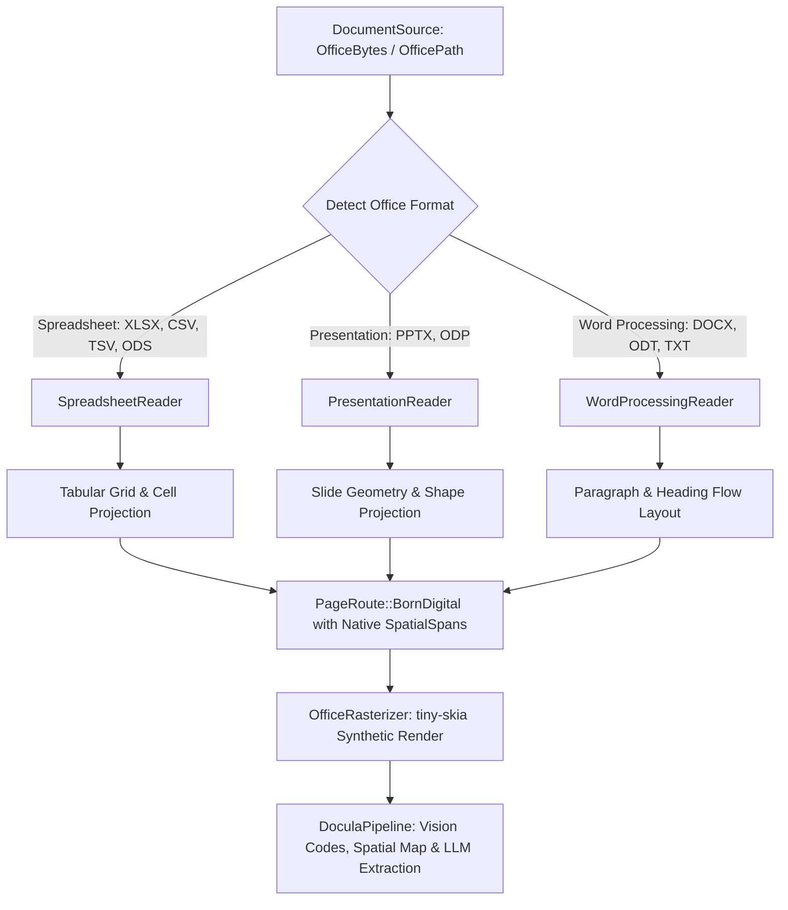

# Module 19: Pure-Rust Ofimatic & Office Suite Ingestion Engine

## 1. Overview & Purpose

The **Ofimatic & Office Suite Ingestion Engine** extends `docula` beyond PDF and raster image formats to natively ingest, inspect, and extract structured data from popular office and productivity documents:
- **Spreadsheets & Tabular Data**: Microsoft Excel (`.xlsx`, `.xls`), OpenDocument Spreadsheet (`.ods`), and delimited data (`.csv`, `.tsv`).
- **Presentations**: Microsoft PowerPoint (`.pptx`, `.ppt`), OpenDocument Presentation (`.odp`).
- **Word Processing & Documents**: Microsoft Word (`.docx`, `.doc`), OpenDocument Text (`.odt`), and rich/plain text (`.rtf`, `.txt`).

In enterprise financial and operational environments, invoices, purchase orders, financial reports, and shipping manifests routinely arrive as spreadsheets or presentation slide decks rather than compiled PDFs. 

Treating office documents as scanned images and running optical OCR would be inefficient, lossy, and noisy. Instead, office documents are born-digital, highly structured artifacts. This module implements a **pure-Rust, zero-FFI parsing architecture** leveraging `zip`, `quick-xml`, and streaming parsers to reconstruct 2D spatial layouts, cell coordinates, and slide decks directly into `docula`'s spatial model (`SpatialSpan`, `BoundingBox`, `PageRoute::BornDigital`).

---

## 2. Technical Stack & Pure-Rust Dependencies

| Crate       | Target Version | Purpose                                                                                     | Zero-FFI Status |
|:------------|:---------------|:--------------------------------------------------------------------------------------------|:----------------|
| `zip`       | `^8.6`         | Pure-Rust ZIP archive decompression for OOXML (`.xlsx`, `.pptx`, `.docx`) and ODF (`.ods`). | 100% Pure Rust  |
| `quick-xml` | `^0.42`        | Streaming SAX/StAX zero-copy XML event parser for high-speed OOXML stream traversal.        | 100% Pure Rust  |
| `csv`       | `^1.4`         | High-throughput pure-Rust RFC 4180 CSV/TSV delimited tabular reader.                       | 100% Pure Rust  |
| `tiny-skia` | `^0.11`        | 2D software vector rendering of spreadsheet grids and slide geometry for visual buffers.     | 100% Pure Rust  |

---

## 3. Core Architecture & Abstractions

### 3.1 Format Classification & Typing (`docula-core`)

The `OfficeFormat` enum categorizes ofimatic documents into domain verticals:
- `OfficeFormat::Spreadsheet(SpreadsheetSubtype)`: `Xlsx`, `Xls`, `Ods`, `Csv`, `Tsv`.
- `OfficeFormat::Presentation(PresentationSubtype)`: `Pptx`, `Ppt`, `Odp`.
- `OfficeFormat::WordProcessing(WordSubtype)`: `Docx`, `Doc`, `Odt`, `Rtf`, `PlainText`.

`DocumentSource` is extended with:
- `DocumentSource::OfficeBytes { format: OfficeFormat, data: Vec<u8> }`
- `DocumentSource::OfficePath { path: PathBuf, format: OfficeFormat }`

With automatic sniffing based on file extensions and binary magic headers (e.g., PK ZIP headers with OOXML content types).

### 3.2 Spatial Grid & Geometry Projection (`docula-ingest`)

1. **Spreadsheets (`.xlsx`, `.csv`, `.tsv`, `.ods`)**:
   - Each sheet corresponds to an 0-indexed page in `DocumentRoutingReport`.
   - Grid layout coordinates $(col, row)$ are projected onto normalized $[0.0, 1.0]$ bounding boxes based on relative row heights and column indices.
   - Cells carry text value, formulas, and alphanumeric cell coordinates (e.g. `A1`, `B2`).

2. **Presentations (`.pptx`, `.odp`)**:
   - Each slide corresponds to an 0-indexed page.
   - Text frames, shapes, and titles are extracted with normalized bounding boxes derived from shape offsets and extents.

3. **Word Processing Documents (`.docx`, `.odt`, `.txt`)**:
   - Paragraphs, table rows, and headings flow downward sequentially with proportional bounding boxes.

### 3.3 Synthetic Visual Rasterization (`docula-preprocess`)

`OfficeRasterizer` uses `tiny-skia` to render the spatial layout of an office sheet or slide into an RGBA `PageRasterBuffer`:
- Cell borders and table grid lines are drawn with vector strokes.
- Text blocks are represented visually.
- This guarantees compatibility with:
  - Document screenshot generation (`capture_page_screenshot`).
  - Region-of-interest cropping (`PdfRegionCropper` / `ImageCrop`).
  - Optical code detection (`OpticalCodeDetector`).

---

## 4. Acceptance Criteria & Definition of Done

1. **Format Support**:
   - Parse valid `.xlsx` spreadsheets, resolving shared strings and worksheet cells into spatial spans.
   - Parse `.csv` and `.tsv` files into structured rows and normalized spatial grid spans.
   - Parse `.pptx` presentations, mapping slides to pages and slide shapes to spatial spans.
   - Parse `.docx` documents, mapping paragraphs and tables to spatial spans.
   - Parse `.ods` and `.odt` OpenDocument XML files.
2. **Precision & Zero OCR Jitter**:
   - Extracted text from born-digital office files must be 100% exact character-for-character with zero OCR hallucination.
3. **Pipeline Integration**:
   - `DoculaPipeline::process_document` accepts any office `DocumentSource`, parses spatial layout, generates synthetic buffer, and extracts strongly typed domain structs via LLM backends.
4. **Code Quality & Complexity**:
   - Zero `unwrap()` or `expect()` in library production code.
   - Cyclomatic complexity $\le 15$, Cognitive complexity $\le 20$, function length $\le 80$ lines.
   - 100% Pure Rust, Zero-FFI.
